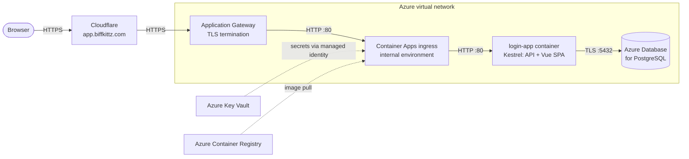

# Login App

A small, deliberately focused web app: people can **create an account**, **sign in** and **sign out**, and nothing
else. It is built to production standards so it can serve as a solid foundation:

- **Backend:** ASP.NET Core 10 minimal API, ASP.NET Core Identity, JWTs in an `HttpOnly` cookie, and EF Core on
  PostgreSQL.
- **Frontend:** Vue 3 with TypeScript, Vite, Pinia, Vue Router and Tailwind CSS, in a cozy mid-century-modern palette
  of orange and brown.
- **Hosting:** one Linux container in which Kestrel serves the API and the compiled SPA on port 80. It is designed
  for an internal (VNet-only) Azure Container Apps environment and reads its secrets from Azure Key Vault.



The Azure side is built with Terraform in [`infra/`](infra/README.md).

## Quick start (WSL Ubuntu)

Prerequisites are covered step by step in [docs/DEVELOPMENT.md](docs/DEVELOPMENT.md): the .NET 10 SDK,
Node.js 24 LTS and PostgreSQL. Once they are installed:

```bash
# 1. A local database (once). Docker works too; see docs/DEVELOPMENT.md.
sudo -u postgres psql -c "CREATE ROLE loginapp WITH LOGIN PASSWORD 'loginapp_dev' CREATEDB;"
sudo -u postgres createdb --owner=loginapp loginapp

# 2. Build, test and run the complete site
./app/buildAndRunSite.sh
# then browse to http://localhost:8080
```

For day-to-day work with hot reload, run the API and the Vite dev server separately (or press F5 in VS Code on
**Full stack: API + Vite**):

```bash
dotnet watch run --project app/backend --launch-profile http   # API on http://localhost:5082
cd app/frontend && npm run dev                                   # SPA on http://localhost:5173
```

## Documentation

| Document | What it covers |
| --- | --- |
| [docs/DEVELOPMENT.md](docs/DEVELOPMENT.md) | Setting up WSL, VS Code, extensions and tooling; running, debugging and testing locally; conventions; troubleshooting |
| [docs/BUILD_AND_DEPLOY.md](docs/BUILD_AND_DEPLOY.md) | `buildAndRunSite.sh`, the container image, and deployment to Azure Container Apps with Key Vault and PostgreSQL |
| [docs/ARCHITECTURE.md](docs/ARCHITECTURE.md) | How the pieces fit together, the authentication flow, and the security decisions behind them |
| [infra/README.md](infra/README.md) | The Terraform project for Azure and Cloudflare, with its own docs: [architecture](infra/docs/ARCHITECTURE.md), [authentication](infra/docs/AUTHENTICATION.md), [deployment](infra/docs/DEPLOYMENT.md), [development setup](infra/docs/DEVELOPMENT.md) |

## Repository layout

```text
login-app/
├── login-app.code-workspace      VS Code workspace: settings, recommended extensions, debug configs, tasks
├── global.json                   Pins the .NET 10 SDK and selects Microsoft.Testing.Platform for `dotnet test`
├── dotnet-tools.json             Local .NET tools (dotnet-ef), installed with `dotnet tool restore`
├── .editorconfig                 Code style for every file type; the C# rules are enforced at build time
├── docs/                         Developer and operations documentation
├── app/
│   ├── buildAndRunSite.sh        Builds and tests both projects, combines them, runs the site locally
│   ├── Dockerfile                Container image: Kestrel on port 80, running as a non-root user
│   ├── compose.yaml              Runs the image locally next to a throwaway PostgreSQL
│   ├── LoginApp.slnx             .NET solution (API and tests)
│   ├── Directory.Build.props     Shared .NET build settings (analyzers; warnings are errors in Release)
│   ├── Directory.Packages.props  Central NuGet package versions
│   ├── backend/                  ASP.NET Core 10 API (LoginApp.Api)
│   ├── backend.tests/            xUnit v3 unit and in-memory integration tests
│   └── frontend/                 Vue 3 + TypeScript SPA
├── infra/                        Terraform: network, gateway, Container Apps, PostgreSQL, Key Vault, DNS
├── .github/workflows/infra.yml   CI for infra/: fmt, validate, mocked tests, lint, docs
└── .pre-commit-config.yaml       Git hooks for infra/ (fmt, validate, lint, docs, ShellCheck)
```

## What's in the box

- **Accounts:** registration with name, email and password. Passwords need at least 12 characters (a length-based
  policy per NIST SP 800-63B) and are hashed with PBKDF2 by ASP.NET Core Identity.
- **Sessions:** a signed JWT, valid for 60 minutes, stored in an `HttpOnly`, `Secure`, `SameSite=Strict`, `__Host-`
  cookie. JavaScript never sees the token, and the UI signs out automatically when it expires.
- **Abuse protection:** accounts lock for 15 minutes after five failed sign-ins, and each client IP is rate-limited
  on the login and registration endpoints.
- **Hardening:**
  - A strict Content-Security-Policy and security headers on every response.
  - A 64 KB request body limit.
  - No `Server` header.
  - An internal-network allow-list.
  - HSTS behind the TLS-terminating proxy.
- **Operations:**
  - Liveness and readiness health endpoints.
  - Structured JSON logs.
  - EF Core migrations applied at startup, safely even with several replicas.
  - Validated configuration that fails fast.
- **Quality gates:**
  - Backend unit and in-memory integration tests (xUnit v3), and frontend unit and component tests (Vitest).
  - Analyzers and code style enforced at build time.
  - ESLint with oxlint, Prettier, and strict TypeScript.
