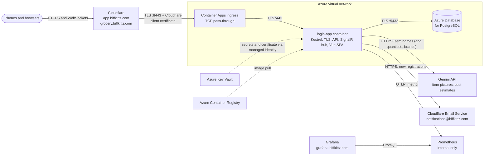

# Nibbles

A realtime grocery list for a family, built for phones. Everyone who signs in shares one list: they can add, edit,
check off, delete and drag items into order, and every change appears on everybody else's screen as it happens.
Items carry a quantity, brand, store and notes, remember who changed them last and when, and get a small picture
drawn by Google's Gemini, which can also estimate what the whole list costs.

**Live demo: <https://grocery.biffkittz.com>.** Register an account (any email address and a password of 12 or more
characters) and add a few items. It is a demonstration site with its own accounts and list, so don't put anything
private on it: everyone who registers shares the one list.

Nibbles grew out of a sign-up / sign-in app built to production standards, which is still its foundation (the code
keeps its original `LoginApp` names):

- **Backend:** ASP.NET Core 10 minimal API, ASP.NET Core Identity, JWTs in an `HttpOnly` cookie, EF Core on
  PostgreSQL, and SignalR (WebSockets) for realtime updates, hosted in the app itself.
- **Frontend:** Vue 3 with TypeScript, Vite, Pinia, Vue Router and Tailwind CSS, in a cozy mid-century-modern palette
  of orange and brown, designed mobile first.
- **Hosting:** one Linux container in which Kestrel serves the API, the realtime hub and the compiled SPA. In Azure
  Container Apps it terminates TLS itself on port 443 with the Cloudflare origin certificate, accepts only requests
  that carry Cloudflare's client certificate, and reads its secrets from Azure Key Vault. Locally it serves plain HTTP.



The Azure side is built with Terraform in [`infra/`](infra/README.md).

## Quick start (WSL Ubuntu)

Prerequisites are covered step by step in [docs/DEVELOPMENT.md](docs/DEVELOPMENT.md): the .NET 10 SDK,
Node.js 24 LTS and PostgreSQL. Once they are installed:

```bash
# 1. A local database (once). Docker works too; see docs/DEVELOPMENT.md.
sudo -u postgres psql -c "CREATE ROLE loginapp WITH LOGIN PASSWORD 'loginapp_dev' CREATEDB;"
sudo -u postgres createdb --owner=loginapp loginapp

# 2. Build, test and run the complete site
./app/buildAndRunSite.sh
# then browse to http://localhost:8080
```

To see the realtime updates, register two accounts in two browser windows (one of them private) and put them side by
side.

For day-to-day work with hot reload, run the API and the Vite dev server separately (or press F5 in VS Code on
**Full stack: API + Vite**):

```bash
dotnet watch run --project app/backend --launch-profile http   # API on http://localhost:5082
cd app/frontend && npm run dev                                   # SPA on http://localhost:5173
```

## Documentation

| Document | What it covers |
| --- | --- |
| [docs/DEVELOPMENT.md](docs/DEVELOPMENT.md) | Setting up WSL, VS Code, extensions and tooling; running, debugging and testing locally; conventions; troubleshooting |
| [docs/BUILD_AND_DEPLOY.md](docs/BUILD_AND_DEPLOY.md) | `buildAndRunSite.sh`, the container image, and deployment to Azure Container Apps with Key Vault and PostgreSQL |
| [docs/ARCHITECTURE.md](docs/ARCHITECTURE.md) | How the pieces fit together: authentication, the grocery list and its realtime updates, and the security decisions behind them |
| [docs/CI_CD.md](docs/CI_CD.md) | GitHub Actions: checks on every pull request, approval-gated image publishing and Terraform applies, the security model, and how to set it up (identities, environments, secrets) |
| [infra/README.md](infra/README.md) | The Terraform project for Azure and Cloudflare, with its own docs: [architecture](infra/docs/ARCHITECTURE.md), [authentication](infra/docs/AUTHENTICATION.md), [deployment](infra/docs/DEPLOYMENT.md), [development setup](infra/docs/DEVELOPMENT.md) |

## Repository layout

```text
login-app/
├── login-app.code-workspace      VS Code workspace: settings, recommended extensions, debug configs, tasks
├── global.json                   Pins the .NET 10 SDK and selects Microsoft.Testing.Platform for `dotnet test`
├── dotnet-tools.json             Local .NET tools (dotnet-ef), installed with `dotnet tool restore`
├── .editorconfig                 Code style for every file type; the C# rules are enforced at build time
├── docs/                         Developer and operations documentation
├── app/
│   ├── buildAndRunSite.sh        Builds and tests both projects, combines them, runs the site locally
│   ├── Dockerfile                Container image: Kestrel on port 80 (443 with TLS in Azure), as a non-root user
│   ├── compose.yaml              Runs the image locally next to a throwaway PostgreSQL
│   ├── LoginApp.slnx             .NET solution (API and tests)
│   ├── Directory.Build.props     Shared .NET build settings (analyzers; warnings are errors in Release)
│   ├── Directory.Packages.props  Central NuGet package versions
│   ├── backend/                  ASP.NET Core 10 API (LoginApp.Api)
│   ├── backend.tests/            xUnit v3 unit and in-memory integration tests
│   └── frontend/                 Vue 3 + TypeScript SPA
├── infra/                        Terraform: network, Container Apps, PostgreSQL, Key Vault, Cloudflare DNS
├── .github/                      CI/CD: workflows (app, infra, workflow linting), their scripts and actions, Dependabot
└── .pre-commit-config.yaml       Git hooks for infra/ (fmt, validate, lint, docs, ShellCheck)
```

## What's in the box

- **The grocery list:**
  - Add an item with one field at the top of the screen; tap it for quantity, brand, store and notes. The store is
    picked from a dropdown (Whole Foods, Indian Grocery, Teeter/Lion, Costco), and the list groups itself by store,
    with items that have none in a "No store" section at the top.
  - Check items off with one tap and undo the mistake from the toast; drag the handle to reorder (or use the arrow
    keys, or the move buttons in an item's details). Drag an item into another store's section, or onto a store with
    nothing on the list yet, to change its store.
  - Every change shows at once (optimistically) and reaches every other open list within a fraction of a second over
    SignalR. A list reconnects and catches up by itself after a dropped connection, a server restart, or a phone
    coming out of a pocket.
  - Each item records when it was added and last changed, and by whom.
  - Each new item gets a picture, left of its name: Gemini draws it from the name in the background, and the server
    shrinks it to a WebP of a few kilobytes that phones cache for good. Items with the same name share one picture.
    A switch in the list's settings turns AI pictures off for everyone.
  - **Estimate Cost**, below the list, asks Gemini 3.1 Flash-Lite what everything on the list costs at average U.S.
    prices and shows the total with a price per item. Only names, quantities and brands are sent, the answer must
    match a JSON Schema and is checked by the server, and the whole site allows 500 estimates a day.
- **Accounts:** registration with name, email and password. Passwords need at least 12 characters (a length-based
  policy per NIST SP 800-63B) and are hashed with PBKDF2 by ASP.NET Core Identity. Any registered user can use the
  list. In Azure, every registration sends the site's owner an email from notifications@biffkittz.com,
  "[grocery app] new registration detected", naming the site, the time and the name given (not the email address),
  through Cloudflare Email Service.
- **Sessions:** a signed JWT, valid for 60 minutes, stored in an `HttpOnly`, `Secure`, `SameSite=Strict`, `__Host-`
  cookie. JavaScript never sees the token; the UI signs out automatically when it expires, and the realtime
  connection closes with it.
- **Abuse protection:** accounts lock for 15 minutes after five failed sign-ins; each client IP is rate-limited on the
  login and registration endpoints, and each user on changes to the list. The list holds at most 500 items, and at
  most 100 pictures are drawn and 500 cost estimates made a day.
- **Hardening:**
  - A strict Content-Security-Policy and security headers on every response.
  - A 64 KB request body limit, and a cap on concurrent WebSocket connections.
  - No `Server` header.
  - An optional internal-network allow-list (`Network:RestrictToInternalNetworks`, off in the shipped settings).
  - TLS 1.2+ terminated in the container, and HSTS.
  - Only Cloudflare gets in: its Authenticated Origin Pulls client certificate is required.
  - The realtime hub refuses connections opened by pages on other sites, and accounts that no longer exist.
- **Operations:**
  - Liveness and readiness health endpoints.
  - Metrics pushed to Prometheus over OTLP: realtime connections and SignalR messages per second, HTTP rates, errors
    and latency, sign-ins, AI pictures and cost estimates, the database pool and the .NET runtime, plus Azure's
    platform metrics (replicas, restarts, CPU, memory, PostgreSQL). Grafana dashboards at grafana.biffkittz.com, behind
    GitHub sign-in for the people listed in Terraform ([infra/docs/DEPLOYMENT.md](infra/docs/DEPLOYMENT.md#observability)).
  - Structured JSON logs that never contain item contents, emails or tokens.
  - EF Core migrations applied at startup.
  - Validated configuration that fails fast.
- **Quality gates:**
  - Backend unit and in-memory integration tests (xUnit v3), including realtime tests over WebSockets, and frontend
    unit and component tests (Vitest).
  - Analyzers and code style enforced at build time.
  - ESLint with oxlint, Prettier, and strict TypeScript.
