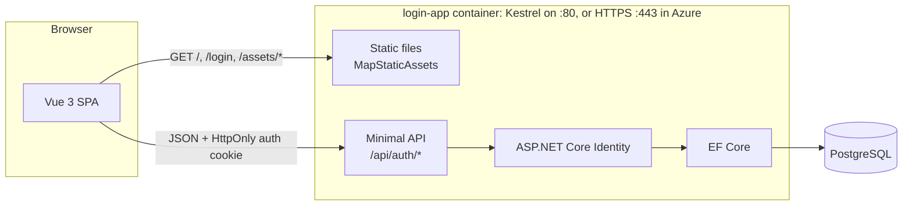

# Architecture

Login App does three things: register, sign in and sign out. This document explains how it is put together and,
more importantly, *why*, because most of the design is about doing those three things securely.

## The big picture



- **One origin.** The API serves the compiled SPA, and in development Vite proxies `/api` to the API. The browser
  therefore always talks to a single origin, which is what allows a `SameSite=Strict` cookie and removes CORS
  entirely.
- **One container.** Kestrel serves both static files and the API. In Azure it terminates TLS itself on port 443
  with the Cloudflare origin certificate: Container Apps passes the TCP connection through. Locally it serves plain
  HTTP on port 80 (or 5082/8080 in development).
- **Stateless app.** Sessions are signed tokens kept in the browser's cookie and accounts live in PostgreSQL, so
  replicas can be added or removed freely.

## Authentication flow

```mermaid
sequenceDiagram
  participant B as Browser (Vue SPA)
  participant A as API
  participant D as PostgreSQL
  B->>A: POST /api/auth/login {email, password}
  A->>D: find user by normalized email
  A->>A: verify PBKDF2 hash, update the lockout counter
  A-->>B: 200 {user, sessionExpiresAt}<br/>Set-Cookie: __Host-LoginApp.Auth=JWT; HttpOnly; Secure; SameSite=Strict
  Note over B: JavaScript never sees the token
  B->>A: GET /api/auth/me (cookie attached by the browser)
  A->>A: verify signature, issuer, audience, lifetime (HS256 only)
  A->>D: load user by id (deleted accounts lose access at once)
  A-->>B: 200 {user, sessionExpiresAt}
  B->>A: POST /api/auth/logout
  A-->>B: 204 + Set-Cookie that expires the cookie
```

| Endpoint | Auth | Success | Failure |
| --- | --- | --- | --- |
| `POST /api/auth/register` | anonymous, rate-limited | `201` + user + cookie | `400` validation problem (field errors) |
| `POST /api/auth/login` | anonymous, rate-limited | `200` + user + cookie | `401` wrong credentials, `429` locked out or rate-limited |
| `POST /api/auth/logout` | cookie required | `204`, cookie deleted | `401` |
| `GET /api/auth/me` | cookie required | `200` + user | `401` |
| `GET /health/live`, `/health/ready` | anonymous | `200 Healthy` | `503` (ready: database unreachable) |

All errors are [RFC 9457 problem details](https://www.rfc-editor.org/rfc/rfc9457) (`application/problem+json`).

## Security decisions

| Decision | Why |
| --- | --- |
| **JWT in an `HttpOnly` cookie**, not in `localStorage` | Any successful XSS can read `localStorage`. An `HttpOnly` cookie is invisible to scripts, so an injected script can't steal the session. The SPA learns who is signed in from `/api/auth/me` instead of decoding a token. |
| **`SameSite=Strict`, JSON-only endpoints, no CORS** instead of antiforgery tokens | Browsers never attach a `Strict` cookie to requests started by another site. Cross-site HTML forms can't send `application/json` (the API answers `415`), and without a CORS policy cross-origin scripts can't call the API. Logout requires the cookie, so cross-site "log out" forms fail too. |
| **`__Host-` cookie prefix** | Browsers then require `Secure`, `Path=/` and no `Domain`, so sibling subdomains can't plant or overwrite the cookie. The API refuses to start if the prefix is used without `Secure`. |
| **Short-lived tokens (60 min), no refresh tokens** | JWTs can't be revoked once issued. A short lifetime bounds the damage, and the UI returns to the login page the moment the session expires. `/me` re-reads the account, so deleted users lose access immediately. |
| **HS256 only, pinned** | A single service issues and validates the tokens, so a symmetric key (at least 256 bits, from Key Vault) suffices. Pinning the algorithm rules out algorithm-substitution attacks. |
| **ASP.NET Core Identity for accounts** | Battle-tested PBKDF2 password hashing, normalized unique emails, security stamps and lockout. Only `AddIdentityCore` is registered: no Identity cookies or redirects. |
| **Length-based password policy** | 12+ characters with at least 4 distinct characters, following NIST SP 800-63B. Composition rules push people toward `Password1!`. |
| **Lockout and rate limiting** | Five failures lock an account for 15 minutes (stops guessing one account), and a per-IP fixed window on login and registration slows credential stuffing and sign-up spam. |
| **Same message for "unknown email" and "wrong password"** | Avoids revealing which emails are registered at sign-in. Registration and lockout responses *do* reveal it: registration must say "already registered", and a locked-out user deserves to know why. With registration revealing it anyway, hiding it at lockout would protect nothing. |
| **Strict Content-Security-Policy** | `script-src 'self'` with no `unsafe-inline` is possible because Vite emits only external, fingerprinted files and the app loads nothing from other origins. Also `frame-ancestors 'none'`, `nosniff`, `no-referrer`, COOP/CORP and a permissions policy. |
| **Cloudflare client certificate required** | The container is publicly reachable, and a public Container Apps environment can't be fenced with an NSG. With `OriginTls:RequireCloudflareClientCertificate`, Kestrel asks every client for a certificate and accepts only one that chains to Cloudflare's origin-pull CA, embedded in the image (not the system roots). Requests without one get 403, except the health endpoints, which the platform's probes call directly. See `Infrastructure/Tls/`. |
| **TLS in the container** | `OriginTls:CertificatePfxBase64` (the origin certificate from Key Vault) becomes Kestrel's HTTPS certificate, TLS 1.2 and 1.3 only. The app refuses to start if the certificate is unreadable, has no private key or is outside its validity period. |
| **Internal-network allow-list** | The app refuses TCP peers outside `Network:InternalNetworks`, in case the image is ever exposed somewhere without the other controls. It checks the *immediate* peer (in Azure, the Container Apps ingress proxy), not the forwarded client, because users legitimately arrive from the internet through Cloudflare. |
| **Trusted forwarded headers** | `X-Forwarded-For` and `X-Forwarded-Proto` are honored only from internal networks (and Cloudflare's ranges), walking back through trusted hops to the real client. That is what makes per-client rate limits and logs correct behind Cloudflare. The client-certificate check is what makes the header trustworthy: only Cloudflare can send it. |
| **Request body limit 64 KB, no `Server` header** | The largest legitimate request is a few hundred bytes, and the server software is nobody's business. |
| **Data Protection keys in memory** | `AddAuthentication` registers Data Protection, but nothing uses it. Keeping its keys in memory avoids writing unused secret material into the container. |
| **No secrets in source or image** | Secrets come from Key Vault (or user secrets locally). `.dockerignore` keeps `appsettings.Development.json` out of the image, and Development generates a temporary JWT key rather than committing one. |
| **Logging hygiene** | Logs identify users by opaque ID only, never email, password or token. Request DTOs and token types are classes, not records, so a synthesized `ToString()` can't leak them. |
| **Non-root container** | The process runs as the image's `app` user, with only `CAP_NET_BIND_SERVICE` added so it can listen on port 80 or 443. Its code is owned by root and read-only to it. |

## Backend

```text
app/backend/
├── Program.cs                           Composition root: configuration → services → middleware → endpoints
├── Features/Auth/                       Everything about accounts and sessions
│   ├── AuthEndpoints.cs                 HTTP mapping: status codes and the auth cookie
│   ├── AuthService.cs                   Registration and sign-in on top of Identity (no HTTP concerns)
│   ├── JwtAccessTokenIssuer.cs          Token creation (JsonWebTokenHandler)
│   ├── AuthCookieManager.cs             Writes and deletes the HttpOnly cookie
│   ├── AuthServiceCollectionExtensions  Identity, JWT bearer, options and rate limiting registration
│   ├── Contracts/                       Request and response DTOs (validated by the .NET 10 validation generator)
│   └── *Options.cs, *Result.cs, ...     Validated settings and result types for expected failures
└── Infrastructure/
    ├── Data/                            ApplicationDbContext, ApplicationUser, migrations, startup migration
    ├── Configuration/                   Azure Key Vault configuration provider
    ├── Networking/                      Internal-network middleware and forwarded-header trust
    ├── Security/                        Security headers, Kestrel hardening, in-memory Data Protection keys
    ├── Tls/                             HTTPS in Kestrel with the origin certificate; Cloudflare client-certificate check
    └── Hosting/                         SPA static files and fallback; health checks
```

The **request pipeline** order is deliberate (`Program.cs`):

1. Exception handler: always returns problem details, never a stack trace.
2. Client-certificate requirement (when `OriginTls:RequireCloudflareClientCertificate` is on): refuses requests
   without Cloudflare's certificate before any other work, except the health endpoints.
3. Internal-network check: must see the original peer, so it runs before forwarded headers.
4. Forwarded headers: restores the client IP and scheme.
5. HSTS (outside Development).
6. Security headers.
7. Status-code pages.
8. Rate limiter.
9. Authentication, then authorization.
10. Endpoints, mapped in priority order: health, API, OpenAPI (Development), and last the SPA static files and
    fallback.

**Validation** happens before handlers run: `AddValidation()` (new in .NET 10) generates validators for the public
request contracts and answers invalid input with a `400` validation problem. Identity's own rules (unique email,
password policy) produce errors in the same shape, keyed by the same property names.

**Configuration** is bound to options classes that validate at startup (`ValidateOnStart`), so a missing secret, a
weak signing key or a malformed CIDR stops the app immediately with a precise message instead of failing later.

**Database.** `ApplicationDbContext` derives from `IdentityUserContext<ApplicationUser>`: the user tables only (the
app has no roles). It uses Npgsql with retry-on-failure for transient cloud faults. Migrations run at startup by
default; EF Core 9+'s migration lock makes this safe with several replicas. See
[BUILD_AND_DEPLOY.md](BUILD_AND_DEPLOY.md#4-database-migrations-in-azure) for the alternative.

## Frontend

```text
app/frontend/src/
├── main.ts                    Creates the app: error handler plugin, Pinia, router
├── app.vue                    Layout shell: skip link, header, backdrop, error boundary, <RouterView>
├── router/                    Routes (lazy-loaded views) and the auth guard (pure, unit-tested)
├── stores/auth.ts             Pinia setup store: the signed-in user, session restore, expiry timer
├── services/                  Axios client, typed API calls, ApiError normalization
├── composables/               useFormValidation, useAsyncAction, useRedirectTarget, useSignedOutRedirect, ...
├── validation/                Validation rules and the account policy mirrored from the API
├── views/                     Route-level containers: login, register, home, not found
├── components/                Presentational components: ui/ (fields, buttons, alerts), auth/, layout/, brand/
├── directives/                v-focus-on-mount (focus management after navigation)
└── assets/main.css            Tailwind import and the design tokens (@theme)
```

- **Containers vs presentational components.** Views own state and talk to the store. Components under
  `components/` only receive props, emit events and expose slots, which keeps them reusable and easy to test.
- **Session handling.**
  - The router guard awaits `restoreSession()` (one `/me` call per page load), then applies each route's
    `requiresAuth` or `guestOnly` meta.
  - The store schedules a timer for `sessionExpiresAt`.
  - `useSignedOutRedirect` sends the user to the login page whenever the session ends on a protected page, whether
    by signing out or by expiry. The login page then explains which happened.
- **Requests.** `useAsyncAction` gives every API call explicit pending and error state, aborts stale requests when a
  new one starts or the component unmounts, and never surfaces cancellations as errors.
- **Open-redirect protection.** After sign-in the app returns to `?redirect=` only when it is an internal path.
- **Design.**
  - A cozy mid-century modern palette: cream paper, walnut browns, ember oranges and a mustard accent.
  - Geometric type (Futura, Avenir or Century Gothic, as available).
  - An "atomic starburst" mark and soft decorative shapes.
  - Offset "print" shadows on cards and buttons.
  - Every color pairing meets WCAG AA. Motion respects `prefers-reduced-motion`.

## Known limitations and possible next steps

- **No server-side session revocation.** A stolen cookie stays valid until it expires (at most 60 minutes). If
  needed, add the Identity security stamp as a claim and validate it on each request, or keep a revocation list.
- **No email confirmation or password reset.** These need an email service. Identity supports both once a sender is
  configured.
- **Passwordless database access.** The app uses a password connection string as required. Microsoft Entra
  authentication for PostgreSQL (managed identity tokens via Npgsql) would remove that secret altogether.
- **Single signing key.** Rotating the key signs everyone out. Supporting a list of validation keys would allow
  seamless rotation.
- **End-to-end tests.** The unit and in-memory integration tests cover the logic; browser tests (Playwright) with
  axe-core accessibility checks would cover the full user journey.
