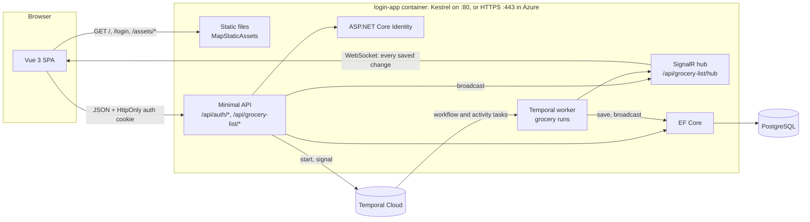
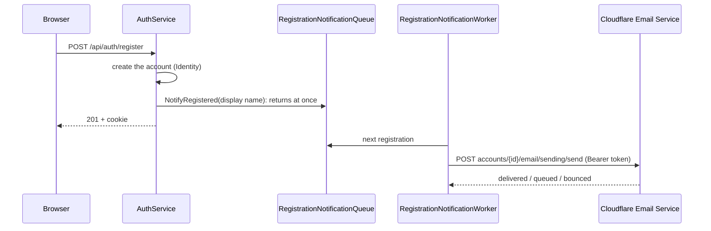
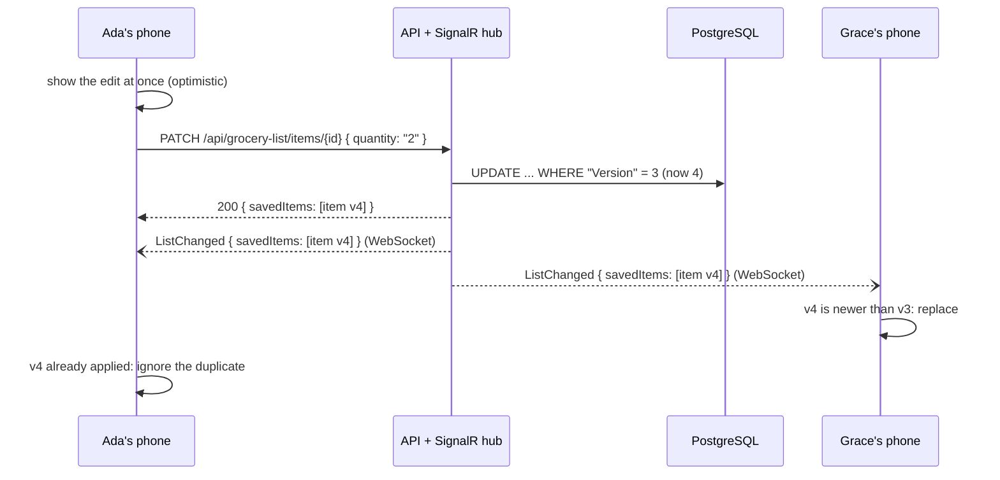
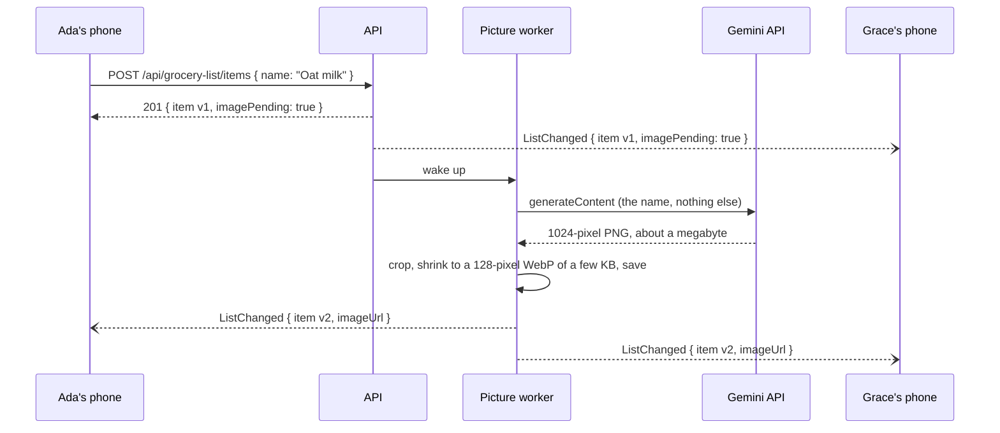
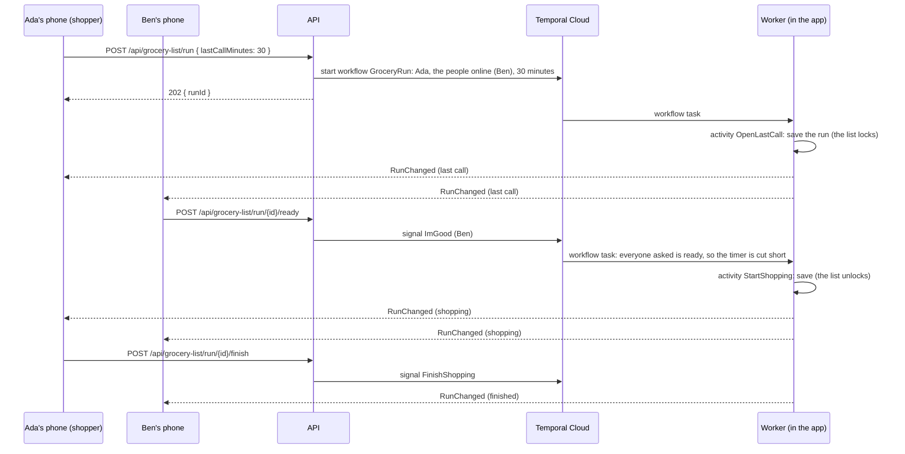

# Architecture

Nibbles is a family grocery list that every signed-in user shares and that updates on every screen in real time. It
is built on the sign-up / sign-in app it grew from (the code keeps its `LoginApp` names). This document explains how
it is put together and, more importantly, *why*: most of the design is about doing simple things securely, and about
keeping several phones in agreement over unreliable mobile networks.

## The big picture



- **One origin.** The API serves the compiled SPA, and in development Vite proxies `/api` (WebSockets included) to
  the API. The browser therefore always talks to a single origin, which is what allows a `SameSite=Strict` cookie,
  lets the WebSocket authenticate with that same cookie, and removes CORS entirely.
- **One container.** Kestrel serves both static files and the API. In Azure it terminates TLS itself on port 443
  with the Cloudflare origin certificate: Container Apps passes the TCP connection through. Locally it serves plain
  HTTP on port 80 (or 5082/8080 in development).
- **One replica.** Sessions are signed tokens kept in the browser's cookie and all data lives in PostgreSQL, but the
  realtime hub is SignalR running inside the app with no backplane (deliberately not Azure SignalR Service). A change
  is broadcast only to the phones connected to the replica that saved it, so each deployment of the app runs as
  exactly one replica; Terraform refuses `app_max_replicas` other than 1. (The two sites, app. and grocery.biffkittz.com,
  are separate deployments with separate databases, not replicas of each other.) Scaling out would need a backplane
  such as Redis.
- **One worker, in the app.** Grocery runs are Temporal workflows on Temporal Cloud. The app runs its own Temporal
  worker in the same process, because the workflow's activities push to phones through the in-process hub (see
  [Grocery runs](#grocery-runs)).

## Authentication flow

```mermaid
sequenceDiagram
  participant B as Browser (Vue SPA)
  participant A as API
  participant D as PostgreSQL
  B->>A: POST /api/auth/login {email, password}
  A->>D: find user by normalized email
  A->>A: verify PBKDF2 hash, update the lockout counter
  A-->>B: 200 {user, sessionExpiresAt}<br/>Set-Cookie: __Host-LoginApp.Auth=JWT; HttpOnly; Secure; SameSite=Strict
  Note over B: JavaScript never sees the token
  B->>A: GET /api/auth/me (cookie attached by the browser)
  A->>A: verify signature, issuer, audience, lifetime (HS256 only)
  A->>D: load user by id (deleted accounts lose access at once)
  A-->>B: 200 {user, sessionExpiresAt}
  B->>A: POST /api/auth/logout
  A-->>B: 204 + Set-Cookie that expires the cookie
```

| Endpoint | Auth | Success | Failure |
| --- | --- | --- | --- |
| `POST /api/auth/register` | anonymous, rate-limited | `201` + user + cookie | `400` validation problem (field errors) |
| `POST /api/auth/login` | anonymous, rate-limited | `200` + user + cookie | `401` wrong credentials, `429` locked out or rate-limited |
| `POST /api/auth/logout` | cookie required | `204`, cookie deleted | `401` |
| `GET /api/auth/me` | cookie required | `200` + user | `401` |
| `GET /api/grocery-list`, the item, picture and settings endpoints | cookie required | see [The grocery list](#the-grocery-list) | `401` |
| `GET /health/live`, `/health/ready` | anonymous | `200 Healthy` | `503` (ready: database unreachable) |

All errors are [RFC 9457 problem details](https://www.rfc-editor.org/rfc/rfc9457) (`application/problem+json`).

### Registration emails

Every successful registration emails the people in `RegistrationNotifications:Recipients`, so the family hears when
someone new joins. In Azure they are set by Terraform (`registration_notification_recipients`, the site's owner);
locally the list is empty and nothing is sent.



- **From and to.** From notifications@biffkittz.com (`Email:SenderAddress`, a domain onboarded for Cloudflare Email
  Sending), to the recipients, subject `[grocery app] new registration detected`. The text names the site
  (`RegistrationNotifications:SiteUrl`, set per instance), the time in UTC and the name the person typed. Not their
  email address: the app copies that nowhere, logs included.
- **Registering never waits for it, or fails because of it.** `AuthService` only queues the email (an in-memory
  channel), and a hosted service sends it with Cloudflare's REST API (`CloudflareEmailSender`, a typed `HttpClient`).
  Passing failures (no connection, 429, 5xx) are retried twice, 5 and 10 seconds apart; a refusal isn't. A timeout
  isn't retried either: Cloudflare may have taken the email, and a second copy is worse than a logged miss.
- **Plain text, and a name that can't pose as anything else.** The name is quoted and labelled as the person's own,
  and line breaks and bidirectional controls in it are replaced, so it can't add lines to the email or read in
  another order than it was typed. The subject and sender come from configuration and are validated at startup
  (no control characters), because they become headers.
- **Limits.** At most `RegistrationNotifications:MaxPerDay` (50) emails in any 24 hours, so a flood of sign-ups can't
  flood the inbox; the last one allowed says so. At most 100 wait in the queue. Registrations over either limit
  still succeed and are logged.
- **The token** is a Cloudflare account token limited to Email Sending, created by Terraform and read from Key Vault
  (`Email:ApiToken`). `Email:AccountId`, `Email:ApiToken` and `Email:SenderAddress` go together: the app refuses to
  start with only some of them set.

## The grocery list

There is one list, shared by every registered user (the requirement is that any signed-in user may use it).

| Field | Notes |
| --- | --- |
| `id` | A UUID the SPA generates, so it can show a new item before the server answers and recognize the server's copy |
| `name` | Required, up to 100 characters |
| `quantity`, `brand`, `notes` | Optional free text (quantity is text, so "1 dozen" works); notes up to 1000 characters and may span lines |
| `store` | Optional; one of the stores in `GroceryList:Stores` (Whole Foods, Indian Grocery, Teeter/Lion, Costco), matched regardless of case and saved in the configured spelling. Anything else is a `400` on the `store` field |
| `createdAt`, `lastModifiedAt` | Set by the server. Moving an item doesn't count as modifying it |
| `lastModifiedById`, `lastModifiedByName` | Who added the item or last changed its details; cleared if that account is deleted (the item stays) |
| `position` | The sort key (see [Order](#order)) |
| `version` | Increases with every change, moves included; the optimistic-concurrency token and the key to realtime consistency |
| `imageUrl`, `imagePending` | The item's AI-drawn picture, or `null`; `imagePending` while one is being drawn (see [AI pictures](#ai-pictures)) |

| Endpoint | Body | Success |
| --- | --- | --- |
| `GET /api/grocery-list` | | `200 { items, stores, settings, run, lastCallMinutes }`: items in order, the store choices in display order, the list's settings, the grocery run under way (or `null`) and the lengths of last call on offer |
| `POST /api/grocery-list/items` | `id?`, `name`, optional details, `afterItemId?` | `201` + change |
| `PATCH /api/grocery-list/items/{id}` | only the fields to change; `""` clears one | `200` + change |
| `POST /api/grocery-list/items/{id}/move` | `afterItemId` (`null` = top), `store?` (dropped into another store's section; `""` = none) | `200` + change |
| `DELETE /api/grocery-list/items/{id}` | | `200` + change |
| `GET /api/grocery-list/images/{id}` | | `200` WebP picture, cacheable for a year; `404` |
| `PATCH /api/grocery-list/settings` | `imageGenerationEnabled?` | `200` + settings, also broadcast as `SettingsChanged` |
| `POST /api/grocery-list/cost-estimate` | | `200 { totalUsd, estimatedItemCount, items, note, estimatedAt }` (see [Cost estimates](#cost-estimates)) |
| `POST /api/grocery-list/run` | `lastCallMinutes` (one of those offered) | `202 { runId }`; the run arrives as `RunChanged` (see [Grocery runs](#grocery-runs)) |
| `POST /api/grocery-list/run/{id}/ready`, `/start-shopping`, `/cancel`, `/finish` | | `202`; the change arrives as `RunChanged` |

Every write answers with a **change**, `{ savedItems, deletedItemIds }`, and the hub sends the very same change to
every connected browser, the author's included. The SPA therefore has one code path for its own changes and
everybody else's. Failures: `400` validation problem, `404` item gone, `409` (list full at 500 items, the anchor item
of a move has gone, ID taken, a concurrent write, or a removal or move during a grocery run's last call), `429`
per-user rate limit, `401` session ended.

### Realtime updates



- **Writes go over HTTP, updates come over the WebSocket.** HTTP writes get validation, rate limiting and status
  codes for free, and keep working while a phone's WebSocket is reconnecting. The hub has no methods a client can
  call; it only pushes, which leaves it almost no attack surface.
- **Order doesn't matter.** A change can arrive twice (HTTP response and broadcast) and in any order. The SPA keeps the
  copy with the highest `version`, and remembers deleted IDs so a late copy can't resurrect an item (IDs are never
  reused). Broadcasts are sent after the database commit and outside any lock, so a slow phone never holds up writes.
- **Gaps are healed by reloading.** Nothing is received while the WebSocket is down, so the SPA reloads the whole list
  (at most 500 small items) every time the connection is (re-)established. Changes that arrive during the reload, or
  while a row is being dragged, are held and applied afterwards.
- **Phones in pockets.** Mobile browsers suspend background pages, and a suspended page may not notice that its
  WebSocket died. When the page has been hidden for more than 15 seconds, the SPA reloads the list and reconnects
  as soon as it is visible again. It also reconnects when the device comes back online.
- **When the connection keeps failing,** the status pill says "Offline" and the SPA reloads the list over HTTP every
  30 seconds. That keeps the list fresh on networks that block WebSockets, and it is how the SPA notices an ended
  session: a browser never says why a WebSocket was refused, but the HTTP call gets a `401`, and the user is sent to
  the sign-in page.
- **Reconnecting is never immediate.** The first retry waits about a second (with jitter), then 2, 5, 10, 20 and
  30 seconds, forever. A server that is shutting down closes its connections but keeps listening for a moment; a
  client that came straight back would reattach to it and hold up its shutdown.
- **WebSockets only, without negotiation.** The client skips SignalR's negotiate request, saving a round trip on
  every (re)connection. Cloudflare and the Container Apps TCP ingress both pass WebSockets through, and SignalR's
  15-second keep-alive pings stop idle connections from being dropped.

### Grouping by store

The SPA shows the list in sections, one per store: **No store** first (new items arrive without a store, so they
appear right below the "Add an item" bar), then the offered stores in their configured order, then any store an item
was given before the choices existed (alphabetically, so nothing disappears). Empty sections are hidden. The item
editor's store field is a dropdown of the offered stores plus "No store"; an item still carrying a store that is no
longer offered shows it as an extra choice, and keeps it unless someone picks another.

The store choices are configuration on the server (`GroceryList:Stores` in appsettings.json), sent with the list, so
adding a store means changing one setting and restarting; the SPA and the server can't disagree about them.

Reordering happens within a section. Each section is a slice of the one list, so a move inside a section is sent as
"directly after (or before) that neighbor" in the whole list; how sections interleave in the whole list doesn't
matter, because each is shown on its own. Changing an item's store moves it to that store's section, keeping its
place relative to the items already there.

### AI pictures

Every new item gets a small picture, drawn by Google's Gemini from the item's name and shown left of the name.



- **In the background.** Adding an item never waits for Gemini, which takes 5 to 15 seconds. The item arrives with
  `imagePending: true`, the SPA shows a pulsing placeholder, and the picture follows as an ordinary change to the item
  (`version` goes up; `lastModifiedAt` and the author don't, because nobody edited it).
- **Small and cached.** The picture is center-cropped, shrunk to 128 pixels (sharp at the 40 CSS pixels the list
  uses, even on a 3x screen) and stored as lossy WebP of a few kilobytes (`GroceryImageThumbnails`, using SkiaSharp).
  The list carries only each picture's URL; the browser loads pictures lazily and keeps each one for a year
  (`Cache-Control: private, max-age=31536000, immutable`), because a picture's URL names one picture whose bytes never
  change. It is the only API response that may be cached (everything else is `no-store`), and `private` keeps it out
  of Cloudflare's cache.
- **One picture per name.** Pictures are filed by name, ignoring case and spacing, and kept when their items go. An
  item named like one that has (or had) a picture gets it immediately, at no cost, which suits a list where the same
  things come back every week. Renaming an item gets it a picture of the new name (or, while pictures are off, no
  picture, since the old one shows the old name); fixing its capitalization or spacing keeps the picture.
- **A queue that survives restarts.** Waiting items are flagged in the database (`ImagePending`). The worker
  (`GroceryImageWorker`, a hosted service) looks for them when the app starts and whenever an item starts waiting.
  It draws two names at a time, asks again twice when Gemini is overloaded or rate-limiting, and otherwise gives up:
  the item just has no picture. Failed pictures aren't retried later, so a name Gemini refuses to draw can't cost
  money over and over.
- **A daily limit.** Anyone can register, and each new name costs a picture (about 3 cents with the default model,
  `gemini-3.1-flash-lite-image`), so at most `ImageGeneration:MaxImagesPerDay` (100) are drawn in any 24 hours; items
  over the limit get none. The count is kept in memory and starts again when the app restarts.
- **The switch.** "AI pictures" in the list's settings (the sliders button next to the connection status) turns
  drawing off or on for everyone, like everything else about the list. Turning it off stops pictures still waiting;
  pictures already drawn stay. Without an API key the switch is disabled and says why. Once any item has a picture,
  items without one show a plain tile, so the names stay in line. The setting is one database
  row (`GroceryListSettings`), versioned like items and broadcast to every phone as `SettingsChanged`.

### Cost estimates

The **Estimate Cost** button below the list asks Gemini what the whole list would cost at average U.S. prices, and
shows the total with a price per item in a bottom sheet.

```mermaid
sequenceDiagram
  participant A as Ada's phone
  participant API as API
  participant Gm as Gemini API
  A->>API: POST /api/grocery-list/cost-estimate
  API->>API: read the list; spend one of the day's 500 estimates
  API->>Gm: generateContent: instructions, the JSON Schema, the list as JSON (number, name, quantity, brand)
  Gm-->>API: JSON matching the schema: { items: [{ itemNumber, estimatedCostUsd, basis }], note }
  API->>API: match answers to items by number, check every value, add up the total
  API-->>A: 200 { totalUsd, items, note }
```

- **What is asked.** The prompt (`GeminiCostEstimator.Prompt`) asks for each item's price in U.S. dollars, using the
  average across all of America rather than any one region or store, so that regional differences even out. It
  prices the quantity given, or one typical retail unit, and the brand given, or a mainstream one. The list goes in as
  JSON, so a name can't pose as more instructions, and the prompt says that everything in it is data.
- **What is sent.** Each item's name, quantity and brand, which decide the price. Not its store, notes, or who added
  it. The model is Gemini 3.1 Flash-Lite (`CostEstimates:Model`), with the app's one Gemini key
  (`ImageGeneration:ApiKey`).
- **A schema, twice.** The prompt includes the answer's JSON Schema (`GeminiCostEstimator.ResponseSchema`), and the
  same schema goes in `generationConfig.responseJsonSchema` with `responseMimeType: application/json`, which holds
  Gemini's output to it (hence the `v1beta` endpoint, where Google documents it). Items are referred to by number, so
  the app never has to trust the model to repeat a name. A price may be `null` for something no grocery store sells.
- **The answer is untrusted input.** The app parses it itself and keeps only what fits: entries without a valid
  number or with a negative or non-numeric price are dropped, the first answer for an item counts, numbers not on
  the list are ignored, and a price over $10,000 for one item counts as none. The model's short texts lose control,
  bidi and zero-width characters and are cut to length; the SPA shows them as text, never HTML. The total is the
  app's own sum of the item prices, not the model's arithmetic. An answer that matches no item at all is an error.
- **A daily limit.** Each tap is a paid request, so at most `CostEstimates:MaxEstimatesPerDay` (500) are asked of
  Gemini in any 24 hours, by everyone together, whether or not they succeed. Over it the button gets a `429` saying
  so. The count is in memory, per instance, and starts again when the app restarts. The per-user rate limit of the
  list's writes applies too, so one client can't spend the day's allowance in a burst.
- **On request only.** Nothing is estimated in the background or retried behind the user's back. Every tap prices the
  list as it is then; "Estimate again" in the sheet asks again. The sheet lists the items in the order the screen
  groups them.
- **Failures.** `409` for an empty list (not sent, not counted), `503` without a Gemini key (the button then says so
  without calling the server), `503` when Gemini is busy, rate-limiting or unreachable, or takes over a minute
  (just under Cloudflare's 100-second limit), and `502` when it refuses or its answer is unusable. Log events
  5030-5033 give the reason, with user IDs and item counts only.

### Grocery runs

"Speak now or forever hold your peace." Someone about to go shopping taps **Start grocery run** and picks how long
last call lasts (`GroceryRuns:LastCallMinutes`: 15 minutes, 30 minutes, 1 hour or 2 hours). Everyone else who has the
list open gets a banner with the countdown and an **I'm good** button. Until last call ends, items can be added and
changed but not removed or moved. Last call ends when everyone asked has said they're good, when the time is up, or
when the shopper taps **Start shopping now**. The list is then final and open to every change again, and the banner
says who is shopping until the shopper taps **Done shopping**.



- **Temporal decides, the database shows.** The workflow (`Features/GroceryList/Runs/GroceryRunWorkflow.cs`) holds
  the run's state and makes every decision. Last call is one durable timer that wakes early
  (`Workflow.WaitConditionAsync(everyoneReady, window)`), and the shopping another (`GroceryRuns:ShoppingTimeLimitMinutes`,
  4 hours). Each change of state is numbered and handed to an activity (`GroceryRunActivities`). The activity saves it
  to the `GroceryRuns` and `GroceryRunParticipants` tables and broadcasts it to every phone as `RunChanged`. The API
  and the list read the database, never Temporal, so loading the list, the banner and last call's lock don't depend on
  Temporal being reachable.
- **Repeats are harmless.** Temporal may run an activity twice (a retry, or two workers during a deployment), or late.
  A state is saved only if its number is higher than the stored one, and phones keep the copy with the highest
  `sequence`, so neither can take a run backwards.
- **Who is asked.** Everyone else who has the list open when the run starts: the users with a connection the hub
  accepted (`GroceryListPresence`). Someone who opens the list during last call can add things, but nobody waits for
  them. With nobody to ask, last call runs its full time, unless the shopper starts shopping.
- **The lock.** During last call, `DELETE` and `move` answer `409`; adding and editing work as usual. The check runs
  during the write's turn on the write lock, which the activities take too, so last call can't begin between a
  removal's check and its save. It lapses a minute after last call's deadline, whatever the database says, so a run
  whose workflow has stalled can't lock the list for long.
- **Signals.** `ImGood` (someone asked, during last call), `StartShoppingNow` and `Cancel` (the shopper, during last
  call), and `FinishShopping` (the shopper, while shopping). Signals don't answer, so the API checks each tap against
  the database first and explains a late one (`409`) or one that isn't the user's to make (`403`). The workflow ignores
  any that slip through, and each signal names its run, so a tap on an out-of-date banner can't count towards the next
  run.
- **One run at a time.** All of a site's runs have one workflow ID (`<task queue>/grocery-run`), so Temporal itself
  refuses a second while one is running. A run's final activity saves its end a few milliseconds before the workflow
  completes; a new start in between is retried for up to a second.
- **Ending a run.** The shopper taps **Done shopping**, or the run ends by itself after the shopping time limit, or the
  shopper calls it off during last call. An operator who cancels the workflow (Temporal UI or CLI) still ends the run
  on every phone: the workflow catches the cancellation and runs its last activity. A workflow that is terminated
  outright can't; its deadlines end the run for the app, and the next run marks it ended.
- **Only IDs go to Temporal Cloud.** Temporal keeps every workflow's input, signals and activity arguments in its
  history. They carry user IDs, run IDs and times, never names, email addresses or items; names are looked up in the
  database when a run is broadcast.
- **When Temporal is down.** Starting a run and the banner's buttons answer `503`; the list itself works, and the
  `temporal` health check reports Degraded (it isn't part of readiness). The worker keeps reconnecting, and runs in
  flight continue when it is back: their timers and signals wait in Temporal. Without `Temporal:Address` (local
  development, tests), grocery runs are off and the app says so.
- **Changing the workflow.** A deployment replays the runs in flight on the new code, which must make the same
  decisions for them. Guard changes to the order or kind of timers and activities with `Workflow.Patched`;
  `GroceryRunReplayTests` replays recorded histories (`backend.tests/.../Runs/Histories`) to catch a change that
  doesn't.

### Order

Items are ordered by a floating-point `position` (fractional indexing). Moving an item gives it the midpoint between
its new neighbors, so a move rewrites one row and broadcasts one item instead of renumbering everything in between.
After about 30 moves into the same gap the gap gets too small to split; the server then renumbers the whole list
(0, 1024, 2048, ...) in the same transaction and broadcasts every item that moved. A move names its new place by a
neighbor ("after Bread") rather than an index, which still means what the user saw when someone else has added or
removed items meanwhile. New items go to the top, next to the "Add an item" field.

### Concurrent edits

- **Field-level updates.** The editor sends only the fields the user changed. Two people editing different fields of
  the same item both keep their change; editing the same field, the later save wins. If an item changes while
  someone has it open, the editor says so; if it is removed, the editor says that instead.
- **Per-item versions.** `Version` is an EF Core concurrency token: an `UPDATE` or `DELETE` only succeeds if the row
  still has the version that was read, so two writers can never silently overwrite each other (`409` instead).
- **One writer at a time.** Writes take turns on an in-process lock, so "is there room for one more item?" and "what
  are this item's new neighbors?" stay true until the write is saved. That is enough because the app is one instance;
  the version check still protects the data if two instances ever overlap during a deployment.

## Security decisions

| Decision | Why |
| --- | --- |
| **JWT in an `HttpOnly` cookie**, not in `localStorage` | Any successful XSS can read `localStorage`. An `HttpOnly` cookie is invisible to scripts, so an injected script can't steal the session. The SPA learns who is signed in from `/api/auth/me` instead of decoding a token. |
| **`SameSite=Strict`, JSON-only endpoints, no CORS** instead of antiforgery tokens | Browsers never attach a `Strict` cookie to requests started by another site. Cross-site HTML forms can't send `application/json` (the API answers `415`), and without a CORS policy cross-origin scripts can't call the API. Logout requires the cookie, so cross-site "log out" forms fail too. |
| **`__Host-` cookie prefix** | Browsers then require `Secure`, `Path=/` and no `Domain`, so sibling subdomains can't plant or overwrite the cookie. The API refuses to start if the prefix is used without `Secure`. |
| **Short-lived tokens (60 min), no refresh tokens** | JWTs can't be revoked once issued. A short lifetime bounds the damage, and the UI returns to the login page the moment the session expires. `/me` re-reads the account, so deleted users lose access immediately. |
| **HS256 only, pinned** | A single service issues and validates the tokens, so a symmetric key (at least 256 bits, from Key Vault) suffices. Pinning the algorithm rules out algorithm-substitution attacks. |
| **ASP.NET Core Identity for accounts** | Battle-tested PBKDF2 password hashing, normalized unique emails, security stamps and lockout. Only `AddIdentityCore` is registered: no Identity cookies or redirects. |
| **Length-based password policy** | 12+ characters with at least 4 distinct characters, following NIST SP 800-63B. Composition rules push people toward `Password1!`. |
| **Lockout and rate limiting** | Five failures lock an account for 15 minutes (stops guessing one account), and a per-IP fixed window on login and registration slows credential stuffing and sign-up spam. Changes to the grocery list, and opening realtime connections, are limited per **user** (120 a minute), because a family on one home network shares an IP address. The rate limiter runs after authentication so it knows the user. |
| **Realtime hub hardening** | The hub requires the auth cookie and re-checks that the account still exists. It refuses connections opened by a page on another site (`Origin` must match the host: OWASP's defense against cross-site WebSocket hijacking, on top of `SameSite=Strict`). It closes a connection when the token that opened it expires, accepts messages of at most 4 KB (clients only send pings), and has no methods clients can call. Kestrel caps concurrent WebSocket connections at 1000. |
| **Bounded, validated list data** | At most 500 items, so one account can't fill the database. Every text field has a length limit, and control characters (except line breaks in notes) are rejected, so pasted junk can't disturb other people's screens. Vue escapes everything it renders (`v-html` is banned). |
| **Same message for "unknown email" and "wrong password"** | Avoids revealing which emails are registered at sign-in. Registration and lockout responses *do* reveal it: registration must say "already registered", and a locked-out user deserves to know why. With registration revealing it anyway, hiding it at lockout would protect nothing. |
| **Strict Content-Security-Policy** | `script-src 'self'` with no `unsafe-inline` is possible because Vite emits only external, fingerprinted files and the app loads nothing from other origins. Also `frame-ancestors 'none'`, `nosniff`, `no-referrer`, COOP/CORP and a permissions policy. |
| **Cloudflare client certificate required** | The container is publicly reachable, and a public Container Apps environment can't be fenced with an NSG. With `OriginTls:RequireCloudflareClientCertificate`, Kestrel asks every client for a certificate and accepts only one that chains to Cloudflare's origin-pull CA, embedded in the image (not the system roots). Requests without one get 403, except the health endpoints, which the platform's probes call directly. See `Infrastructure/Tls/`. |
| **TLS in the container** | `OriginTls:CertificatePfxBase64` (the origin certificate from Key Vault) becomes Kestrel's HTTPS certificate, TLS 1.2 and 1.3 only. The app refuses to start if the certificate is unreadable, has no private key or is outside its validity period. |
| **Optional internal-network allow-list** | With `Network:RestrictToInternalNetworks` on, the app refuses TCP peers outside `Network:InternalNetworks`, in case the image is ever exposed somewhere without the other controls. It is off in the shipped settings (so also in Azure and in the compose file), where the client-certificate requirement does that job. It checks the *immediate* peer, not the forwarded client, because users legitimately arrive from the internet through Cloudflare. `Network:InternalNetworks` also decides which proxies' `X-Forwarded-*` headers are trusted, and that part is always on. |
| **Trusted forwarded headers** | `X-Forwarded-For` and `X-Forwarded-Proto` are honored only from internal networks (and Cloudflare's ranges), walking back through trusted hops to the real client. That is what makes per-client rate limits and logs correct behind Cloudflare. The client-certificate check is what makes the header trustworthy: only Cloudflare can send it. |
| **AI pictures: little out, nothing raw back in** | Only an item's name goes to Gemini, with the API key in a header (never in a URL). What the app serves is its own re-encoding, never Gemini's bytes: the decoder checks the size in the header before decoding (at most 4096 pixels a side), the HTTP client stops reading at 16 MB, and the result is a fresh WebP served as `image/webp` with `nosniff`. Pictures need the auth cookie like the rest of the list, and the daily limit bounds what a hostile account can spend. |
| **Cost estimates: little out, the answer checked** | Only each item's name, quantity and brand go to Gemini, as JSON inside a prompt that calls them data, with the key in a header. The answer must fit a JSON Schema the decoder enforces, and the app checks it again field by field, adds up the total itself, and strips control and bidi characters from the model's text before the SPA shows it as plain text. A daily limit of 500 estimates (all users together) caps the spend. |
| **Registration emails: little out, never in the way** | The email carries the site, the time and the display name the person typed, never their email address. The name is quoted and stripped of line breaks and bidirectional controls, the email is plain text, and the subject and sender can't contain control characters. Sending is queued, so a slow or failing mail service can't delay or break registration, and a daily limit stops a sign-up flood from becoming an inbox flood. The Cloudflare token is limited to Email Sending. |
| **Request body limit 64 KB, no `Server` header** | The largest legitimate request is an item with long notes, a few kilobytes, and the server software is nobody's business. |
| **Data Protection keys in memory** | `AddAuthentication` registers Data Protection, but nothing uses it. Keeping its keys in memory avoids writing unused secret material into the container. |
| **No secrets in source or image** | Secrets come from Key Vault (or user secrets locally). `.dockerignore` keeps `appsettings.Development.json` out of the image, and Development generates a temporary JWT key rather than committing one. |
| **Logging hygiene** | Logs identify users and items by opaque ID only: never an email, password, token, or what a family buys. Request DTOs and token types are classes, not records, so a synthesized `ToString()` can't leak them. |
| **Non-root container** | The process runs as the image's `app` user, with only `CAP_NET_BIND_SERVICE` added so it can listen on port 80 or 443. Its code is owned by root and read-only to it. |

## Backend

```text
app/backend/
├── Program.cs                           Composition root: configuration → services → middleware → endpoints
├── Features/Auth/                       Everything about accounts and sessions
│   ├── AuthEndpoints.cs                 HTTP mapping: status codes and the auth cookie
│   ├── AuthService.cs                   Registration and sign-in on top of Identity (no HTTP concerns)
│   ├── JwtAccessTokenIssuer.cs          Token creation (JsonWebTokenHandler)
│   ├── AuthCookieManager.cs             Writes and deletes the HttpOnly cookie
│   ├── AuthServiceCollectionExtensions  Identity, JWT bearer, options and rate limiting registration
│   ├── Contracts/                       Request and response DTOs (validated by the .NET 10 validation generator)
│   ├── Notifications/                   Registration emails: queue, background worker, daily limit, the email's text
│   └── *Options.cs, *Result.cs, ...     Validated settings and result types for expected failures
├── Features/GroceryList/                The shared list and its realtime updates
│   ├── GroceryItem.cs, ...Configuration EF Core entity and mapping (concurrency token, ordering index)
│   ├── GroceryListEndpoints.cs          HTTP mapping for /api/grocery-list, and the hub's route and options
│   ├── GroceryListService.cs            Reads and writes the list, then broadcasts each saved change
│   ├── GroceryListHub.cs                SignalR hub: push-only; refuses other sites' pages and deleted accounts
│   ├── GroceryListHubNotifier.cs        Broadcasts through the hub (behind IGroceryListNotifier)
│   ├── ItemPositions.cs                 Fractional positions and the renumbering threshold
│   ├── GroceryListWriteLock.cs          Lets writes take turns within the instance
│   ├── CostEstimates/                   Estimate Cost: the Gemini text client, prompt and schema, daily limit, checks
│   └── Contracts/                       Requests, responses, the change message and text validation attributes
└── Infrastructure/
    ├── Data/                            ApplicationDbContext, ApplicationUser, migrations, startup migration
    ├── Configuration/                   Azure Key Vault configuration provider
    ├── Networking/                      Internal-network middleware and forwarded-header trust
    ├── Security/                        Security headers, Kestrel hardening, in-memory Data Protection keys
    ├── Tls/                             HTTPS in Kestrel with the origin certificate; Cloudflare client-certificate check
    ├── Email/                           Sending email with Cloudflare Email Service's REST API (IEmailSender)
    ├── Telemetry/                       The app's meter, the OTLP metrics exporter, the health check gauge
    └── Hosting/                         SPA static files and fallback; health checks
```

The **request pipeline** order is deliberate (`Program.cs`):

1. Exception handler: always returns problem details, never a stack trace.
2. Client-certificate requirement (when `OriginTls:RequireCloudflareClientCertificate` is on): refuses requests
   without Cloudflare's certificate before any other work, except the health endpoints.
3. Internal-network check (only when `Network:RestrictToInternalNetworks` is on): must see the original peer, so it runs before forwarded headers.
4. Forwarded headers: restores the client IP and scheme.
5. HSTS (outside Development).
6. Security headers.
7. Status-code pages.
8. Authentication, then authorization.
9. Rate limiter: after authentication, so the grocery list's limits can be counted per user.
10. Endpoints, mapped in priority order: health, API and the realtime hub, OpenAPI (Development), and last the SPA
    static files and fallback.

**Validation** happens before handlers run: `AddValidation()` (new in .NET 10) generates validators for the public
request contracts and answers invalid input with a `400` validation problem. Identity's own rules (unique email,
password policy) produce errors in the same shape, keyed by the same property names.

**Configuration** is bound to options classes that validate at startup (`ValidateOnStart`), so a missing secret, a
weak signing key or a malformed CIDR stops the app immediately with a precise message instead of failing later.

**Database.** `ApplicationDbContext` derives from `IdentityUserContext<ApplicationUser>` (the user tables, with no
roles) and adds `GroceryItems`. It uses Npgsql with retry-on-failure for transient cloud faults. Migrations run at startup by
default; EF Core 9+'s migration lock makes this safe with several replicas. See
[BUILD_AND_DEPLOY.md](BUILD_AND_DEPLOY.md#4-database-migrations-in-azure) for the alternative.

## Metrics

The app records metrics with .NET's `System.Diagnostics.Metrics` and, when `Telemetry:OtlpEndpoint` is set (Terraform
sets it in Azure when the observability stack exists), pushes them to Prometheus every 15 seconds over OTLP/HTTP,
signing in with HTTP Basic authentication (`Telemetry:OtlpUsername`, `Telemetry:OtlpPassword`). Pushing, rather than
letting Prometheus scrape a `/metrics` endpoint, needs no second port and no public endpoint: the app's only port faces
Cloudflare, which would serve `/metrics` to anyone. Every metric carries `site` (`Telemetry:Site`, the instance's host
name), and each process is its own `instance` (the replica's host name), so instances and overlapping revisions never
mix. Prometheus, Grafana and the dashboards are infrastructure: [infra/docs/ARCHITECTURE.md](../infra/docs/ARCHITECTURE.md#observability-prometheus-and-grafana).

The app's own meter, `Nibbles` (`Infrastructure/Telemetry/ApplicationMeter.cs`), has these instruments, shown here as
Prometheus stores them:

| Metric | Labels | What it counts |
| --- | --- | --- |
| `nibbles_signalr_connections` | | Realtime connections the hub accepted that are still open: phones and browsers with the list open |
| `nibbles_signalr_messages_total` | `event` | Messages the hub sent, one per connected client for each broadcast. `rate()` is the hub's messages per second |
| `nibbles_signalr_broadcasts_total` | `event` (`list_changed`, `settings_changed`, `run_changed`) | Changes pushed to everyone |
| `nibbles_signalr_connections_refused_total` | `reason` (`cross_origin`, `unknown_user`) | Connections the hub closed at once |
| `nibbles_grocery_item_changes_total` | `change` (`saved`, `deleted`) | Items in the broadcast changes |
| `nibbles_pictures_total`, `nibbles_pictures_duration_seconds` | `outcome` (`drawn`, `reused`, `failed`, `daily_limit`) | AI pictures, and how long drawing one took |
| `nibbles_cost_estimates_total`, `nibbles_cost_estimates_duration_seconds` | `status` (`succeeded`, `model_busy`, `model_failed`, `daily_limit_reached`, `empty_list`, `not_available`) | Estimate Cost presses, and how long Gemini took to answer |
| `nibbles_registration_emails_total` | `outcome` (`sent`, `failed`, `daily_limit`, `lost_at_shutdown`) | Registration emails |
| `nibbles_grocery_runs_started_total` | | Grocery runs that opened last call |
| `nibbles_grocery_runs_last_calls_total` | `outcome` (`everyone_ready`, `time_up`, `shopper_went_early`) | Last calls that ended and let the shopping begin |
| `nibbles_grocery_runs_ended_total` | `status` (`finished`, `expired`, `cancelled`) | Grocery runs that ended |
| `nibbles_health_status` | `check` (`database`, `temporal`) | The latest health check result: 1 healthy, 0.5 degraded, 0 unhealthy (every 30 seconds) |

The metrics carry no user, item name, email address or other personal data: their labels are the fixed values above.

Next to them the app exports ASP.NET Core's and .NET's own meters: HTTP requests by route and status code (the
realtime hub's WebSocket requests excluded, since one lasts as long as the connection), Kestrel's connections and TLS
handshakes, SignalR's connections and their duration, rate limits, exceptions, Identity's sign-ins and registrations,
EF Core's queries, saves and concurrency conflicts, Npgsql's connection pool and commands, outgoing HTTP (Gemini,
Cloudflare), and the runtime (CPU, memory, garbage collection, thread pool). The list is in
`TelemetryServiceCollectionExtensions`; it leaves out meters that cost series without answering a question, such as
routing match attempts.

With grocery runs on, the Temporal SDK's own metrics come too (meter `Temporal`, `Infrastructure/Temporal`), named by
the SDK: the worker's task slots and pollers (`temporal_worker_task_slots_used`, `temporal_num_pollers`), calls to
Temporal Cloud and their failures (`temporal_request_total`, `temporal_request_failure_total`), workflow and activity
task latencies (`temporal_workflow_task_execution_latency_seconds`, `temporal_activity_execution_latency_seconds`, and
their schedule-to-start waits), and failed activities (`temporal_activity_execution_failed_total`). Their labels are the
namespace, task queue, workflow and activity types and RPC operation names: fixed values too.

## Frontend

```text
app/frontend/src/
├── main.ts                    Creates the app: error handler plugin, Pinia, router
├── app.vue                    Layout shell: skip link, header, backdrop, error boundary, <RouterView>
├── router/                    Routes (lazy-loaded views) and the auth guard (pure, unit-tested)
├── stores/auth.ts             Pinia setup store: the signed-in user, session restore, expiry timer
├── stores/grocery-list.ts     Pinia setup store: the list, kept consistent with versions, optimistic writes, reloads
├── services/                  Axios client, typed API calls (auth-api, grocery-api), the SignalR connection
│                              (grocery-list-hub: WebSockets only, retries forever), ApiError normalization
├── composables/               useFormValidation, useAsyncAction, useDragReorder, useGroceryListLiveUpdates,
│                              useToast, useNow, useRedirectTarget, useSignedOutRedirect, useCostEstimate, ...
├── utils/                     Pure helpers: list order and positions, relative times, the editor's changed fields
├── validation/                Validation rules and the account and item limits mirrored from the API
├── views/                     Route-level containers: grocery list (home), login, register, not found
├── components/                Presentational components: grocery/ (add form, store sections, rows, item editor, status,
│                              cost estimate sheet),
│                              ui/ (fields, buttons, alerts, bottom sheet, toast), auth/, layout/, brand/
├── directives/                v-focus-on-mount (focus management after navigation)
└── assets/main.css            Tailwind import and the design tokens (@theme)
```

- **Containers vs presentational components.** Views own state and talk to the store. Components under
  `components/` only receive props, emit events and expose slots, which keeps them reusable and easy to test.
- **Session handling.**
  - The router guard awaits `restoreSession()` (one `/me` call per page load), then applies each route's
    `requiresAuth` or `guestOnly` meta.
  - The store schedules a timer for `sessionExpiresAt`.
  - `useSignedOutRedirect` sends the user to the login page whenever the session ends on a protected page, whether
    by signing out or by expiry. The login page then explains which happened.
- **Requests.** `useAsyncAction` gives every API call explicit pending and error state, aborts stale requests when a
  new one starts or the component unmounts, and never surfaces cancellations as errors.
- **Open-redirect protection.** After sign-in the app returns to `?redirect=` only when it is an internal path.
- **The list on a phone.**
  - Big tap targets (44 px), 16 px inputs (so iOS doesn't zoom), safe-area padding, and a sticky "Add an item" bar.
  - Checking an item off shows the check for a moment, then removes it with an "Undo" toast (Ctrl/Cmd+Z works too):
    in a store nobody wants a confirmation dialog per item.
  - Items are grouped into a section per store. Dragging an item within its section reorders it; dropping it into
    another section moves it there and gives it that store. While a row is dragged, stores with nothing on the list
    get a drop zone below the sections. Stores no longer offered keep their section but take no drops, because the
    server would refuse them.
  - The store and the new place go to the server in one move request (`store` on `/move`), so it is one change with
    one version: nobody sees the item moved but still in its old store, and a refused store moves nothing. A new store
    counts as a change to the item's details (`lastModifiedAt` and author); a move alone doesn't.
  - Dragging uses Pointer Events and CSS transforms, so only the dragged row and the rows it passes move; the page
    scrolls by itself near the edges. Over another section nothing there moves (rows stepping aside would spill out
    of its card): a line marks the spot, the card is outlined, and the dragged row says which store it is going to,
    since the row and the finger cover the spot itself.
  - Arrow keys on the handle, and Move up/down buttons in the item's details, reorder without dragging, and the
    details' store field changes the store (WCAG 2.5.7).
  - Item details open in a native `<dialog>` bottom sheet, which traps focus, closes with Escape and returns focus.
  - The realtime client is in the list page's chunk only, so the sign-in pages never download it.
- **Design.**
  - A cozy mid-century modern palette: cream paper, walnut browns, ember oranges and a mustard accent.
  - Geometric type (Futura, Avenir or Century Gothic, as available).
  - An "atomic starburst" mark and soft decorative shapes.
  - Offset "print" shadows on cards and buttons.
  - Every color pairing meets WCAG AA. Motion respects `prefers-reduced-motion`.

## Known limitations and possible next steps

- **Anyone can register.** As required, every registered user can see and change the list, and registration is open
  to anyone who finds the site. The site's owner now hears of every registration by email, but only after the fact.
  For a real family, consider an invitation code or an allow-list of email addresses.
- **Hour-long sessions.** Sessions last 60 minutes with no refresh, so a shopper is signed out every hour. A sliding
  session (re-issuing the cookie while the user is active, with an absolute maximum) would fix that; it changes the
  security trade-offs above, so it hasn't been done without a decision.
- **One replica.** The realtime hub runs in-process. More than one replica would need a SignalR backplane.
- **Grocery runs reach open lists only.** Notifications are in the app: a run asks whoever has the list open when it
  starts, and a phone that isn't looking finds the banner when it opens the list. Web Push would reach closed phones,
  but needs a service worker, VAPID keys and a subscriptions table, and on iPhones works only for sites added to the
  home screen.
- **No offline editing.** Changes made without a connection fail (and are rolled back) rather than queue. The list
  shown is the last one loaded, and the status pill says it may be out of date.
- **Undo re-creates.** "Undo" adds the item back, in its old place, as a new item: its creation date is the time of
  the undo.
- **Estimates are a language model's guesses.** Gemini has no live price data: its prices come from what it learned
  in training (Flash-Lite's knowledge ends in January 2025), so they lag inflation and can be plain wrong for unusual
  items. The sheet says they are estimates. Grounding with Google Search would make them more current, at a cost per
  request. The daily allowance is in memory, so a restart resets it, and each instance has its own.
- **No server-side session revocation.** A stolen cookie stays valid until it expires (at most 60 minutes). If
  needed, add the Identity security stamp as a claim and validate it on each request, or keep a revocation list.
- **No email confirmation or password reset.** The app can send email now (`IEmailSender`, Cloudflare Email Service),
  but on Cloudflare's free plan only to verified addresses such as the site owner's. Sending to every user needs the
  Workers Paid plan; Identity supports both features once that is in place.
- **Registration emails wait in memory.** One queued just before a restart gets ten seconds to go out, then is lost
  and logged. Cloudflare Email Sending is also still in public beta.
- **Passwordless database access.** The app uses a password connection string as required. Microsoft Entra
  authentication for PostgreSQL (managed identity tokens via Npgsql) would remove that secret altogether.
- **Single signing key.** Rotating the key signs everyone out. Supporting a list of validation keys would allow
  seamless rotation.
- **End-to-end tests in CI.** The unit and in-memory integration tests cover the logic; browser tests (Playwright) with
  axe-core accessibility checks would cover the full user journey.
