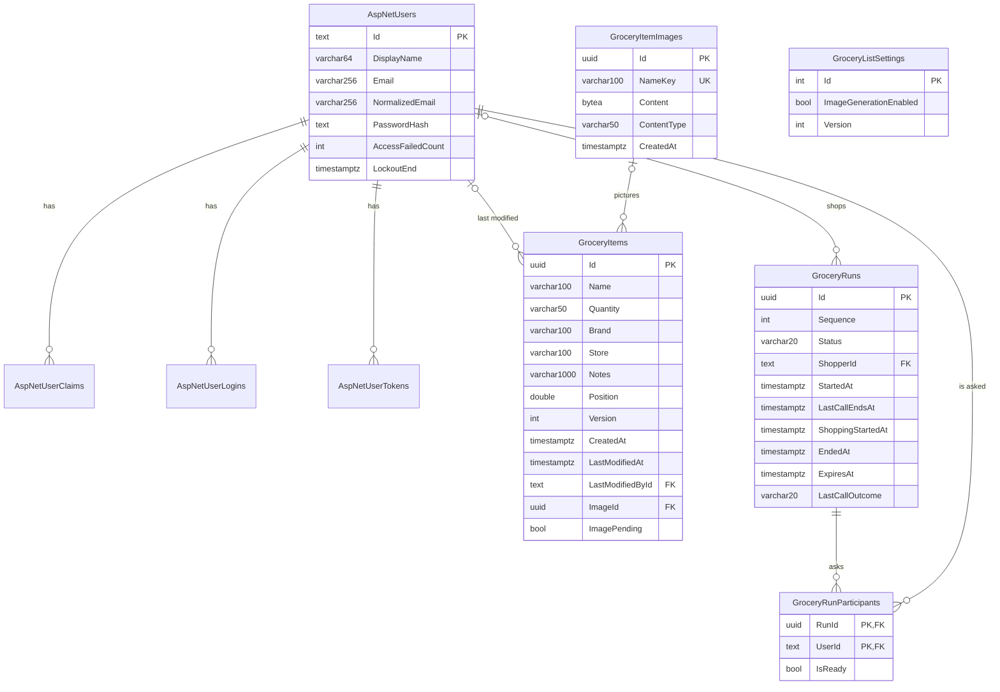

# Database schema

The grocery app's PostgreSQL schema as it stands after the latest migration (`20261111233709_AddGroceryRuns`). The
source of truth is the EF Core model: the entity classes and their `*Configuration.cs` mappings, which
`app/backend/Infrastructure/Data/Migrations/ApplicationDbContextModelSnapshot.cs` records. This document explains it.

- [Where the data lives](#where-the-data-lives)
- [Diagram](#diagram)
- [Tables](#tables)
  - [Accounts (ASP.NET Core Identity)](#accounts-aspnet-core-identity)
  - [The grocery list](#the-grocery-list)
  - [Grocery runs](#grocery-runs)
- [Relationships and deletes](#relationships-and-deletes)
- [Concurrency and consistency](#concurrency-and-consistency)
- [Personal data](#personal-data)
- [Migrations](#migrations)
- [Looking at the data](#looking-at-the-data)

## Where the data lives

| Environment | Server | Databases | The app connects as |
| --- | --- | --- | --- |
| Azure | Azure Database for PostgreSQL flexible server (PostgreSQL 18, B1ms), private access only | `loginapp` (app.biffkittz.com) and `grocery` (grocery.biffkittz.com), with identical schemas | `loginapp_app`, which may connect and create in schema `public` of each database, and owns the tables it creates. Nothing more |
| Local development | Your PostgreSQL on `localhost:5432` | `loginapp` | `loginapp` ([DEVELOPMENT.md](DEVELOPMENT.md#4-local-database)) |
| Tests | SQLite, a temporary file per test host | the same model, created with `EnsureCreated` | n/a |

Each site has its **own database**: separate accounts, list, pictures and grocery runs. Nothing is shared between them
except the server. Everything below is in schema `public`, and table and column names are EF Core's defaults
(PascalCase, so quote them in SQL: `"GroceryItems"."Name"`).

## Diagram



`GroceryListSettings` stands alone: it has one row and no relationships.

## Tables

Types are PostgreSQL's. "Null" says whether a column may be null.

### Accounts (ASP.NET Core Identity)

The app uses `IdentityUserContext`, the user part of ASP.NET Core Identity, without roles: there are no `AspNetRoles`
tables. `AspNetUsers` is Identity's standard table plus `DisplayName`.

#### `AspNetUsers`

| Column | Type | Null | Notes |
| --- | --- | --- | --- |
| `Id` | `text` | no | **Primary key.** A GUID string generated by Identity. Referenced everywhere as "user ID" |
| `DisplayName` | `varchar(64)` | no | The name shown in the app (added by `ApplicationUser`) |
| `UserName`, `NormalizedUserName` | `varchar(256)` | yes | The email address doubles as the user name. `NormalizedUserName` has a **unique** index (`UserNameIndex`) |
| `Email`, `NormalizedEmail` | `varchar(256)` | yes | Index `EmailIndex` on `NormalizedEmail` |
| `EmailConfirmed` | `boolean` | no | Unused (there is no email confirmation) |
| `PasswordHash` | `text` | yes | PBKDF2 hash (Identity v3 format) |
| `SecurityStamp`, `ConcurrencyStamp` | `text` | yes | Identity's stamps; `ConcurrencyStamp` is a concurrency token |
| `AccessFailedCount`, `LockoutEnabled`, `LockoutEnd` | `integer`, `boolean`, `timestamptz` | no, no, yes | Lockout after five failed sign-ins |
| `PhoneNumber`, `PhoneNumberConfirmed`, `TwoFactorEnabled` | `text`, `boolean`, `boolean` | yes, no, no | Unused Identity columns |

#### `AspNetUserClaims`, `AspNetUserLogins`, `AspNetUserTokens`

Identity's standard tables for extra claims, external logins and stored tokens. The app doesn't use them today, so
they stay empty. Each references `AspNetUsers.Id` with `ON DELETE CASCADE`.

| Table | Primary key | Other columns |
| --- | --- | --- |
| `AspNetUserClaims` | `Id` (`integer`, identity) | `UserId`, `ClaimType`, `ClaimValue` |
| `AspNetUserLogins` | (`LoginProvider`, `ProviderKey`) | `ProviderDisplayName`, `UserId` |
| `AspNetUserTokens` | (`UserId`, `LoginProvider`, `Name`) | `Value` |

### The grocery list

#### `GroceryItems`: one row per item on the shared list

| Column | Type | Null | Notes |
| --- | --- | --- | --- |
| `Id` | `uuid` | no | **Primary key.** Usually chosen by the SPA (so an item can show before the server answers); never generated by the database |
| `Name` | `varchar(100)` | no | What to buy |
| `Quantity` | `varchar(50)` | yes | Free text: "2", "1 dozen" |
| `Brand` | `varchar(100)` | yes | |
| `Store` | `varchar(100)` | yes | One of `GroceryList:Stores`, in its configured spelling, or null for "no store" |
| `Notes` | `varchar(1000)` | yes | May span lines |
| `Position` | `double precision` | no | The sort key: fractional, so a move rewrites one row. The list is ordered by (`Position`, `Id`) |
| `Version` | `integer` | no | Increases with every change, moves included. **Concurrency token**, and the clients' "newest copy" rule |
| `CreatedAt` | `timestamptz` | no | |
| `LastModifiedAt` | `timestamptz` | no | Moves and pictures don't change it |
| `LastModifiedById` | `text` | yes | FK to `AspNetUsers`, `ON DELETE SET NULL`: an item outlives its author's account |
| `ImageId` | `uuid` | yes | FK to `GroceryItemImages`, `ON DELETE SET NULL` |
| `ImagePending` | `boolean` | no | A picture is still to be drawn. The picture worker's queue is this flag, so a restart loses nothing |

Indexes: (`Position`, `Id`) for reading the list in order; `LastModifiedById`; `ImageId`.

The app caps the list at `GroceryList:MaxItems` (500) rows; the database doesn't.

#### `GroceryItemImages`: AI pictures, one per distinct name

| Column | Type | Null | Notes |
| --- | --- | --- | --- |
| `Id` | `uuid` | no | **Primary key**; also the picture's URL (`/api/grocery-list/images/{id}`) and ETag |
| `NameKey` | `varchar(100)` | no | The item name trimmed, single-spaced and upper-cased. **Unique**: items with the same name share a picture |
| `Content` | `bytea` | no | A 128-pixel WebP of a few kilobytes |
| `ContentType` | `varchar(50)` | no | `image/webp` |
| `CreatedAt` | `timestamptz` | no | |

Pictures are kept after their items are deleted, so the next item with that name reuses the picture instead of paying
Gemini again. Nothing deletes them today; at a few KB each, that is fine for a family list.

#### `GroceryListSettings`: the list's shared settings, a single row

| Column | Type | Null | Notes |
| --- | --- | --- | --- |
| `Id` | `integer` | no | **Primary key**, always `1` |
| `ImageGenerationEnabled` | `boolean` | no | The AI pictures switch |
| `Version` | `integer` | no | Concurrency token; clients keep the highest |

The migration inserts the row (`Id = 1`, pictures on, `Version = 1`).

### Grocery runs

Written only by the grocery run workflow's activities. Each row is the last state its Temporal workflow published
([TEMPORAL.md](TEMPORAL.md)).

#### `GroceryRuns`: one row per grocery run

| Column | Type | Null | Notes |
| --- | --- | --- | --- |
| `Id` | `uuid` | no | **Primary key**: the run ID the API chose when starting the workflow |
| `Sequence` | `integer` | no | Number of the workflow state this row holds; a state is applied only if newer. **Concurrency token** |
| `Status` | `varchar(20)` | no | `LastCall`, `Shopping`, `Finished`, `Expired` or `Cancelled` (stored by name) |
| `ShopperId` | `text` | yes | FK to `AspNetUsers`, `ON DELETE SET NULL`: the history stays when the account goes |
| `StartedAt` | `timestamptz` | no | When the run and last call started |
| `LastCallEndsAt` | `timestamptz` | no | Last call's deadline; the list's lock lapses a minute after it whatever `Status` says |
| `ShoppingStartedAt` | `timestamptz` | yes | Set when last call ends |
| `EndedAt` | `timestamptz` | yes | Set when the run ends |
| `ExpiresAt` | `timestamptz` | no | The latest the run can be under way; past it the app treats the run as over |
| `LastCallOutcome` | `varchar(20)` | yes | `EveryoneReady`, `TimeUp` or `ShopperWentEarly` once the shopping starts |

Indexes: `Status` (finding the run under way), `ShopperId`.

At most one run per database is under way at a time. The database doesn't enforce that; Temporal does (one workflow
per ID), and a new run marks any older row still under way as `Cancelled`.

#### `GroceryRunParticipants`: who was asked during a run's last call

| Column | Type | Null | Notes |
| --- | --- | --- | --- |
| `RunId` | `uuid` | no | **Primary key** (with `UserId`). FK to `GroceryRuns`, `ON DELETE CASCADE` |
| `UserId` | `text` | no | **Primary key** (with `RunId`). FK to `AspNetUsers`, `ON DELETE CASCADE` |
| `IsReady` | `boolean` | no | They said "I'm good" |

Index: `UserId`. A run's participants are everyone else who had the list open when it started; the shopper isn't one.

## Relationships and deletes

Deleting an account removes the account's own data, and leaves the family's shared data in place:

| When this is deleted | These | Become |
| --- | --- | --- |
| An `AspNetUsers` row | its claims, logins and tokens | deleted (cascade) |
| | `GroceryItems.LastModifiedById` | null: the item stays, without an editor's name |
| | `GroceryRuns.ShopperId` | null: the run stays, without a shopper's name |
| | its `GroceryRunParticipants` rows | deleted (cascade): nobody waits for it any more |
| A `GroceryItemImages` row | `GroceryItems.ImageId` | null: those items lose their picture |
| A `GroceryRuns` row | its `GroceryRunParticipants` rows | deleted (cascade) |

## Concurrency and consistency

- **Optimistic concurrency.** `GroceryItems.Version`, `GroceryListSettings.Version`, `GroceryRuns.Sequence` and
  `AspNetUsers.ConcurrencyStamp` are concurrency tokens: an `UPDATE` or `DELETE` includes the value read in its `WHERE`
  clause, so a write that raced another fails (the API answers 409) instead of silently overwriting it.
- **One writer at a time, in the app.** Writes to the list and grocery runs take turns on an in-process lock
  (`GroceryListWriteLock`), so decisions such as "is there room for one more item?" or "is it last call?" stay true
  until the change is saved. The tokens above still protect the data when two processes overlap during a deployment.
- **Order-independent clients.** Phones apply rows by their `Version` / `Sequence`, so updates can arrive in any order.

## Personal data

| Where | What |
| --- | --- |
| `AspNetUsers` | Email address, display name, password hash |
| `GroceryItems` | What the family buys, notes, and who last changed each item |
| `GroceryRuns`, `GroceryRunParticipants` | Who shopped, who was asked, and when |

The app never logs or exports these values: logs and metrics use opaque IDs and counts only, and only IDs and times go
to Temporal Cloud. Item names (and only names) go to Gemini for pictures; names, quantities and brands for cost
estimates.

## Migrations

| Migration | Adds |
| --- | --- |
| `20261104175602_InitialCreate` | Identity's user tables |
| `20261109173529_AddGroceryList` | `GroceryItems` |
| `20261109211559_AddGroceryItemImages` | `GroceryItemImages`, `GroceryListSettings` (and its row); `ImageId` and `ImagePending` on `GroceryItems` |
| `20261111233709_AddGroceryRuns` | `GroceryRuns`, `GroceryRunParticipants` |

The app applies pending migrations when it starts (`Database:MigrateOnStartup`, true by default), under EF Core's
database-wide migration lock, so replicas starting together don't collide. In Azure, each instance migrates its own
database as `loginapp_app`, which therefore owns the tables. To add a migration:

```bash
dotnet ef migrations add <Name> --project app/backend --output-dir Infrastructure/Data/Migrations
```

Then update this document. More in [DEVELOPMENT.md](DEVELOPMENT.md#9-database-migrations).

## Looking at the data

Locally:

```bash
psql -h localhost -U loginapp -d loginapp -c 'SELECT "Name", "Store", "Version" FROM "GroceryItems" ORDER BY "Position";'
```

In Azure the server has no public endpoint: run `psql` from a temporary container in the Container Apps environment,
with the passwords in Key Vault (`postgresql-app-password`, `postgresql-admin-password`); see
[infra/CLAUDE.md](../infra/CLAUDE.md) and [infra/docs/DEPLOYMENT.md](../infra/docs/DEPLOYMENT.md).

Some useful queries:

```sql
-- The grocery run under way, if any, with who has said "I'm good".
SELECT r."Id", r."Status", r."LastCallEndsAt", u."DisplayName", p."IsReady"
FROM "GroceryRuns" r
LEFT JOIN "GroceryRunParticipants" p ON p."RunId" = r."Id"
LEFT JOIN "AspNetUsers" u ON u."Id" = p."UserId"
WHERE r."Status" IN ('LastCall', 'Shopping')
ORDER BY r."StartedAt" DESC;

-- Pictures: how many, and how much space.
SELECT count(*), pg_size_pretty(sum(length("Content"))::bigint) FROM "GroceryItemImages";

-- Items still waiting for a picture.
SELECT "Id", "Name" FROM "GroceryItems" WHERE "ImagePending";
```
