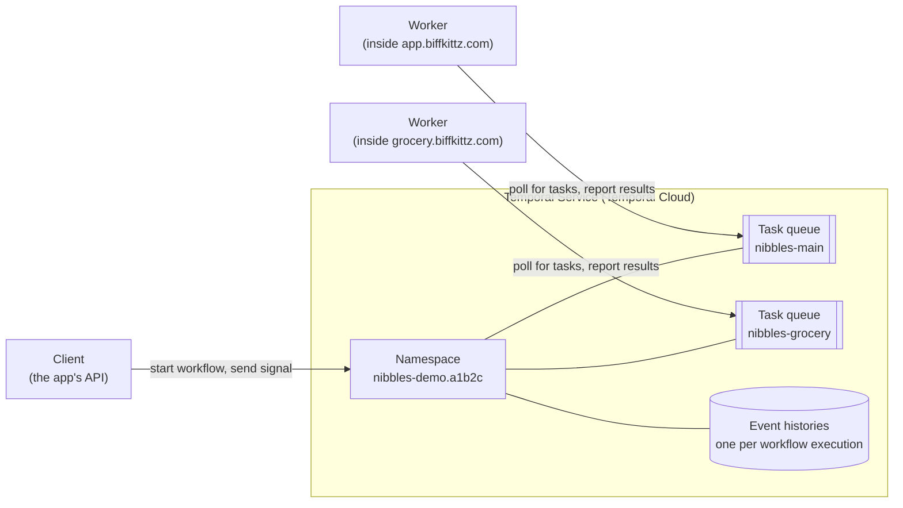
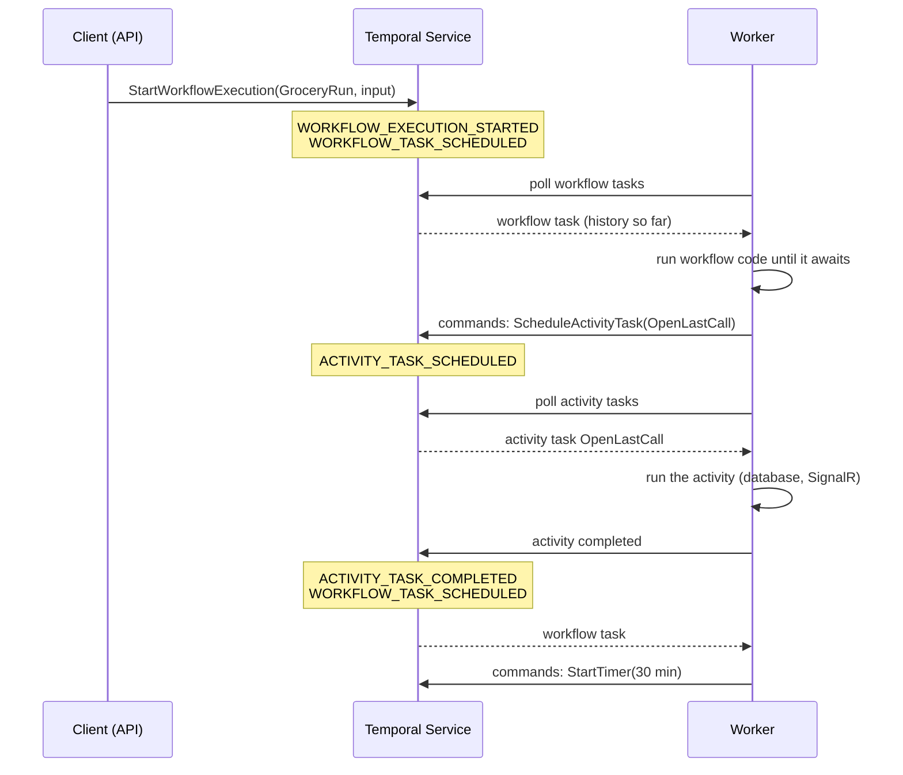
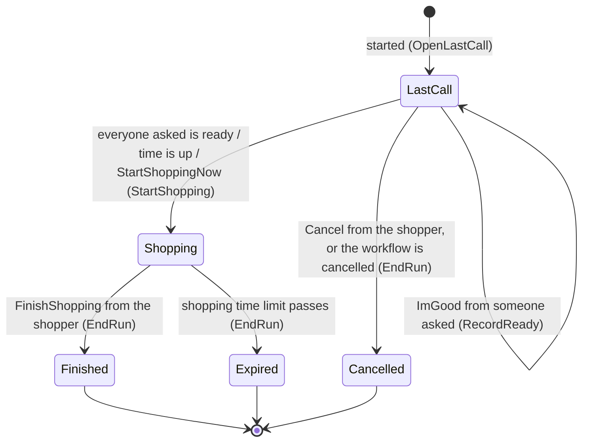
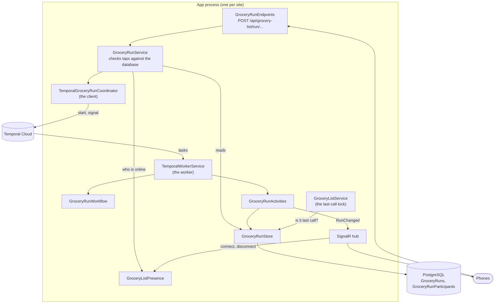

# Temporal and the grocery run workflow

This guide explains how Nibbles uses [Temporal](https://temporal.io) to run **grocery runs** ("speak now or forever
hold your peace"). It covers three things:

1. The Temporal concepts you need: what a workflow, an activity, a worker and a task queue are, and how they talk.
2. How the grocery run is built on them, step by step, using a real recorded run.
3. What every file involved is for.

For the feature as users see it, see "Grocery runs" in [ARCHITECTURE.md](ARCHITECTURE.md#grocery-runs). For setting
up Temporal Cloud, see [infra/docs/DEPLOYMENT.md](../infra/docs/DEPLOYMENT.md#grocery-runs-temporal-cloud).

- [1. Why Temporal](#1-why-temporal)
- [2. Temporal in five minutes](#2-temporal-in-five-minutes)
- [3. How the pieces talk](#3-how-the-pieces-talk)
- [4. Determinism and replay](#4-determinism-and-replay)
- [5. The grocery run workflow](#5-the-grocery-run-workflow)
- [6. One run, event by event](#6-one-run-event-by-event)
- [7. How the app hosts Temporal](#7-how-the-app-hosts-temporal)
- [8. The files, one by one](#8-the-files-one-by-one)
- [9. Testing](#9-testing)
- [10. Operating it](#10-operating-it)
- [Glossary](#glossary)

## 1. Why Temporal

A grocery run is a small process that lasts minutes to hours:

- It waits: up to two hours for last call, up to four hours for the shopping.
- It reacts to people: "I'm good", "Start shopping now", "Call it off", "Done shopping".
- It must survive things that happen meanwhile: the app restarting, a deployment, a database outage.

Without Temporal you would build that from a timer table, a background job that polls it, and careful bookkeeping
about what has already happened. Temporal provides it as a programming model. You write the process as ordinary C#,
`await` a two-hour timer as if it were `Task.Delay`, and Temporal guarantees the code continues correctly, even if
the process that started the timer is long gone when it fires.

## 2. Temporal in five minutes



| Concept | What it is | In Nibbles |
| --- | --- | --- |
| **Temporal Service** | The server. It stores workflow state, runs timers, and hands out work. It never runs your code. | Temporal Cloud (locally: the Temporal CLI's development server) |
| **Namespace** | An isolated unit inside the service, with its own workflows, retention and credentials. | One namespace for both sites |
| **Workflow definition** | The code that describes the process: a C# class with a `[Workflow]` attribute. It decides what happens next; it doesn't do I/O. | `GroceryRunWorkflow` |
| **Workflow execution** | One running instance of a definition. It is identified by a **workflow ID** that you choose, and a **run ID** that Temporal assigns. | One grocery run. Its workflow ID is `nibbles-main/grocery-run` |
| **Event history** | The append-only log of everything that has happened to an execution: started, timer fired, signal received, activity completed. It *is* the workflow's state. | Viewable in the Temporal UI; four are recorded in the repository for tests |
| **Activity** | A normal method that does real work: I/O, databases, network calls. It may fail, and Temporal retries it. | `OpenLastCall`, `RecordReady`, `StartShopping`, `EndRun`: save the run and push it to phones |
| **Signal** | A one-way message from outside into a running workflow. It doesn't return anything. | `ImGood`, `StartShoppingNow`, `Cancel`, `FinishShopping` |
| **Query** | A read-only question to a running workflow, answered from its in-memory state. | `State` |
| **Timer** | A durable sleep, kept by the service rather than the process. | Last call's window, and the shopping time limit |
| **Task queue** | A named queue in the service. Workers poll it for tasks; workflows are started "on" it. | `nibbles-main` and `nibbles-grocery`, one per site |
| **Worker** | A process of yours that polls a task queue, runs workflow code and activities, and reports back. | A background service inside each app instance |
| **Client** | Code that talks to the service from outside a workflow: starts workflows, sends signals, queries. | `TemporalGroceryRunCoordinator`, used by the API |

The service and the worker split the work. **The service owns state and time; the worker owns code.** The service
remembers that a run started at 17:00, that a timer is due at 17:30, and that Ben signalled at 17:04. The worker knows
what the code should do about it.

## 3. How the pieces talk

Workers don't receive calls. They **long-poll** the task queue (`PollWorkflowTaskQueue`, `PollActivityTaskQueue`):
each poll waits up to about a minute for work, and returns early when some arrives. So the worker needs only outbound
connections, which is why it can sit inside the app behind Cloudflare with no extra port open. There are two kinds of
task:

**Workflow tasks: decisions.** Whenever something happens to a workflow (it starts, a timer fires, an activity
finishes, a signal arrives), the service appends an event to its history and schedules a **workflow task**. A worker
picks it up and runs the workflow code forward until it is blocked again on an `await` that can't complete yet. Then
it reports what the code now wants as **commands**: "schedule activity `StartShopping` with this input", "start a
30-minute timer", "cancel that timer", "complete the workflow". Older Temporal material calls these *decisions* and the
task a *decision task*; *workflow task* and *command* are the current names for the same thing. The service turns each
command into a new event (`ACTIVITY_TASK_SCHEDULED`, `TIMER_STARTED`, ...).

**Activity tasks: the work.** A scheduled activity becomes an **activity task** on the queue. A worker (it may be the
same one) runs the method, then reports the result or the exception. The service records `ACTIVITY_TASK_COMPLETED` (or
schedules a retry) and schedules another workflow task, so the workflow learns of the result.



Two things follow from this design:

- **A crash loses nothing.** If the worker dies halfway through, the history still says exactly where the workflow is.
  Another worker, or the same app after a restart, picks up the next task.
- **Timers don't need a running process.** A two-hour timer is an entry in the service. When it fires, a workflow task
  appears on the queue, and whatever worker is polling then handles it.

## 4. Determinism and replay

A worker keeps recently used workflows in memory (the **sticky cache**). If it hasn't got the workflow in memory (after
a restart, a deployment, or on another worker), it rebuilds it by **replay**: it runs the workflow code from the start,
feeding it the recorded history instead of doing anything for real. Each `await` that already happened in the history
completes at once with the recorded result. Commands the code issues are compared with the commands recorded in the
history. When the code reaches the end of the history, it continues live.

Replay works only if the code makes **exactly the same decisions** every time it runs over the same history. That is
the one hard rule of workflow code, and it is why `GroceryRunWorkflow` is written the way it is:

| Not allowed in workflow code | Why | Used instead |
| --- | --- | --- |
| `DateTime.UtcNow`, `TimeProvider` | The time is different on replay | `Workflow.UtcNow`: the time of the workflow task, recorded in the history |
| Database calls, HTTP, SignalR, logging | Side effects would repeat on every replay | Activities do all of it |
| `Task.Run`, `Task.Delay`, threads | They escape Temporal's deterministic scheduler | `Workflow.DelayAsync`, `Workflow.WaitConditionAsync` |
| Iterating a `HashSet<string>` | String hash codes differ between processes, so the order varies | `List<string>` in a fixed order |
| `Guid.NewGuid()`, `Random` | Different values on replay | The run ID comes in the input |

If replay does produce different commands (say, a new version of the code schedules an activity where the history
has a timer), the worker reports a **non-determinism error** and the workflow stops until it is fixed. A code change
that alters the order or kind of timers and activities must therefore be guarded with `Workflow.Patched("id")`. Runs
already in flight take the old branch, and new runs take the new one. The repository's replay tests catch a change
that forgets (section 9).

Signal handlers, queries and the run method all run on one logical thread, interleaving only at `await`s. So the
workflow's fields need no locks.

## 5. The grocery run workflow

### The state machine



### The main method

`RunAsync` is the whole process, in about thirty lines (simplified here):

```csharp
GroceryRunState opened = Next(_state);
await PublishAsync(activities => activities.OpenLastCallAsync(opened));   // activity: save + push

LastCallOutcome? outcome = await WaitOutLastCallAsync();                    // timer + signals
if (outcome is null)
    return await EndAsync(GroceryRunStatus.Cancelled);                       // activity: EndRun

GroceryRunState shopping = Next(_state with { Status = Shopping, ... });
await PublishAsync(activities => activities.StartShoppingAsync(shopping)); // activity: save + push

bool finished = await Workflow.WaitConditionAsync(() => _finishRequested, _input.ShoppingTimeLimit);
return await EndAsync(finished ? GroceryRunStatus.Finished : GroceryRunStatus.Expired);
```

### Timers and wait conditions

The heart of last call is one call:

```csharp
await Workflow.WaitConditionAsync(() => _readyChanged || _shopperGoingNow || _cancelRequested, remaining);
```

It does two things at once. It starts a **durable timer** for `remaining` (the time left until last call's deadline),
and it waits for the **condition** to become true. It returns `true` if the condition won, and `false` if the timer
fired first. Temporal re-checks the condition after every event, which in practice means after every signal. The
condition must be cheap and side-effect free.

A loop around it (`WaitOutLastCallAsync`) handles each wake-up:

- **Cancel requested:** return `null`, and the run ends as cancelled.
- **Shopper going now:** the outcome is `ShopperWentEarly`.
- **Everyone asked is ready:** the outcome is `EveryoneReady`. This is the "wake up early" in the feature description.
- **Someone new is ready, but not everyone:** publish it (`RecordReady`), then wait again for the remaining time. That
  starts a new, shorter timer, and the old one is cancelled.
- **The timer fired:** the outcome is `TimeUp`.

"Everyone ready" needs at least one person to have been asked. With nobody asked, nobody can end last call early, so it
runs its full time unless the shopper starts shopping.

### Signals

Each signal handler only changes a field, after checking that the signal applies:

```csharp
[WorkflowSignal("ImGood")]
public Task ImGoodAsync(GroceryRunSignal signal)
{
    if (signal.RunId == _input.RunId                          // meant for this run
        && _state.Status == GroceryRunStatus.LastCall        // still in last call
        && _input.ParticipantIds.Contains(signal.UserId)     // someone who was asked
        && !_ready.Contains(signal.UserId))                  // not already counted
    {
        _ready.Add(signal.UserId);
        _readyChanged = true;
    }
    return Task.CompletedTask;
}
```

The change of field is what wakes the `WaitConditionAsync` above. Handlers never call activities themselves: one place,
the main method, does all the publishing, which keeps the order of published states simple.

| Signal | From | When it counts |
| --- | --- | --- |
| `ImGood` | Someone asked | During last call, once per person |
| `StartShoppingNow` | The shopper | During last call |
| `Cancel` | The shopper | During last call |
| `FinishShopping` | The shopper | During the shopping |

Every site's runs share one workflow ID, so each signal carries the run ID it is meant for. A tap on a banner that was
already out of date can't count towards the next run.

Signals don't answer the sender. The API therefore checks each tap against the database before sending it (section 7),
so a user who taps too late is told so. The workflow's own checks are the backstop.

### The query

`[WorkflowQuery("State")]` returns the current `GroceryRunState`. The app itself never queries: it reads the database.
The query exists for people, so the Temporal UI or `temporal workflow query --name State` shows where a run is.

### Activities: publishing numbered states

The workflow has no side effects, so each change of state goes out through an activity. `Next()` builds the next
`GroceryRunState` with a **sequence number** one higher than the last, and `PublishAsync` schedules an activity with it.
All four activities do the same thing, saving the state and pushing it to every phone. They differ only in name, so
the history reads like what happened.

Activities run **at least once**, not exactly once. A retry after a timeout, or two workers during a deployment, can run
the same activity twice, and a slow one can finish late. The sequence number makes that harmless:

- **The database:** `GroceryRunStore.ApplyAsync` saves a state only if its sequence is higher than the stored one.
- **The phones:** the SPA keeps the copy of a run with the highest sequence.

Activity options set in `PublishAsync`:

| Option | Value | Why |
| --- | --- | --- |
| `StartToCloseTimeout` | 30 seconds | One attempt saves a row and queues a message: milliseconds. A stuck attempt is abandoned and retried |
| `RetryPolicy` | 1 s, doubling, at most 1 min apart, unlimited attempts | A run can't continue without its state reaching the database; a database outage just delays it |
| `CancellationToken` | The workflow's, except for the final cleanup | See cancellation below |

### Ending, cancelling, failing

- **Normal end:** `EndRun` is published, and `RunAsync` returns the final status. The execution is then *Completed*.
- **Called off by the shopper:** a signal, so the workflow ends normally with status `Cancelled`.
- **Cancelled by an operator** (Temporal UI or `temporal workflow cancel`): Temporal cancels the workflow's
  cancellation token, which makes the pending `await` throw. The workflow catches that, publishes `EndRun(Cancelled)`
  with a *fresh* token so this last activity isn't cancelled too, and then rethrows. The execution ends as *Canceled*,
  and the phones still learn the run is over.
- **Terminated** (a hard stop): no code runs, so nothing is published. The app copes anyway, because every run in the
  database carries its deadlines, and past them it treats the run as over (section 7).
- **Invalid input** (a zero-length window): the workflow throws a non-retryable `ApplicationFailureException` before
  publishing anything. The execution *Fails*.
- **Execution timeout:** two days, set by the client. This is far beyond the longest possible run, and only catches a
  run stuck on an activity that fails forever.

### Payloads and privacy

Inputs, signals, activity arguments and results are serialized to JSON by Temporal's default data converter, and
stored in the history in Temporal Cloud. So they carry only opaque IDs and times:

- `GroceryRunWorkflowInput`: run ID, shopper ID, participant IDs, the two durations.
- `GroceryRunSignal`: run ID, user ID.
- `GroceryRunState`: the above plus status, sequence and timestamps.

Never names, email addresses or items: display names are looked up from the database when the run is broadcast. The
enums serialize by name (`"lastCall"`, `"everyoneReady"`), and those names live in recorded histories, so they must
never be renamed.

## 6. One run, event by event

This is the actual history of a test run (`Histories/v1/everyone-ready-then-finished.json`). Two people were asked,
both said "I'm good", and the shopper finished. Each workflow task is one round of decisions.

| # | Event | What happened |
| --- | --- | --- |
| 1 | `WORKFLOW_EXECUTION_STARTED` | The API started `GroceryRun` with the input |
| 2-4 | `WORKFLOW_TASK_SCHEDULED/STARTED/COMPLETED` | The worker ran the constructor and `RunAsync` up to the first `await`. Its command was to schedule `OpenLastCall` |
| 5 | `ACTIVITY_TASK_SCHEDULED` `OpenLastCall` | |
| 6-7 | `ACTIVITY_TASK_STARTED/COMPLETED` | The run was saved (sequence 1) and pushed: the list locks on every phone |
| 8-10 | workflow task | The workflow entered the last-call loop. Its command was to start a timer |
| 11 | `TIMER_STARTED` 3600 s | Last call: one hour |
| 12 | `WORKFLOW_EXECUTION_SIGNALED` `ImGood` | Alice is ready |
| 13-15 | workflow task | The handler set `_readyChanged`, and the condition woke. Commands: cancel the timer, schedule `RecordReady` |
| 16 | `TIMER_CANCELED` | |
| 17-19 | `RecordReady` | Saved and pushed (sequence 2): "1 of 2 ready" |
| 20 | `WORKFLOW_TASK_SCHEDULED` | Reporting the activity's result |
| 21 | `WORKFLOW_EXECUTION_SIGNALED` `ImGood` | Bob, arriving in the same workflow task |
| 22-23 | workflow task | Everyone is ready. No new timer; the command was to schedule `StartShopping` |
| 24-26 | `StartShopping` | Saved and pushed (sequence 3): the list unlocks, the banner says "shopping" |
| 27-29 | workflow task | The command was to start the shopping timer |
| 30 | `TIMER_STARTED` 14400 s | The four-hour shopping limit |
| 31 | `WORKFLOW_EXECUTION_SIGNALED` `FinishShopping` | The shopper is done |
| 32-35 | workflow task, `TIMER_CANCELED` | Command: schedule `EndRun` |
| 36-38 | `EndRun` | Saved and pushed (sequence 4): the banner goes away |
| 39-41 | workflow task | `RunAsync` returned `Finished`. Command: complete the workflow |
| 42 | `WORKFLOW_EXECUTION_COMPLETED` | |

Note what is *not* in the history: nothing about the database or SignalR. Activities are black boxes to Temporal; only
their inputs and results are recorded.

## 7. How the app hosts Temporal



### Temporal decides; the database shows

Only the workflow's activities write grocery runs to the database. Everything else reads them there, never asking
Temporal:

- `GET /api/grocery-list` and the banner.
- The **last-call lock**: `DELETE` and `move` answer 409 during last call.
- The API's checks before sending a signal.

So loading the list never waits for Temporal or fails with it. The price is that the database lags the workflow by a
few hundred milliseconds. Two safety nets cover a workflow that stops reporting altogether:

- **The lock lapses** one minute past last call's deadline.
- **The run counts as over** past its `ExpiresAt`, whatever its stored status says.

### The worker lives in the app

The activities push to phones through the app's SignalR hub, which runs in-process with no backplane. A worker in any
other process couldn't reach it. Each site's app therefore runs its own worker, on its own task queue
(`Temporal:TaskQueue`, `nibbles-<instance>`). Each site's runs have their own workflow ID (`<task queue>/grocery-run`)
and only reach that site's database and phones.

Temporal's own hosting package (`Temporalio.Extensions.Hosting`) wasn't used. Its worker service connects once, and a
failure stops the whole app (.NET's default for a crashed background service). `TemporalWorkerService` retries
instead, pausing 5 s, then 15 s, then 30 s, 1 min and 5 min, and reports through the `temporal` health check. That check
is Degraded at worst and not part of readiness, so a Temporal outage never takes the list offline.

### One run at a time

Temporal allows only one *running* execution per workflow ID. With every run of a site sharing
`nibbles-main/grocery-run`, starting a second run while one is under way fails with `WorkflowAlreadyStartedException`.
That is atomic protection, with no locking in the app. After a run completes, the ID is free again (the default ID
reuse policy).

There is one subtlety: a run's final activity saves "ended" a few milliseconds *before* its workflow completes. A start
in that gap sees no run in the database but is refused by Temporal, so `GroceryRunService` retries for up to a second
while the database still shows no run.

### Who is asked

`GroceryListPresence` counts the hub's accepted connections per user. When a run starts, the API snapshots everyone
online except the shopper into the workflow input (`ParticipantIds`). The workflow never asks who is online, because
the answer changes and its decisions must not.

### Connection and configuration

`TemporalServiceCollectionExtensions` registers:

- **One `TemporalRuntime`:** Temporal's Rust core with its own threads. Its logs are forwarded to ASP.NET Core logging,
  and its metrics go to a .NET meter named `Temporal`, which the app's OTLP pipeline exports to Prometheus.
- **One lazy `ITemporalClient`:** it connects on first use and reconnects after failures. The API and the worker share
  it.

| Setting | Azure (Terraform) | Local development |
| --- | --- | --- |
| `Temporal:Address` | `<namespace>.<account>.tmprl.cloud:7233` | `localhost:7233` |
| `Temporal:Namespace` | `<namespace>.<account>` | `default` |
| `Temporal:ApiKey` | Key Vault `Temporal--ApiKey` (TLS on) | none (plain text, loopback only) |
| `Temporal:TaskQueue` | `nibbles-main`, `nibbles-grocery` | `nibbles` |

Without `Temporal:Address` none of this is registered. `UnavailableGroceryRunCoordinator` stands in, and the app says
grocery runs aren't set up.

## 8. The files, one by one

### The workflow and what Temporal sees (`app/backend/Features/GroceryList/Runs/`)

| File | Purpose |
| --- | --- |
| `GroceryRunWorkflow.cs` | **The workflow definition.** The run method, the four signal handlers, the `State` query, the last-call loop, cancellation cleanup. Deterministic code only |
| `GroceryRunWorkflowInput.cs` | The workflow's input: run ID, shopper, people asked, last call's length, the shopping limit |
| `GroceryRunSignal.cs` | The argument of every signal: which run, which user |
| `GroceryRunSignalKind.cs` | The four signals, as an enum for the API side |
| `GroceryRunState.cs` | The numbered state the workflow publishes, which activities apply and the query returns |
| `GroceryRunStatus.cs` | `lastCall`, `shopping`, `finished`, `expired`, `cancelled` (JSON names fixed forever) |
| `LastCallOutcome.cs` | `everyoneReady`, `timeUp`, `shopperWentEarly` |
| `GroceryRunActivities.cs` | **The activities.** `OpenLastCall`, `RecordReady`, `StartShopping`, `EndRun`: save through the store, count metrics once, broadcast `RunChanged` |
| `GroceryRunWorkerContribution.cs` | Puts the workflow and activities on the app's worker |

### Talking to Temporal from the API

| File | Purpose |
| --- | --- |
| `IGroceryRunCoordinator.cs` | The API's only view of Temporal: start a workflow, send a signal. Lets the API's rules be tested without Temporal |
| `TemporalGroceryRunCoordinator.cs` | **The client side.** Starts workflows with ID `<task queue>/grocery-run` and a 2-day execution timeout, sends signals, and maps Temporal's errors (already started, not found, unreachable) to `GroceryRunCoordinatorResult` |
| `UnavailableGroceryRunCoordinator.cs` | Stands in when Temporal isn't configured |
| `GroceryRunCoordinatorResult.cs` | `Succeeded`, `AlreadyRunning`, `NotRunning`, `Unreachable` |
| `GroceryRunService.cs` | The API's logic. Start: validate, snapshot who is online, start, retry the start for up to a second while the previous run's workflow completes. Signals: check against the database first, so late or unauthorized taps get a clear answer |
| `GroceryRunCommandStatus.cs` | Every way a start or a tap can turn out, which the endpoints map to HTTP |
| `GroceryRunEndpoints.cs` | `POST /api/grocery-list/run` and `/run/{id}/ready`, `/start-shopping`, `/cancel`, `/finish`. Each answers 202, and the effect arrives by `RunChanged` |

### The database's copy and the lock

| File | Purpose |
| --- | --- |
| `GroceryRun.cs`, `GroceryRunParticipant.cs` | The tables `GroceryRuns` and `GroceryRunParticipants`: the last state each workflow published |
| `GroceryRunConfiguration.cs` | Their EF Core mapping (statuses stored by name, `Sequence` as the concurrency token) |
| `GroceryRunStore.cs` | Applies published states (only newer sequences, under the list's write lock), ends stale runs, builds the response with names, answers "is the list locked?" |
| `GroceryRunApplyResult.cs` | What an apply did, so activities log and count each transition once |
| `GroceryRunQueries.cs` | Finds the run under way, and the deadline rules (one minute of grace) |
| `GroceryListPresence.cs` | Who has the list open: the people a run asks |

### Settings, observability, registration

| File | Purpose |
| --- | --- |
| `GroceryRunOptions.cs` | `GroceryRuns:LastCallMinutes` (15, 30, 60, 120) and `:ShoppingTimeLimitMinutes` (240) |
| `GroceryRunMetrics.cs` | `nibbles.grocery_runs.started`, `.last_calls{outcome}`, `.ended{status}` |
| `GroceryRunLog.cs` | Log events 5040-5047 (IDs only) |
| `GroceryRunServiceCollectionExtensions.cs` | Registers all of the above; the real coordinator and activities only when Temporal is configured |

### Hosting Temporal (`app/backend/Infrastructure/Temporal/`)

| File | Purpose |
| --- | --- |
| `TemporalOptions.cs` | The `Temporal` settings and their validation (an API key whenever the address isn't this machine) |
| `TemporalServiceCollectionExtensions.cs` | Creates the runtime (logs, metrics), the lazy client, the worker service and the health check |
| `TemporalWorkerService.cs` | **The worker.** Connects, builds a `TemporalWorker` from every contribution, polls until the app stops, and retries with growing pauses after any failure |
| `ITemporalWorkerContribution.cs` | How a feature adds workflows and activities without the infrastructure knowing about it |
| `TemporalWorkerStatus.cs`, `TemporalWorkerHealthCheck.cs` | Whether the worker is polling, as the `temporal` health check (Healthy or Degraded) |
| `TemporalLog.cs` | Log events 7000-7003 |

### Touched elsewhere in the app

| File | Change |
| --- | --- |
| `Features/GroceryList/GroceryListService.cs` | The lock on delete and move, and the run in `GET /api/grocery-list` |
| `Features/GroceryList/GroceryListHub.cs` | Feeds `GroceryListPresence` |
| `Features/GroceryList/IGroceryListClient.cs`, `GroceryListHubNotifier.cs` | The `RunChanged` message |
| `Infrastructure/Data/Migrations/*_AddGroceryRuns.cs` | The two tables |
| `Infrastructure/Telemetry/TelemetryServiceCollectionExtensions.cs` | Exports the `Temporal` meter |

### The SPA (`app/frontend/src/`)

| File | Purpose |
| --- | --- |
| `stores/grocery-list.ts` | Holds the run (the highest sequence wins), starts runs and sends taps ("I'm good" shown at once) |
| `services/grocery-list-hub.ts`, `services/grocery-api.ts` | `RunChanged`, and the run endpoints |
| `composables/useGroceryRun.ts` | The countdown, the lock, "am I the shopper / was I asked", and a reload if an expected change seems missed |
| `components/grocery/grocery-run-banner.vue` | The banner and its buttons |
| `components/grocery/start-run-sheet.vue` | Choosing last call's length |
| `views/grocery-list-view.vue` | Puts it together: the banner, the lock on rows and the editor, toasts for others' runs |

### Infrastructure and CI

| File | Purpose |
| --- | --- |
| `infra/variables.tf` | `temporal_namespace`, `temporal_address`, `temporal_api_key` (namespace and key go together) |
| `infra/main.tf` | The Key Vault secret, the app's settings and each instance's task queue |
| `infra/modules/observability/dashboards/nibbles-service.json` | The "Grocery runs (Temporal)" dashboard row |
| `.github/workflows/app.yml` | Installs the Temporal CLI (hash-checked) so the workflow tests run in CI |
| `.github/workflows/infra.yml`, `.github/scripts/terraform-plan.sh` | Pass `TEMPORAL_API_KEY` to plans |

## 9. Testing

Temporal code is tested at four levels (`app/backend.tests/Features/GroceryList/Runs/`):

| Level | Tests | Needs |
| --- | --- | --- |
| The workflow alone | `GroceryRunWorkflowTests` run the real workflow on a local Temporal server, with stand-in activities (`RecordingRunActivities`) that record each published state. `WorkflowHarness` gives each test its own task queue and worker. Short windows (2 s) exercise the timers for real | Temporal CLI |
| Replay | `GroceryRunReplayTests` replays the histories in `Histories/v1` with `WorkflowReplayer`, exactly as a new deployment would. It fails on a non-determinism error | Nothing |
| The API's rules | `GroceryRunEndpointsTests`, `GroceryRunStoreTests` and `GroceryRunActivitiesTests` use `FakeGroceryRunCoordinator` instead of Temporal, and Temporal's `ActivityEnvironment` to run activities without a worker | Nothing |
| End to end | `GroceryRunEndToEndTests` run the app with its own worker against the local server, over real WebSockets. `TemporalOutageTests` point the app at nothing, and check the list still works | Temporal CLI / nothing |

The local server is the Temporal CLI's (`TemporalDevServer`, started once per test run). Without the CLI those tests
are skipped; CI sets `TEMPORAL_TESTS_REQUIRED=true` so they must run. To record new histories after an intentional,
patched change, see [DEVELOPMENT.md](DEVELOPMENT.md#8-tests-and-quality-checks).

## 10. Operating it

- **See a run:** in the Temporal Cloud UI, open the namespace and find workflow ID `nibbles-main/grocery-run` (or
  `nibbles-grocery/...`). The history shows every event, and the **Queries** tab can call `State`.
- **Workers:** the task queue's page lists its pollers. During a deployment, two workers (the old and new revision)
  poll for a few seconds; any task can go to either, and the sequence numbers make that harmless.
- **Logs:** 7000 (worker polling), 7001 (worker failed, retrying), 5040-5047 (runs started, signals, transitions).
- **Metrics:** the "Grocery runs (Temporal)" row of the *Service health* dashboard, from `nibbles_grocery_runs_*`, the
  `temporal` health check, and the SDK's `temporal_*` metrics (slots, pollers, task latencies, failures).
- **Changing the workflow:** guard behavior changes with `Workflow.Patched`, record new histories into a new folder,
  and keep the old ones until no run that used the old code can still be in flight (a run lasts at most about six
  hours).
- **Setup, key rotation, troubleshooting:** [infra/docs/DEPLOYMENT.md](../infra/docs/DEPLOYMENT.md#grocery-runs-temporal-cloud).

## Glossary

| Term | Meaning |
| --- | --- |
| Activity | A method that does real work (I/O); retried by Temporal on failure |
| Command | What a workflow task reports back: schedule activity, start timer, complete... (formerly *decision*) |
| Event history | The durable log of an execution; replaying it rebuilds the workflow's state |
| Long poll | A worker's request for work, held open until a task arrives |
| Namespace | An isolated unit of the Temporal service |
| Non-determinism error | Replay produced different commands than the history recorded |
| Patch | `Workflow.Patched`: a branch that lets old executions keep the old behavior |
| Query | A read-only request answered from a workflow's state |
| Replay | Re-running workflow code over its history to rebuild state |
| Run ID | Temporal's ID for one execution of a workflow ID |
| Signal | A one-way message into a running workflow |
| Sticky cache | A worker's in-memory copy of recent workflows, which saves replays |
| Task queue | Where tasks wait for workers; also how work is routed to the right workers |
| Timer | A durable sleep kept by the service |
| Workflow ID | The ID you choose; at most one running execution per ID |
| Workflow task | A unit of "run the workflow code forward and decide" (formerly *decision task*) |
| Worker | Your process that polls a task queue and runs workflow and activity code |
