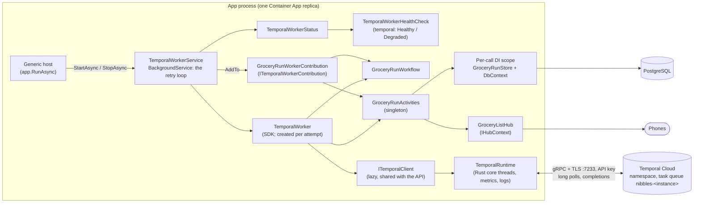

# How the Temporal worker is hosted

Grocery runs are Temporal workflows. Something has to *execute* them: poll Temporal for work, run the workflow code,
run the activities, and report back. That something is a **worker**, and in Nibbles it runs inside the app's own
process, next to the HTTP API and the SignalR hub. This document explains how, in detail, and why it was built this way.

It assumes the basics from [TEMPORAL.md](TEMPORAL.md) (workflows, activities, task queues, workflow tasks and replay).
For the workflow itself, see section 5 there.

- [1. At a glance](#1-at-a-glance)
- [2. Why the worker lives in the app](#2-why-the-worker-lives-in-the-app)
- [3. The pieces](#3-the-pieces)
- [4. From startup to polling](#4-from-startup-to-polling)
- [5. The worker loop](#5-the-worker-loop)
- [6. What runs on the worker, and where](#6-what-runs-on-the-worker-and-where)
- [7. Shutdown and deployments](#7-shutdown-and-deployments)
- [8. When things go wrong](#8-when-things-go-wrong)
- [9. Health, logs and metrics](#9-health-logs-and-metrics)
- [10. Configuration per environment](#10-configuration-per-environment)
- [11. Tests](#11-tests)
- [12. Changing it](#12-changing-it)

## 1. At a glance

- **Where:** a hosted background service, `TemporalWorkerService`, in each app instance (app.biffkittz.com and
  grocery.biffkittz.com). Nothing else is deployed for Temporal. Temporal Cloud runs the server side.
- **What it polls:** one task queue per instance, `Temporal:TaskQueue` (`nibbles-main`, `nibbles-grocery`; `nibbles`
  locally). Both instances share one Temporal Cloud namespace.
- **What it runs:** whatever features contribute through `ITemporalWorkerContribution`. Today that is the
  `GroceryRun` workflow and its four activities.
- **How it connects:** out to `<namespace>.<account>.tmprl.cloud:7233` over gRPC with TLS and an API key. Nothing
  connects *in*, so the app opens no port for Temporal.
- **When Temporal is down:** the worker keeps retrying with growing pauses. The list keeps working, the health check
  reports Degraded, and only grocery runs wait.
- **When Temporal isn't configured:** no worker, client or health check is registered at all, and the app says grocery
  runs aren't set up.

## 2. Why the worker lives in the app

Temporal is happy to run workers anywhere that can reach the namespace: a separate container, a VM, a function. Three
options were weighed:

| Option | Verdict |
| --- | --- |
| **In the app process** (chosen) | The activities can push to phones through the in-process SignalR hub, and use the app's database context, write lock and settings directly. Nothing extra to deploy, scale or pay for |
| A separate Container App running only the worker | Couldn't reach the hub. SignalR runs in-process with no backplane, a project requirement, so a second process can't send to the app's connections without adding an HTTP callback or a message bus, both with their own failure modes and secrets |
| Temporal's hosting package (`Temporalio.Extensions.Hosting`) in the app | Same place, but its hosted worker connects once and lets a failure escape. .NET's default for a crashed background service is to stop the whole app, so a Temporal outage would take the grocery list down too |

The load doesn't argue for a separate process either. A family produces a few workflow tasks an hour. The worker
spends nearly all of its time in long polls, waiting.

The decisive constraint is the hub. The activities' job is "save this state, then tell every open phone"
([TEMPORAL.md, section 5](TEMPORAL.md#activities-publishing-numbered-states)), and telling phones means calling
`IHubContext<GroceryListHub>` in the process that holds their WebSockets. That is why the project instructions say:
don't move the worker out of the app without solving that.

A consequence: **each instance needs its own task queue.** Both instances share a namespace, and Temporal hands a task
to any worker polling that task queue. If they shared a queue, a run started on grocery.biffkittz.com could have its
activities executed by the app.biffkittz.com process, which would write to the wrong database and push to the wrong
phones. Per-instance queues (and per-instance workflow IDs, `<task queue>/grocery-run`) keep each site's runs at home.

## 3. The pieces



| File | Role in hosting |
| --- | --- |
| `app/backend/Infrastructure/Temporal/TemporalServiceCollectionExtensions.cs` | `AddTemporal`: registers the options, one `TemporalRuntime`, the lazy `ITemporalClient`, `TemporalWorkerStatus`, the hosted `TemporalWorkerService` and the `temporal` health check, but only when `Temporal:Address` is set. `LogTemporalConfiguration` logs once when it isn't |
| `app/backend/Infrastructure/Temporal/TemporalOptions.cs` | The `Temporal` section: `Address`, `Namespace`, `ApiKey`, `TaskQueue`. Validated at startup (see section 4) |
| `app/backend/Infrastructure/Temporal/TemporalWorkerService.cs` | The `BackgroundService` that connects, builds a `TemporalWorker`, runs it, and retries after failures |
| `app/backend/Infrastructure/Temporal/ITemporalWorkerContribution.cs` | How a feature puts its workflows and activities on the worker without the infrastructure knowing about it |
| `app/backend/Infrastructure/Temporal/TemporalWorkerStatus.cs` | Thread-safe "is the worker polling, and if not, why", written by the service and read by the health check |
| `app/backend/Infrastructure/Temporal/TemporalWorkerHealthCheck.cs` | Reports `temporal` as Healthy or Degraded, never Unhealthy |
| `app/backend/Infrastructure/Temporal/TemporalLog.cs` | Log events 7000-7003 |
| `app/backend/Features/GroceryList/Runs/GroceryRunWorkerContribution.cs` | The grocery run feature's contribution: `AddWorkflow<GroceryRunWorkflow>()` and `AddAllActivities(activities)` |
| `app/backend/Features/GroceryList/Runs/GroceryRunServiceCollectionExtensions.cs` | `AddGroceryRuns`: registers the activities and the contribution when Temporal is configured, or `UnavailableGroceryRunCoordinator` when it isn't |
| `app/backend/Features/GroceryList/Runs/GroceryRunActivities.cs` | The activities: a singleton that opens a DI scope per call |
| `app/backend/Program.cs` | Calls `AddGroceryListFeature` (which calls `AddGroceryRuns`), then `AddTemporal`, then `LogTemporalConfiguration` |

## 4. From startup to polling

### Registration (while the app is being built)

`Program.cs` calls `builder.Services.AddTemporal(builder.Configuration)`. Two things happen there:

1. **Options are registered for validation.** `AddOptions<TemporalOptions>().BindConfiguration("Temporal")
   .ValidateDataAnnotations().ValidateOnStart()`. This runs whether or not Temporal is configured, so a half
   configuration is caught (see below).
2. **The section is read immediately** to decide whether to register anything else. Whether a hosted service exists
   has to be decided while services are registered, before the container is built, so `AddTemporal` can't wait for
   `IOptions<TemporalOptions>`. It reads the section directly, and `TemporalOptions.IsConfigured` (a non-blank
   `Address`) decides. When it is false, `AddTemporal` returns, and there is no runtime, client, worker or health
   check.

`AddGroceryRuns` makes the same `IsConfigured` decision, so the feature's registrations always match the
infrastructure's:

| Temporal configured | Registered |
| --- | --- |
| Yes | `TemporalRuntime`, `ITemporalClient`, `TemporalWorkerStatus`, `TemporalWorkerService` (hosted), the `temporal` health check, `TemporalGroceryRunCoordinator`, `GroceryRunActivities`, `GroceryRunWorkerContribution` |
| No | `UnavailableGroceryRunCoordinator` only. The settings response says `groceryRunsAvailable: false`, and the SPA hides the start button |

All of these are singletons. The worker, the activities instance and the client live as long as the app. See the
next section for how the activities still get a fresh database context per call.

### Validation (when the host starts)

`ValidateOnStart` makes the host check `TemporalOptions` before it starts any hosted service, and a failure stops the
app with a clear message. The checks (`TemporalOptions.Validate`):

- `Namespace` or `ApiKey` without `Address` is an error. Half a configuration would otherwise silently leave grocery
  runs off.
- `Address` must be `host:port`, not a URL.
- `Namespace` is required with `Address`.
- **No API key means plain text,** which is allowed only for a loopback address (the local development server).
  Anywhere else the key is required, and with a key the SDK always uses TLS.
- `TaskQueue` must be letters, digits, `.`, `_` or `-`, up to 100 characters.

These are configuration mistakes an operator must fix, so failing fast is right. A Temporal *outage* is different:
it is never a startup failure (section 8).

### The runtime and the client

- **`TemporalRuntime`** is the SDK's Rust core: its own threads for networking, polling and timers, plus its
  telemetry. One per process. It is configured to:
  - forward its logs (warnings and up) into ASP.NET Core logging, under the category `Temporalio.Core`;
  - report its metrics through a .NET meter named `Temporal`, with durations in seconds, so they leave over OTLP
    with the app's own metrics.
- **`ITemporalClient`** is created with `TemporalClient.CreateLazy`. Building it opens no connection, so neither
  building nor starting the app ever waits for Temporal. The API's `TemporalGroceryRunCoordinator` and the worker
  share this one client and its one gRPC connection.

### Starting the service

`app.RunAsync()` starts the generic host, which calls `StartAsync` on every hosted service in registration order.
`BackgroundService.StartAsync` calls `TemporalWorkerService.ExecuteAsync(stoppingToken)` and returns straight away. In
.NET 10 the whole of `ExecuteAsync` runs in the background, so the app starts serving HTTP while the worker connects.
No app code calls `ExecuteAsync` directly.

## 5. The worker loop

`TemporalWorkerService.ExecuteAsync` is a loop that runs until the app stops:

```
while the app isn't stopping:
    note the time
    try:
        connect the shared client (stop waiting if the app stops)
        build TemporalWorkerOptions(taskQueue): logger factory, 10 s graceful shutdown
        let every ITemporalWorkerContribution add its workflows and activities
        create a TemporalWorker; status = Running; log 7000
        await worker.ExecuteAsync(stoppingToken)      <- polls until stopping, or until a fatal error
    catch cancellation while stopping:
        leave the loop
    catch anything else:
        count the failure (reset to 1 if the worker had run for 5 minutes)
        status = Stopped(reason); log 7001 with the pause
        wait the pause (cut short if the app stops)
status = Stopped("shutting down"); log 7003
```

Points worth noticing:

- **Connecting explicitly.** A lazy client connects on its first RPC, but a `TemporalWorker` requires a connected
  client, so the loop calls `client.Connection.ConnectAsync()` first. The SDK's connect takes no cancellation token,
  so `.WaitAsync(stoppingToken)` stops *waiting* for it when the app shuts down.
- **A new `TemporalWorker` per attempt.** A worker that has failed can't be restarted. The `using` disposes it, and the
  next attempt builds a fresh one. The workflow cache goes with it (section 6), which costs one replay per open run.
- **Contributions.** The service knows nothing about grocery runs. It asks every registered
  `ITemporalWorkerContribution` to add to the options, so a new feature adds a contribution and leaves this file
  alone.
- **Catch-all.** Any exception other than shutdown is caught, because one escaping `ExecuteAsync` would stop the app
  (`BackgroundServiceExceptionBehavior.StopHost`, .NET's default). Keeping the list up during a Temporal outage is the
  reason this class exists.

### The pauses

| Consecutive failures | Pause before the next attempt | Typical cause |
| --- | --- | --- |
| 1 | 5 s | A network blip, a Temporal Cloud deployment |
| 2 | 15 s | |
| 3 | 30 s | |
| 4 | 1 min | |
| 5 and more | 5 min | A revoked key or deleted namespace, which only an operator can fix. The log stays readable |

A worker that ran at least **5 minutes** before failing was healthy, so its failure counts as the first again. Without
this, a worker that fails once a day would soon be waiting 5 minutes after every hiccup.

Workflows lose nothing while the worker is away. Their state, timers and pending signals are in Temporal's history.
Tasks wait on the task queue until a worker polls again.

## 6. What runs on the worker, and where

Once `worker.ExecuteAsync` is running, the Rust core long-polls two kinds of task from `nibbles-<instance>` and hands
them to .NET.

### Workflow tasks

A workflow task asks: given this history, what are the next commands? The SDK runs `GroceryRunWorkflow` on its own
deterministic task scheduler, one workflow at a time per task, not on the .NET thread pool. That is why workflow code
must not use `Task.Run`, the clock or I/O ([TEMPORAL.md, section 4](TEMPORAL.md#4-determinism-and-replay)). The SDK's
deadlock detector fails a workflow task that blocks the scheduler for more than about two seconds.

The worker keeps recently used workflows in memory (the **workflow cache**) and asks Temporal to send that run's next
task to it alone (a **sticky queue**). With a warm cache it only applies the new events. After a restart the cache is
empty, so the next task replays the run's full history first. For a grocery run that is a few dozen events and takes
milliseconds.

The workflow code never touches the database, the hub or DI. It only returns commands.

### Activity tasks

An activity task says: run `OpenLastCall` (or `RecordReady`, `StartShopping`, `EndRun`) with this `GroceryRunState`.
Activities are ordinary async .NET methods on the thread pool, so they can do I/O. Each one runs
`GroceryRunActivities.PublishAsync`:

1. **Opens a DI scope** (`IServiceScopeFactory.CreateAsyncScope()`). `GroceryRunActivities` is a singleton, and an
   activity isn't an HTTP request, so nobody else has opened a scope. A scope per call gives each activity its own
   `ApplicationDbContext`, just as each HTTP request gets one, and disposes it afterwards. Capturing a scoped
   `GroceryRunStore` in the singleton's constructor would share one context between concurrent activities forever.
2. **Saves the state** through `GroceryRunStore.ApplyAsync`. This takes its turn on the in-process
   `GroceryListWriteLock`, like any list write, and saves only a state newer than the database's (`Sequence`).
3. **Broadcasts** the run as the database now has it, through `IGroceryListNotifier.RunChangedAsync`, which calls
   `IHubContext<GroceryListHub, IGroceryListClient>.Clients.All.RunChanged`. This is the call that ties the worker to
   this process.

The activity honors Temporal's cancellation token until the state is saved, and not after: once saved, it must still
broadcast. If the broadcast throws, the activity fails, and Temporal's retry (every second, doubling, up to a minute,
without limit) finds the state saved and broadcasts again.

### Concurrency and resources

The worker uses the SDK's default limits (up to 100 concurrent workflow tasks and 100 concurrent activities), far
beyond what a family produces. Its memory is small: one cached workflow per open run, at most one per instance. The
Container App's CPU and memory settings (`app_cpu`, `app_memory`) cover the worker without change.

## 7. Shutdown and deployments

### Stopping

When the container gets `SIGTERM` (a new revision, a restart, Ctrl+C locally), the host calls `StopAsync` on each
hosted service, which cancels `stoppingToken`:

1. `worker.ExecuteAsync` stops polling for new tasks.
2. Activities already running get **10 seconds** (`GracefulShutdownTimeout`) to finish. Then their cancellation token
   fires. A cancelled activity is retried by the next worker, and because a state is applied only once, a repeat
   changes nothing.
3. The loop leaves through its cancellation catch, sets the status to stopped and logs 7003.

The 10 seconds sit well inside .NET's default 30-second host shutdown timeout and Container Apps' 30-second
termination grace period.

### Revisions overlapping

The Container App uses single revision mode with exactly one replica (`app_max_replicas` must be 1, because of
SignalR). A deployment still starts the new revision before stopping the old one, so for a short time **two workers
poll the same task queue.** Temporal gives each task to one of them, either one. This is safe because:

- **Activities are idempotent.** Each applies a numbered state, so running one twice, or late, changes nothing.
- **Phones end up on the new revision.** They reconnect after the old one closes their sockets, and reload the list
  (with the run) on reconnect. A broadcast from the old process during the overlap reaches whoever is still connected
  there.
- **The workflow cache moves.** If the old worker held a run's sticky queue, Temporal waits briefly for it (the sticky
  schedule-to-start timeout) and then gives the task to the normal queue, where the new worker replays the history.

### Scale to zero

The worker can only poll while a replica exists. If the app scaled to zero, a last-call timer would fire in Temporal
with nobody to run the workflow task, and the shopping would start late, whenever someone next opened the site.
`app_min_replicas` is 1 (the default and `demo.tfvars`) for this and for cold starts. Keep it there while grocery
runs are on.

## 8. When things go wrong

| What happens | What the worker does | What users see |
| --- | --- | --- |
| Temporal Cloud unreachable at startup | The app starts anyway (lazy client). The loop fails to connect and retries on the pauses above | The list works. Starting a run answers 503 ("Grocery runs aren't available right now"), after the coordinator's 10-second call timeout at most. `temporal` is Degraded |
| Temporal Cloud goes down during a run | The worker's polls fail and the loop restarts it. The run's timers and signals wait in Temporal | The banner stays as last saved. The lock lapses a minute after the deadline (`DeadlineGrace`), so the list never stays locked. When Temporal is back, the workflow catches up and phones get the new state |
| API key revoked or namespace deleted | Each attempt fails with an authentication or not-found error. After four failures it tries every 5 minutes. Log 7001 says why | Same as an outage, until an operator fixes the key (infra/docs/DEPLOYMENT.md) |
| The app restarts mid-run | The new process's worker polls, replays the run's history, and continues | A brief pause. Phones reconnect and reload |
| An activity throws (database busy, a broadcast fails) | Temporal retries it, each second then doubling to a minute, without limit | Usually nothing; the retry succeeds |
| The process dies mid-activity | The activity's 30-second start-to-close timeout expires, and Temporal retries it on whichever worker polls next | A delay of up to about 30 seconds |
| A workflow code bug (a non-determinism error on replay) | The workflow task fails and Temporal retries it; the worker keeps serving other tasks | That run stalls; the lock lapses after the deadline. Fix with `Workflow.Patched` (TEMPORAL.md) |
| Temporal not configured | Nothing is registered; log 7002 once at startup | "Grocery runs aren't set up on this server" in the start sheet |

In every row the grocery list itself keeps working. Temporal is only needed for runs.

## 9. Health, logs and metrics

### Health check

`TemporalWorkerHealthCheck` (name `temporal`) reads `TemporalWorkerStatus`:

- **Healthy:** "Polling task queue nibbles-main."
- **Degraded:** "The worker failed (RpcException); retrying in 00:00:30." or "The Temporal worker hasn't started yet."

It is **never Unhealthy, and it has no `ready` tag**, so it isn't part of `/health/ready`. Container Apps' readiness
probe therefore never takes the site out of service because of Temporal, and the liveness probe (`/health/live`, no
checks) never restarts a healthy container for it. The status is visible in Grafana through the health gauge
`nibbles.health.status` with `check="temporal"` (1 when Healthy, 0.5 when Degraded).

`TemporalWorkerStatus` stores one immutable record, swapped whole, so the health check never reads a "running" flag
alongside another state's description.

### Logs

| Event | Level | When |
| --- | --- | --- |
| 7000 | Information | The worker is polling: task queue, namespace, address (never the key) |
| 7001 | Warning | The worker stopped with an exception; the pause before retrying |
| 7002 | Information | Temporal isn't configured, so runs are unavailable (once, at startup) |
| 7003 | Information | The worker stopped because the app is shutting down |

The SDK's own messages arrive under `Temporalio.*` categories through the `LoggerFactory` passed to the client and
worker, and the Rust core's under `Temporalio.Core` (warnings and up).
Grocery run events are 5040-5047 (`GroceryRunLog`).

### Metrics

The SDK reports through the `Temporal` meter, which the OTLP pipeline exports
(`TelemetryServiceCollectionExtensions` lists it). In Prometheus these are the `temporal_*` series: poll results,
worker task slots, task schedule-to-start and execution latencies, and failures. The app's own grocery run counters
are `nibbles_grocery_runs_*`. The full list is in [ARCHITECTURE.md, "Metrics"](ARCHITECTURE.md#metrics).

## 10. Configuration per environment

| Setting | Azure (Terraform, `infra/main.tf`) | Local development | Tests |
| --- | --- | --- | --- |
| `Temporal:Address` | `<namespace>.tmprl.cloud:7233` (or `temporal_address`) | `localhost:7233` (`temporal server start-dev`) | The dev server's port, from `TemporalDevServer` |
| `Temporal:Namespace` | `temporal_namespace` | `default` | `default` |
| `Temporal:ApiKey` | Key Vault `Temporal--ApiKey`, through a Container App secret | none (plain text, loopback only) | none |
| `Temporal:TaskQueue` | `nibbles-main`, `nibbles-grocery` (per instance) | `nibbles` (appsettings.json) | A unique queue per test, so tests never take each other's tasks |

In Azure all of this appears only when `temporal_namespace` is set. The app's user-assigned identity reads the key
from Key Vault, as it does its other secrets. Setting up the namespace, service account and key is in
[infra/docs/DEPLOYMENT.md](../infra/docs/DEPLOYMENT.md#grocery-runs-temporal-cloud). Running the development server
is in [DEVELOPMENT.md](DEVELOPMENT.md).

## 11. Tests

| Test | What it proves about hosting |
| --- | --- |
| `TemporalOutageTests` | With Temporal configured but unreachable (nothing on port 1), the app starts, the list works, runs are reported unavailable, and `/health/ready` stays healthy. Without Temporal, runs are reported as not set up. Needs no server |
| `GroceryRunEndToEndTests` | The real app, with its in-process worker and a real dev server, runs whole grocery runs: HTTP in, workflow, activities, database, SignalR out to listeners |
| `GroceryRunActivitiesTests` | The activities against a real database and a recording notifier, through `ActivityEnvironment` (no worker) |
| `GroceryRunWorkflowTests` | The workflow on a test worker with recorded activities (`WorkflowHarness`) |
| `GroceryRunReplayTests` | Recorded histories still replay, so a deployment can't break runs in flight |
| `OptionsValidationTests` | The `Temporal` section's startup validation |

Tests that need a server use `TemporalDevServer`, which starts the Temporal CLI's development server
(`TEMPORAL_CLI_PATH` or `PATH`), never one the SDK downloads. CI installs the CLI with a pinned checksum and sets
`TEMPORAL_TESTS_REQUIRED=true`, so these tests can't silently skip there.

## 12. Changing it

- **Keep the worker in the app** unless something else can push to the hub (see section 2).
- **Keep the outage properties:** nothing Temporal-related may fail startup except invalid configuration, nothing may
  escape `ExecuteAsync`, and the `temporal` check stays out of readiness and never goes Unhealthy.
- **Adding a workflow or activity for another feature:** implement `ITemporalWorkerContribution` in that feature and
  register it as a singleton next to its activities, only when Temporal is configured (as `AddGroceryRuns` does).
  `TemporalWorkerService` picks it up. Activities that need the database open a scope per call.
- **Another app instance** needs its own `Temporal:TaskQueue`. Terraform derives it from the instance key.
- **Tuning the worker** (concurrency, cache size, pollers) goes in `TemporalWorkerOptions` in `TemporalWorkerService`.
  The defaults are ample at this scale.
- **More replicas** would need a SignalR backplane first. Temporal itself would cope: several workers on one queue
  share the tasks.
