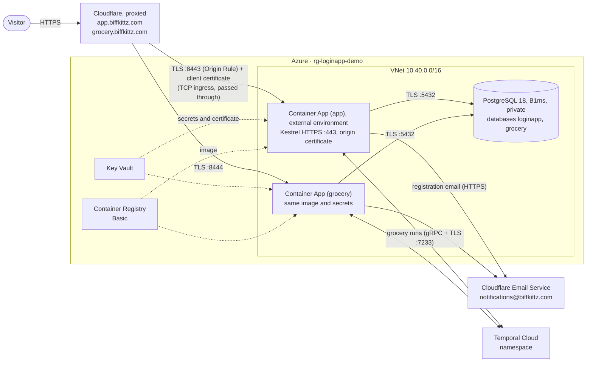

# Nibbles infrastructure (Terraform)

Terraform that builds everything Nibbles (the Login App's code base) needs to run in **Azure Container Apps** and serve
two independent instances of it, <https://app.biffkittz.com> and <https://grocery.biffkittz.com>, each with its own
list and accounts. That includes the network, the Container Apps environment and a Container App per instance,
PostgreSQL with a database per instance, Key Vault, the container registry, logging, and the Cloudflare DNS records,
Origin Rules and Authenticated Origin Pulls. It also sets up Cloudflare Email Service, so that every registration
emails the people in `registration_notification_recipients` from notifications@biffkittz.com. With
`observability_enabled` it adds Prometheus and Grafana to the same environment: the app pushes its metrics to
Prometheus, which also collects Azure's platform metrics, and Grafana shows them at <https://grafana.biffkittz.com>
behind GitHub sign-in ([docs/DEPLOYMENT.md](docs/DEPLOYMENT.md#observability)). With `temporal_namespace`, the apps run
grocery runs as workflows on Temporal Cloud, each with an in-process worker on a task queue of its own and an API key
from Key Vault ([docs/DEPLOYMENT.md](docs/DEPLOYMENT.md#grocery-runs-temporal-cloud)). The instances share the image, the Key
Vault and its secrets. The app terminates TLS itself with the Cloudflare origin certificate, so there
is no Application Gateway. The variable default is `eastus`; the demo deploys to `centralus`
(`environments/demo.tfvars`). Every Azure resource is tagged `project:loginapp`.



## Quick start

Everything below runs from `infra/` in WSL. The first deployment has four phases, because the Container Apps can
only be created once their image exists and their database role has been set up.

```bash
az login && az account set --subscription 3c3f379f-8161-4631-a30c-a3af82622a6a
export CLOUDFLARE_API_TOKEN=...                                         # DNS, Zone Settings, Origin Rules, Email (docs/AUTHENTICATION.md)
export TF_VAR_tls_certificate_pfx_path=~/.secrets/biffkittz-origin.pfx  # Cloudflare origin certificate
read -rsp 'PFX password: ' TF_VAR_tls_certificate_pfx_password && export TF_VAR_tls_certificate_pfx_password
read -rsp 'Gemini API key: ' TF_VAR_gemini_api_key && export TF_VAR_gemini_api_key  # optional: AI pictures and cost estimates
read -rsp 'Temporal API key: ' TF_VAR_temporal_api_key && export TF_VAR_temporal_api_key  # with temporal_namespace: grocery runs

terraform init
terraform plan -var-file=environments/demo.tfvars -out=demo.tfplan     # 1. platform (no app yet)
terraform apply demo.tfplan

TAG=$(git rev-parse --short HEAD)                                      # 2. build and push the image
az acr build --registry "$(terraform output -raw container_registry_name)" \
  --image "login-app:$TAG" --file ../app/Dockerfile ../app

az containerapp job start --resource-group "$(terraform output -raw resource_group_name)" \
  --name "$(terraform output -raw db_bootstrap_job_name)"            # 3. the database role, for every instance

# 4. set app_image_tag = "<TAG>" in environments/demo.tfvars, then plan and apply again
```

[docs/DEPLOYMENT.md](docs/DEPLOYMENT.md) walks through each phase with expected output, verification, day-2
operations (including [adding an instance](docs/DEPLOYMENT.md#adding-an-instance)) and troubleshooting.

## Documentation

| Document | Covers |
| --- | --- |
| [docs/ARCHITECTURE.md](docs/ARCHITECTURE.md) | Request path, network and NSG rules, identities and RBAC, secrets, DNS, the reasoning behind each design decision, Well-Architected alignment, cost |
| [docs/AUTHENTICATION.md](docs/AUTHENTICATION.md) | Signing in to Azure, required permissions, remote state access, CI with OIDC, the Cloudflare API token, and creating the origin certificate PFX |
| [docs/DEPLOYMENT.md](docs/DEPLOYMENT.md) | First deployment step by step, verification, registration emails, observability (Prometheus and Grafana), upgrades, secret and certificate rotation, teardown, troubleshooting |
| [docs/DEVELOPMENT.md](docs/DEVELOPMENT.md) | Tools and VS Code setup in WSL, the everyday check loop, tests, pre-commit, CI, conventions, provider upgrades |

## Layout

```text
infra/
├── backend.tf               Remote state: Azure Storage, locked with blob leases
├── providers.tf             Terraform and provider versions; provider configuration
├── main.tf                  Naming, tags, shared resources and the module wiring
├── variables.tf / outputs.tf
├── environments/demo.tfvars Settings for the demo environment (no secrets)
├── modules/
│   ├── networking/          VNet, subnets, NSGs, service endpoints
│   ├── registry/            Azure Container Registry + AcrPull
│   ├── key-vault/           Key Vault, secrets, TLS certificate, per-secret RBAC
│   ├── database/            PostgreSQL flexible server (private access), database, private DNS
│   ├── container-app/       External environment, the app (TCP ingress), the database bootstrap job
│   ├── email-sending/       Cloudflare Email Service: sending domain, recipients, the app's email token
│   └── observability/       Prometheus, Grafana, their NFS share, init scripts and the dashboards (dashboards/*.json)
├── tests/                   `terraform test` suites with mocked providers (no credentials needed)
├── .tflint.hcl              Lint rules (Terraform "all" preset + azurerm ruleset)
└── .terraform-docs.yml      Generates the reference below and in each module's README
```

## Checks

Run these before every pull request. CI (`.github/workflows/infra.yml`) and the pre-commit hooks run the same set;
CI also plans every pull request and applies `main` after approval ([docs/CI_CD.md](../docs/CI_CD.md)).

```bash
terraform fmt -recursive -check
terraform init -backend=false && terraform validate
terraform test                       # runs against mocked providers
tflint --init && tflint --recursive
terraform-docs .                     # refreshes the reference sections
```

## Reference

Generated by [terraform-docs](https://terraform-docs.io); don't edit between the markers.

<!-- BEGIN_TF_DOCS -->
### Requirements

| Name | Version |
| ---- | ------- |
| <a name="requirement_terraform"></a> [terraform](#requirement\_terraform) | >= 1.17.1, < 2.0.0 |
| <a name="requirement_azurerm"></a> [azurerm](#requirement\_azurerm) | ~> 5.12 |
| <a name="requirement_cloudflare"></a> [cloudflare](#requirement\_cloudflare) | ~> 5.28 |
| <a name="requirement_random"></a> [random](#requirement\_random) | ~> 3.9 |
| <a name="requirement_time"></a> [time](#requirement\_time) | ~> 0.14 |

### Providers

| Name | Version |
| ---- | ------- |
| <a name="provider_azurerm"></a> [azurerm](#provider\_azurerm) | 5.12.0 |
| <a name="provider_cloudflare"></a> [cloudflare](#provider\_cloudflare) | 5.28.1 |
| <a name="provider_random"></a> [random](#provider\_random) | 3.9.1 |

### Modules

| Name | Source | Version |
| ---- | ------ | ------- |
| <a name="module_container_apps"></a> [container\_apps](#module\_container\_apps) | ./modules/container-app | n/a |
| <a name="module_database"></a> [database](#module\_database) | ./modules/database | n/a |
| <a name="module_email_sending"></a> [email\_sending](#module\_email\_sending) | ./modules/email-sending | n/a |
| <a name="module_key_vault"></a> [key\_vault](#module\_key\_vault) | ./modules/key-vault | n/a |
| <a name="module_networking"></a> [networking](#module\_networking) | ./modules/networking | n/a |
| <a name="module_observability"></a> [observability](#module\_observability) | ./modules/observability | n/a |
| <a name="module_registry"></a> [registry](#module\_registry) | ./modules/registry | n/a |

### Resources

| Name | Type |
| ---- | ---- |
| [azurerm_log_analytics_workspace.this](https://registry.terraform.io/providers/hashicorp/azurerm/latest/docs/resources/log_analytics_workspace) | resource |
| [azurerm_resource_group.this](https://registry.terraform.io/providers/hashicorp/azurerm/latest/docs/resources/resource_group) | resource |
| [azurerm_user_assigned_identity.app](https://registry.terraform.io/providers/hashicorp/azurerm/latest/docs/resources/user_assigned_identity) | resource |
| [azurerm_user_assigned_identity.db_bootstrap](https://registry.terraform.io/providers/hashicorp/azurerm/latest/docs/resources/user_assigned_identity) | resource |
| [azurerm_user_assigned_identity.grafana](https://registry.terraform.io/providers/hashicorp/azurerm/latest/docs/resources/user_assigned_identity) | resource |
| [azurerm_user_assigned_identity.prometheus](https://registry.terraform.io/providers/hashicorp/azurerm/latest/docs/resources/user_assigned_identity) | resource |
| [cloudflare_dns_record.app](https://registry.terraform.io/providers/cloudflare/cloudflare/latest/docs/resources/dns_record) | resource |
| [cloudflare_dns_record.grafana](https://registry.terraform.io/providers/cloudflare/cloudflare/latest/docs/resources/dns_record) | resource |
| [cloudflare_ruleset.origin_port](https://registry.terraform.io/providers/cloudflare/cloudflare/latest/docs/resources/ruleset) | resource |
| [cloudflare_zone_setting.authenticated_origin_pulls](https://registry.terraform.io/providers/cloudflare/cloudflare/latest/docs/resources/zone_setting) | resource |
| [random_bytes.jwt_signing_key](https://registry.terraform.io/providers/hashicorp/random/latest/docs/resources/bytes) | resource |
| [random_password.grafana_secret_key](https://registry.terraform.io/providers/hashicorp/random/latest/docs/resources/password) | resource |
| [random_password.postgresql_admin](https://registry.terraform.io/providers/hashicorp/random/latest/docs/resources/password) | resource |
| [random_password.postgresql_app](https://registry.terraform.io/providers/hashicorp/random/latest/docs/resources/password) | resource |
| [random_password.prometheus_users](https://registry.terraform.io/providers/hashicorp/random/latest/docs/resources/password) | resource |
| [azurerm_client_config.current](https://registry.terraform.io/providers/hashicorp/azurerm/latest/docs/data-sources/client_config) | data source |
| [cloudflare_account_api_token_permission_groups_list.this](https://registry.terraform.io/providers/cloudflare/cloudflare/latest/docs/data-sources/account_api_token_permission_groups_list) | data source |
| [cloudflare_ip_ranges.this](https://registry.terraform.io/providers/cloudflare/cloudflare/latest/docs/data-sources/ip_ranges) | data source |
| [cloudflare_zone.this](https://registry.terraform.io/providers/cloudflare/cloudflare/latest/docs/data-sources/zone) | data source |

### Inputs

| Name | Description | Type | Default | Required |
| ---- | ----------- | ---- | ------- | :------: |
| <a name="input_subscription_id"></a> [subscription\_id](#input\_subscription\_id) | Azure subscription to deploy into. | `string` | n/a | yes |
| <a name="input_tls_certificate_pfx_path"></a> [tls\_certificate\_pfx\_path](#input\_tls\_certificate\_pfx\_path) | Path to the PFX file with the TLS certificate and private key that the app serves: the Cloudflare origin certificate. Keep it outside the repository ("~" is expanded). | `string` | n/a | yes |
| <a name="input_additional_app_instances"></a> [additional\_app\_instances](#input\_additional\_app\_instances) | More instances of the app, keyed by a short, stable name (e.g. grocery). Each runs the main instance's image with its identity, Key Vault secrets and settings, but has its own Container App (<main app name>-<key>), public host name (a proxied DNS record and an Origin Rule), exposed port and database on the same PostgreSQL server, so its list and accounts are its own. After adding one, run the database bootstrap job (docs/DEPLOYMENT.md). | <pre>map(object({<br/>    hostname      = string<br/>    exposed_port  = number<br/>    database_name = string<br/>  }))</pre> | `{}` | no |
| <a name="input_app_cpu"></a> [app\_cpu](#input\_app\_cpu) | vCPUs per app replica. | `number` | `0.5` | no |
| <a name="input_app_exposed_port"></a> [app\_exposed\_port](#input\_app\_exposed\_port) | Public TCP port of the environment that Cloudflare connects to for the main instance (additional instances have their own). Not 80 or 443: the environment's own HTTP ingress holds those (Azure answers "exposedPort already in use"). Terraform adds a Cloudflare Origin Rule so visitors still use 443. | `number` | `8443` | no |
| <a name="input_app_hostname"></a> [app\_hostname](#input\_app\_hostname) | Public host name of the app's main instance. Terraform creates a proxied A record for it in the Cloudflare zone. Further instances are in additional\_app\_instances. | `string` | `"app.biffkittz.com"` | no |
| <a name="input_app_image_repository"></a> [app\_image\_repository](#input\_app\_image\_repository) | Repository of the app image in the registry. | `string` | `"login-app"` | no |
| <a name="input_app_image_tag"></a> [app\_image\_tag](#input\_app\_image\_tag) | Tag of the app image every instance runs, e.g. the short commit SHA. Null (the default) skips creating the Container Apps until a first image has been pushed; see docs/DEPLOYMENT.md. | `string` | `null` | no |
| <a name="input_app_max_replicas"></a> [app\_max\_replicas](#input\_app\_max\_replicas) | Maximum number of app replicas. Must be 1: the grocery list's realtime updates (SignalR) run inside the app with no backplane, so users connected to a second replica would never see each other's changes. | `number` | `1` | no |
| <a name="input_app_memory"></a> [app\_memory](#input\_app\_memory) | Memory per app replica. The Consumption profile requires exactly twice the vCPUs in GiB (0.5 vCPU -> 1Gi). | `string` | `"1Gi"` | no |
| <a name="input_app_min_replicas"></a> [app\_min\_replicas](#input\_app\_min\_replicas) | Minimum number of app replicas. 1 keeps one warm replica (no cold starts). | `number` | `1` | no |
| <a name="input_app_target_port"></a> [app\_target\_port](#input\_app\_target\_port) | Port Kestrel listens on for HTTPS inside the container. 443 needs the image's port-binding capability; set 8443 if the platform refuses it (see docs/DEPLOYMENT.md). | `number` | `443` | no |
| <a name="input_cloudflare_email_sending_permission_groups"></a> [cloudflare\_email\_sending\_permission\_groups](#input\_cloudflare\_email\_sending\_permission\_groups) | Names of Cloudflare API token permission groups that allow sending email, narrowest first. The app's own sending token gets the first one the Cloudflare account offers. Change this only if Cloudflare renames them; the plan then fails and lists the email sending groups it found. | `list(string)` | <pre>[<br/>  "Email Sending Send",<br/>  "Email Sending Write"<br/>]</pre> | no |
| <a name="input_container_apps_transitional_ingress_cidrs"></a> [container\_apps\_transitional\_ingress\_cidrs](#input\_container\_apps\_transitional\_ingress\_cidrs) | Container Apps infrastructure ranges also allowed by the app's ingress IP restrictions. While Microsoft rolls out real client IPs to the ingress (until about March 2027, GitHub issue microsoft/azure-container-apps#1666), requests may appear to come from these ranges. Remove them once Microsoft announces the rollout is complete; Cloudflare's client certificate keeps other callers out in the meantime. | `list(string)` | <pre>[<br/>  "100.100.0.0/17",<br/>  "100.100.128.0/19",<br/>  "100.100.160.0/19",<br/>  "100.100.192.0/19"<br/>]</pre> | no |
| <a name="input_container_registry_sku"></a> [container\_registry\_sku](#input\_container\_registry\_sku) | Azure Container Registry SKU. | `string` | `"Basic"` | no |
| <a name="input_database_name"></a> [database\_name](#input\_database\_name) | Name of the main instance's database. Additional instances name theirs in additional\_app\_instances. | `string` | `"loginapp"` | no |
| <a name="input_db_bootstrap_image"></a> [db\_bootstrap\_image](#input\_db\_bootstrap\_image) | Image with psql for the database bootstrap job, pinned to a dated tag. Microsoft's Azure Linux PostgreSQL image is pulled anonymously from MCR, so there is no Docker Hub rate limit. | `string` | `"mcr.microsoft.com/azurelinux/base/postgres:16.15-1-azl3.0.20261027"` | no |
| <a name="input_dns_zone_name"></a> [dns\_zone\_name](#input\_dns\_zone\_name) | Cloudflare zone that holds the app's DNS record. | `string` | `"biffkittz.com"` | no |
| <a name="input_environment"></a> [environment](#input\_environment) | Environment name, e.g. demo. Used in resource names and the "environment" tag. | `string` | `"demo"` | no |
| <a name="input_gemini_api_key"></a> [gemini\_api\_key](#input\_gemini\_api\_key) | Google Gemini API key with which the app draws pictures of grocery items and estimates what the list costs. Gemini's image models have no free tier, so the key's Google Cloud project needs billing. Null leaves pictures and cost estimates unavailable (the app says so). Pass it as TF\_VAR\_gemini\_api\_key; never put it in a tfvars file. | `string` | `null` | no |
| <a name="input_grafana_cpu"></a> [grafana\_cpu](#input\_grafana\_cpu) | vCPUs for Grafana. | `number` | `0.25` | no |
| <a name="input_grafana_exposed_port"></a> [grafana\_exposed\_port](#input\_grafana\_exposed\_port) | Public TCP port of the environment for Grafana, which Cloudflare's Origin Rule connects to (see app\_exposed\_port). | `number` | `8445` | no |
| <a name="input_grafana_github_admins"></a> [grafana\_github\_admins](#input\_grafana\_github\_admins) | GitHub usernames, as GitHub spells them, that sign in to Grafana as administrators. Anyone not listed here or in grafana\_github\_viewers is refused. | `list(string)` | `[]` | no |
| <a name="input_grafana_github_client_id"></a> [grafana\_github\_client\_id](#input\_grafana\_github\_client\_id) | Client ID of the GitHub OAuth App that Grafana signs users in with (not a secret). Register it with the callback URL https://<grafana\_hostname>/login/github. | `string` | `null` | no |
| <a name="input_grafana_github_client_secret"></a> [grafana\_github\_client\_secret](#input\_grafana\_github\_client\_secret) | Client secret of that GitHub OAuth App. A secret: pass it as TF\_VAR\_grafana\_github\_client\_secret (the GRAFANA\_GITHUB\_CLIENT\_SECRET secret in CI); it is kept in Key Vault. | `string` | `null` | no |
| <a name="input_grafana_github_viewers"></a> [grafana\_github\_viewers](#input\_grafana\_github\_viewers) | GitHub usernames that may sign in to Grafana to view dashboards, without changing anything. | `list(string)` | `[]` | no |
| <a name="input_grafana_hostname"></a> [grafana\_hostname](#input\_grafana\_hostname) | Public host name of Grafana, inside dns\_zone\_name. Cloudflare proxies it like the app's. | `string` | `"grafana.biffkittz.com"` | no |
| <a name="input_grafana_memory"></a> [grafana\_memory](#input\_grafana\_memory) | Memory for Grafana, twice grafana\_cpu in Gi. | `string` | `"0.5Gi"` | no |
| <a name="input_ingress_additional_allowed_cidrs"></a> [ingress\_additional\_allowed\_cidrs](#input\_ingress\_additional\_allowed\_cidrs) | Extra source ranges allowed by the app's ingress IP restrictions when restrict\_ingress\_to\_cloudflare is true, e.g. your own IP for troubleshooting. Without Cloudflare's client certificate they still get only the health endpoints. | `list(string)` | `[]` | no |
| <a name="input_key_vault_additional_administrators"></a> [key\_vault\_additional\_administrators](#input\_key\_vault\_additional\_administrators) | More principals that manage the vault's contents, by a label of your choosing, e.g. { github\_deploy = "<object ID>" }. Every principal that runs a refreshing plan or an apply needs this access: Terraform reads the secrets back. | `map(string)` | `{}` | no |
| <a name="input_key_vault_administrator_object_id"></a> [key\_vault\_administrator\_object\_id](#input\_key\_vault\_administrator\_object\_id) | Object ID of the principal that manages the vault's contents (Key Vault Secrets Officer and Certificates Officer). Null means whoever runs Terraform, which suits one person running it. Set it once several principals run Terraform, such as you and GitHub Actions (docs/CI\_CD.md): otherwise every plan moves the role to whoever runs it. | `string` | `null` | no |
| <a name="input_key_vault_allowed_ip_ranges"></a> [key\_vault\_allowed\_ip\_ranges](#input\_key\_vault\_allowed\_ip\_ranges) | Public ranges allowed through the Key Vault firewall: wherever Terraform runs, e.g. ["203.0.113.10/32"]. | `list(string)` | `[]` | no |
| <a name="input_key_vault_firewall_enabled"></a> [key\_vault\_firewall\_enabled](#input\_key\_vault\_firewall\_enabled) | Deny Key Vault network access except from the Container Apps subnet, trusted Azure services and key\_vault\_allowed\_ip\_ranges. Read docs/ARCHITECTURE.md (Key Vault network access) before enabling it. | `bool` | `false` | no |
| <a name="input_key_vault_purge_protection_enabled"></a> [key\_vault\_purge\_protection\_enabled](#input\_key\_vault\_purge\_protection\_enabled) | Prevents purging deleted vault objects before soft-delete retention (7 days) ends. Recommended; it can't be turned off later. | `bool` | `true` | no |
| <a name="input_location"></a> [location](#input\_location) | Azure region for every resource. | `string` | `"eastus"` | no |
| <a name="input_log_analytics_daily_quota_gb"></a> [log\_analytics\_daily\_quota\_gb](#input\_log\_analytics\_daily\_quota\_gb) | Daily ingestion cap in GB, protecting the demo budget. Ingestion stops for the rest of the day when reached; -1 removes the cap. | `number` | `1` | no |
| <a name="input_log_analytics_retention_days"></a> [log\_analytics\_retention\_days](#input\_log\_analytics\_retention\_days) | Days the Log Analytics workspace keeps logs (30-730). | `number` | `30` | no |
| <a name="input_name_suffix"></a> [name\_suffix](#input\_name\_suffix) | Suffix that makes the registry, Key Vault and PostgreSQL names globally unique. Null derives a stable 6-character value from the subscription, project and environment. | `string` | `null` | no |
| <a name="input_notification_sender_username"></a> [notification\_sender\_username](#input\_notification\_sender\_username) | The part before the @ of the address the app sends its emails from, in dns\_zone\_name: "notifications" sends from notifications@biffkittz.com. Nobody reads replies: Cloudflare Email Service only sends from it. | `string` | `"notifications"` | no |
| <a name="input_observability_enabled"></a> [observability\_enabled](#input\_observability\_enabled) | Runs Prometheus and Grafana in the app's environment: the app pushes its metrics to Prometheus, and Grafana is public at grafana\_hostname with GitHub sign-in. Needs grafana\_github\_client\_id, grafana\_github\_admins and TF\_VAR\_grafana\_github\_client\_secret (infra/docs/DEPLOYMENT.md). | `bool` | `false` | no |
| <a name="input_observability_images"></a> [observability\_images](#input\_observability\_images) | Images of the observability stack, pinned by digest (a tag can be moved to other content). Dependabot can't see these: check for new releases now and then (infra/docs/DEPLOYMENT.md). | <pre>object({<br/>    prometheus             = string<br/>    azure_metrics_exporter = string<br/>    grafana                = string<br/>    init                   = string<br/>  })</pre> | <pre>{<br/>  "azure_metrics_exporter": "quay.io/webdevops/azure-metrics-exporter@sha256:0f26a275e593538983a13c9ebb9d229e296524a3f292e684666667f24eae2b76",<br/>  "grafana": "docker.io/grafana/grafana@sha256:0615ec4fbd4072004b7d86b46ded63013a74b7d6eb1119273dd89e8fa25c13cf",<br/>  "init": "mcr.microsoft.com/azurelinux/base/core@sha256:88fc2b4a425801b3b4d8fe5342e24fb6134669fb718ec970340bdd36dee50c35",<br/>  "prometheus": "quay.io/prometheus/prometheus@sha256:fa3302279710be2f21a8301ec17a8b4f2301fd829bd113839b3b6b02b6f191a2"<br/>}</pre> | no |
| <a name="input_postgresql_admin_login"></a> [postgresql\_admin\_login](#input\_postgresql\_admin\_login) | Login name of the server administrator. Used only by the bootstrap job, never by the app. | `string` | `"loginapp_admin"` | no |
| <a name="input_postgresql_app_role"></a> [postgresql\_app\_role](#input\_postgresql\_app\_role) | PostgreSQL login role the app connects as. The bootstrap job creates it; it owns the app's tables but has no server-level rights. | `string` | `"loginapp_app"` | no |
| <a name="input_postgresql_backup_retention_days"></a> [postgresql\_backup\_retention\_days](#input\_postgresql\_backup\_retention\_days) | Days of point-in-time-restore backups (7-35). | `number` | `7` | no |
| <a name="input_postgresql_sku_name"></a> [postgresql\_sku\_name](#input\_postgresql\_sku\_name) | Server compute SKU. B\_Standard\_B1ms (Burstable, 1 vCore, 2 GiB) is the smallest available. | `string` | `"B_Standard_B1ms"` | no |
| <a name="input_postgresql_storage_mb"></a> [postgresql\_storage\_mb](#input\_postgresql\_storage\_mb) | Server storage in MB. 32768 (32 GiB) is the smallest size. | `number` | `32768` | no |
| <a name="input_postgresql_version"></a> [postgresql\_version](#input\_postgresql\_version) | PostgreSQL major version. | `string` | `"18"` | no |
| <a name="input_project"></a> [project](#input\_project) | Project name. Used in resource names and as the value of the required "project" tag. | `string` | `"loginapp"` | no |
| <a name="input_prometheus_cpu"></a> [prometheus\_cpu](#input\_prometheus\_cpu) | vCPUs for Prometheus. Its Azure Monitor exporter takes another 0.25 vCPU and 0.5 GiB. | `number` | `0.25` | no |
| <a name="input_prometheus_memory"></a> [prometheus\_memory](#input\_prometheus\_memory) | Memory for Prometheus, twice prometheus\_cpu in Gi. | `string` | `"0.5Gi"` | no |
| <a name="input_prometheus_retention_size"></a> [prometheus\_retention\_size](#input\_prometheus\_retention\_size) | Most space Prometheus' data may take on the 100 GiB share, e.g. "20GB"; the oldest data goes first. | `string` | `"20GB"` | no |
| <a name="input_prometheus_retention_time"></a> [prometheus\_retention\_time](#input\_prometheus\_retention\_time) | How long Prometheus keeps metrics, e.g. "30d". | `string` | `"30d"` | no |
| <a name="input_rbac_propagation_wait"></a> [rbac\_propagation\_wait](#input\_rbac\_propagation\_wait) | Pause after creating role assignments before relying on them. Azure usually propagates them in 1-2 minutes. | `string` | `"90s"` | no |
| <a name="input_registration_notification_recipients"></a> [registration\_notification\_recipients](#input\_registration\_notification\_recipients) | Email addresses that get an email whenever someone registers an account on any instance of the app, sent through Cloudflare Email Service from notification\_sender\_username@dns\_zone\_name. Empty (the default) turns the emails off and leaves Cloudflare Email Service unconfigured. Cloudflare emails each address a confirmation link once (docs/DEPLOYMENT.md); sending to confirmed addresses is free on every Cloudflare plan. | `list(string)` | `[]` | no |
| <a name="input_require_cloudflare_client_certificate"></a> [require\_cloudflare\_client\_certificate](#input\_require\_cloudflare\_client\_certificate) | Turn on Cloudflare Authenticated Origin Pulls for the zone (Cloudflare then presents a client certificate to every origin) and make the app refuse requests without it. This is what keeps visitors from bypassing Cloudflare: a public Container Apps environment can't be locked down with an NSG. | `bool` | `true` | no |
| <a name="input_restrict_ingress_to_cloudflare"></a> [restrict\_ingress\_to\_cloudflare](#input\_restrict\_ingress\_to\_cloudflare) | Allow connections to the app's public ingress only from Cloudflare's published IPv4 ranges (plus ingress\_additional\_allowed\_cidrs), using the ingress IP restrictions. The client-certificate check is the stronger control; this one keeps everyone else from even reaching Kestrel. | `bool` | `true` | no |
| <a name="input_subnet_address_prefixes"></a> [subnet\_address\_prefixes](#input\_subnet\_address\_prefixes) | Prefix of each dedicated subnet, inside vnet\_address\_space. Container Apps (workload profiles) needs at least /27, PostgreSQL at least /28. | <pre>object({<br/>    container_apps = string<br/>    postgresql     = string<br/>  })</pre> | <pre>{<br/>  "container_apps": "10.40.1.0/24",<br/>  "postgresql": "10.40.2.0/24"<br/>}</pre> | no |
| <a name="input_tags"></a> [tags](#input\_tags) | Extra tags for every resource. The project, environment and managed\_by tags are always set and win over these. | `map(string)` | `{}` | no |
| <a name="input_temporal_address"></a> [temporal\_address](#input\_temporal\_address) | Temporal Cloud gRPC endpoint (host:port) for temporal\_namespace. Null uses the namespace endpoint, <namespace>.<account>.tmprl.cloud:7233, which Temporal recommends for API keys. | `string` | `null` | no |
| <a name="input_temporal_api_key"></a> [temporal\_api\_key](#input\_temporal\_api\_key) | API key of a namespace-scoped Temporal Cloud service account with Write permission on temporal\_namespace. Keys expire (2 years at most); rotate before then (infra/docs/DEPLOYMENT.md). Pass it as TF\_VAR\_temporal\_api\_key (the TEMPORAL\_API\_KEY secret in CI); never put it in a tfvars file. | `string` | `null` | no |
| <a name="input_temporal_namespace"></a> [temporal\_namespace](#input\_temporal\_namespace) | Temporal Cloud namespace that runs grocery runs, as <namespace>.<account> (e.g. nibbles-demo.a1b2c): the app's in-process worker polls it, and the API starts and signals workflows in it. Both sites share it, each with a task queue of its own (nibbles-<instance>). Null leaves grocery runs unavailable (the app says so). Not a secret. | `string` | `null` | no |
| <a name="input_tls_certificate_pfx_password"></a> [tls\_certificate\_pfx\_password](#input\_tls\_certificate\_pfx\_password) | Password of the PFX file, or null when it has none. Pass it as TF\_VAR\_tls\_certificate\_pfx\_password; never put it in a tfvars file. | `string` | `null` | no |
| <a name="input_vnet_address_space"></a> [vnet\_address\_space](#input\_vnet\_address\_space) | Address space of the virtual network. Must not overlap ranges reserved by Container Apps (100.100.0.0/16 parts, 172.30.0.0/16, 172.31.0.0/16, 192.0.2.0/24, 169.254.0.0/16) and should be in 10.0.0.0/8, which the app trusts as internal. | `list(string)` | <pre>[<br/>  "10.40.0.0/16"<br/>]</pre> | no |

### Outputs

| Name | Description |
| ---- | ----------- |
| <a name="output_app_image"></a> [app\_image](#output\_app\_image) | Image every instance's Container App runs, or null until app\_image\_tag is set. |
| <a name="output_app_instances"></a> [app\_instances](#output\_app\_instances) | Every instance of the app ("main" is app\_hostname): its public URL, Container App, exposed port and database. |
| <a name="output_app_url"></a> [app\_url](#output\_app\_url) | Public URL of the app's main instance (app\_instances lists them all). |
| <a name="output_container_app_fqdn"></a> [container\_app\_fqdn](#output\_container\_app\_fqdn) | The main instance's platform FQDN. It answers TLS on the exposed port but serves only the health endpoints to anyone without Cloudflare's client certificate. |
| <a name="output_container_app_name"></a> [container\_app\_name](#output\_container\_app\_name) | Name of the main instance's Container App (it exists once app\_image\_tag is set). |
| <a name="output_container_apps_environment_name"></a> [container\_apps\_environment\_name](#output\_container\_apps\_environment\_name) | Name of the Container Apps environment. |
| <a name="output_container_registry_login_server"></a> [container\_registry\_login\_server](#output\_container\_registry\_login\_server) | Registry host name used in image references. |
| <a name="output_container_registry_name"></a> [container\_registry\_name](#output\_container\_registry\_name) | Registry name, for az acr build / az acr login. |
| <a name="output_database_name"></a> [database\_name](#output\_database\_name) | Name of the main instance's database (app\_instances lists every instance's). |
| <a name="output_db_bootstrap_job_name"></a> [db\_bootstrap\_job\_name](#output\_db\_bootstrap\_job\_name) | Job that creates the app's database role and lets it into every instance's database. Run it after the first apply, after adding an instance, and after rotating the app's database password. |
| <a name="output_key_vault_name"></a> [key\_vault\_name](#output\_key\_vault\_name) | Name of the Key Vault. |
| <a name="output_key_vault_uri"></a> [key\_vault\_uri](#output\_key\_vault\_uri) | Data-plane URI of the Key Vault. |
| <a name="output_next_steps"></a> [next\_steps](#output\_next\_steps) | Commands for the steps that follow an apply (run them from the repository root). |
| <a name="output_observability"></a> [observability](#output\_observability) | Grafana's URL and the GitHub OAuth App's callback URL, Prometheus' internal URL, and the Container Apps and storage account behind them, or null while observability\_enabled is false. |
| <a name="output_origin_public_ip"></a> [origin\_public\_ip](#output\_origin\_public\_ip) | Public IP of the Container Apps environment (the origin), the target of the Cloudflare DNS record. |
| <a name="output_postgresql_server_fqdn"></a> [postgresql\_server\_fqdn](#output\_postgresql\_server\_fqdn) | Host name of the PostgreSQL server (resolves only inside the VNet). |
| <a name="output_postgresql_server_name"></a> [postgresql\_server\_name](#output\_postgresql\_server\_name) | Name of the PostgreSQL flexible server. |
| <a name="output_registration_notifications"></a> [registration\_notifications](#output\_registration\_notifications) | Who gets an email when someone registers, and the address it comes from, or null while registration\_notification\_recipients is empty. Each recipient shows "verified" once its owner has followed the link in Cloudflare's confirmation email (as of the last plan or apply; terraform apply -refresh-only updates it). |
| <a name="output_resource_group_name"></a> [resource\_group\_name](#output\_resource\_group\_name) | Resource group that holds everything except the Container Apps managed infrastructure group. |
| <a name="output_virtual_network_name"></a> [virtual\_network\_name](#output\_virtual\_network\_name) | Name of the virtual network. |
<!-- END_TF_DOCS -->
