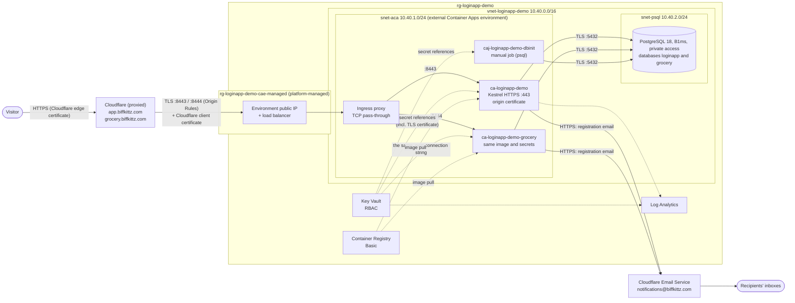
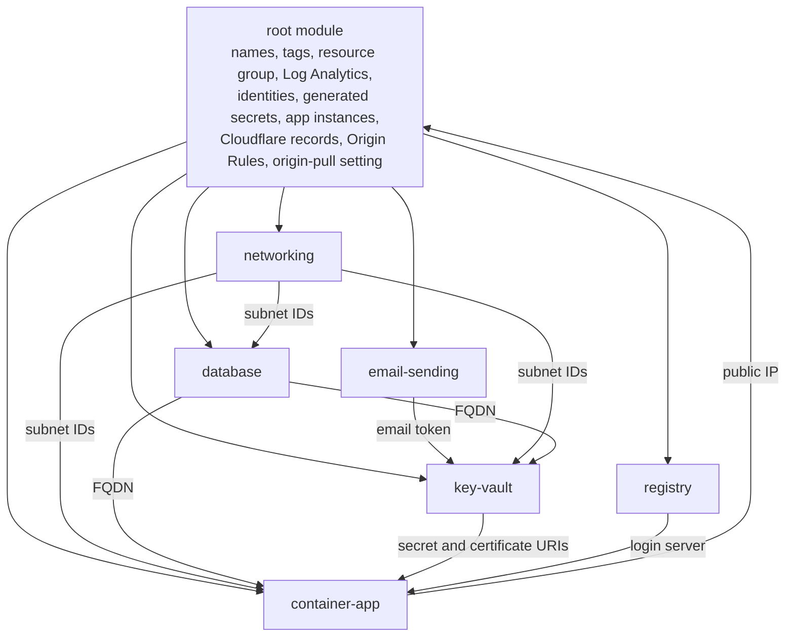

# Architecture

How Nibbles (the app's code still calls itself the Login App) runs in Azure: the request path, the network, identities, secrets and DNS, and why each part is
built the way it is. For the application's own design (authentication flow, security headers, forwarded headers),
see the app's [docs/ARCHITECTURE.md](../../docs/ARCHITECTURE.md).

- [Overview](#overview)
- [Request path](#request-path)
- [Network](#network)
- [Identities and access](#identities-and-access)
- [Secrets and certificates](#secrets-and-certificates)
- [DNS and Cloudflare settings](#dns-and-cloudflare-settings)
- [Terraform structure](#terraform-structure)
- [Design decisions](#design-decisions)
- [Well-Architected Framework alignment](#well-architected-framework-alignment)
- [Cost](#cost)
- [Limitations and possible next steps](#limitations-and-possible-next-steps)

## Overview

| Component | Resource | Purpose |
| --- | --- | --- |
| Edge | Cloudflare (proxied DNS record, Authenticated Origin Pulls) | Visitor-facing TLS, DDoS protection and Cloudflare's security features; hides the origin IP; presents a client certificate to the origin |
| Compute and entry point | Container Apps environment (workload profiles, external) + a Container App with TCP ingress per instance of the app: `ca-loginapp-demo` (app.biffkittz.com) and `ca-loginapp-demo-grocery` (grocery.biffkittz.com) | Public IP for Cloudflare; each runs the app image (exactly one replica, 0.5 vCPU, 1 GiB), terminates TLS itself and hosts its own realtime hub (SignalR over WebSockets) |
| One-off task | Container Apps job | Creates the app's least-privilege database role and lets it into every instance's database |
| Data | Azure Database for PostgreSQL flexible server (B1ms, PostgreSQL 18) + databases `loginapp` and `grocery` | Each instance's data, in a database of its own; private IP only |
| Secrets | Key Vault (RBAC) | A connection string per instance; the JWT signing key, Gemini API key, database passwords and TLS certificate, shared by the instances |
| Images | Azure Container Registry (Basic) | The app's images |
| Observability | Log Analytics workspace | Container logs, Key Vault audit events |
| Email | Cloudflare Email Service: `biffkittz.com` onboarded for Email Sending, the recipients as verified destination addresses, an account token for Email Sending | Emails `registration_notification_recipients` from notifications@biffkittz.com whenever someone registers on either instance |

## Request path

The path is the same for both instances; only the host name and port differ (grocery.biffkittz.com uses 8444).

1. The browser resolves `app.biffkittz.com` to Cloudflare's anycast addresses (the record is proxied), and Cloudflare
   terminates the TLS connection with its edge certificate.
2. Cloudflare connects to the environment's public IP on TCP **8443** (an Origin Rule changes the port; visitors use
   443), sending SNI and Host `app.biffkittz.com`, and presents its **Authenticated Origin Pulls** client certificate.
3. The Container Apps ingress checks its IP restrictions (Cloudflare's IPv4 ranges) and, because the app uses **TCP
   ingress**, passes the connection through to the container on 443 without decrypting it.
4. Kestrel terminates TLS (1.2 or 1.3) with the Cloudflare origin certificate, which Cloudflare verifies under the
   zone's **Full (strict)** mode. During the same handshake Kestrel checks Cloudflare's client certificate against
   the origin-pull CA built into the image, and aborts the handshake if it doesn't chain to it. A connection that
   presents no certificate gets only the health endpoints; every other path answers 403.
5. The app accepts the connection only from an internal peer (the ingress proxy). It takes the visitor's IP from the
   `X-Forwarded-For` header Cloudflare added and uses it for rate limiting and logs.
6. The app connects to PostgreSQL's private IP with `SSL Mode=VerifyFull`. The PostgreSQL subnet's NSG admits only
   the Container Apps subnet on 5432.

The grocery list's realtime connection (a WebSocket to `/api/grocery-list/hub`) follows the same path: Cloudflare
proxies WebSockets (the zone's WebSockets setting, on by default) and the TCP ingress passes the upgraded connection
through like any other. SignalR's keep-alive pings every 15 seconds stop Cloudflare or the ingress from closing it
as idle.

The platform's health probes connect to the container directly over HTTPS on 443. They present no client
certificate, which is why `/health/live` and `/health/ready` are the exception in step 4.

## Network

| Subnet | Prefix | Holds | Delegation | Service endpoints | Inbound allowed (everything else is denied) |
| --- | --- | --- | --- | --- | --- |
| `snet-aca` | 10.40.1.0/24 | Container Apps environment | `Microsoft.App/environments` | `Microsoft.KeyVault` | TCP 8443 and 8444 (every instance's exposed port) and 30000-32767 from Cloudflare IPv4 ranges (+ `ingress_additional_allowed_cidrs`); Azure Load Balancer; within the subnet |
| `snet-psql` | 10.40.2.0/24 | PostgreSQL flexible server | `Microsoft.DBforPostgreSQL/flexibleServers` | `Microsoft.Storage` | TCP 5432 from `snet-aca`; Azure Load Balancer; within the subnet |

- **The NSG can't fence the public ingress.** In an external workload-profiles environment, internet traffic reaches
  the app through the public IP in the managed resource group, and Microsoft documents that it isn't subject to the
  subnet's NSG ([Securing a virtual network](https://learn.microsoft.com/azure/container-apps/firewall-integration)).
  The `AllowAppIngressInbound` rule therefore documents intent and would apply if the platform ever routed that
  traffic through the subnet. The controls that do apply are the ingress IP restrictions and the client certificate
  (see [Only Cloudflare may reach the app](#only-cloudflare-may-reach-the-app)).
- Each NSG ends with an explicit **VirtualNetwork** deny rule. That overrides Azure's default `AllowVnetInBound` rule,
  which would otherwise let any address in the VNet (or a peered VNet) reach every subnet.
- The `VirtualNetwork` service tag also covers the Azure host address 168.63.129.16, where load balancer probes come
  from. That is why each subnet re-allows `AzureLoadBalancer` ahead of its deny rule.
- Outbound traffic keeps the platform defaults. Every service needs to reach Microsoft Entra ID, container
  registries, Azure Storage and Azure Monitor. Locking egress down would take user-defined routes and Azure Firewall;
  see [Limitations](#limitations-and-possible-next-steps).
- The address space sits in 10.0.0.0/8, which the app trusts as internal by default (`Network:InternalNetworks`).
  It also avoids the ranges Container Apps reserves: `100.100.0.0/17`, `100.100.128.0/19`, `100.100.160.0/19`,
  `100.100.192.0/19`, `172.30.0.0/16`, `172.31.0.0/16`, `192.0.2.0/24` and `169.254.0.0/16`. 10.40.0.0/24 is
  unused; it held the Application Gateway subnet in an earlier version.

## Identities and access

Each workload has its own user-assigned managed identity, granted exactly what it uses. User-assigned identities
exist before the resources that use them, so their role assignments can be created and propagated before the
Container App or job first needs them. A system-assigned identity only exists once its resource does.

| Principal | Role | Scope | Why |
| --- | --- | --- | --- |
| `id-loginapp-demo-app` (the app) | AcrPull | the registry | Pull the app image |
| | Key Vault Secrets User | secrets `ConnectionStrings--DefaultConnection`, `grocery-db-connection-string`, `Jwt--SigningKey` and (with a Gemini key) `ImageGeneration--ApiKey`, and the certificate's secret | Its secrets and its TLS certificate, nothing else. Both instances run as this identity |
| `id-loginapp-demo-dbinit` (bootstrap job) | Key Vault Secrets User | secrets `postgresql-admin-password` and `postgresql-app-password` | The only identity that can read the administrator password |
| Whoever runs Terraform | Key Vault Secrets Officer, Key Vault Certificates Officer | the vault | Create and update secrets and import the certificate; Terraform grants these itself |

Running Terraform requires **Owner**, or **Contributor** plus **Role Based Access Control Administrator**, on the
subscription. [AUTHENTICATION.md](AUTHENTICATION.md) explains why and covers CI identities.

New role assignments take a minute or two to take effect, so the configuration waits `rbac_propagation_wait` (90 s)
after creating them. The `time` provider does the waiting: the Key Vault and registry modules expose their outputs
only after the wait.

## Secrets and certificates

| Key Vault object | Generated by | Read by | Contents |
| --- | --- | --- | --- |
| `ConnectionStrings--DefaultConnection` | Terraform (composed) | app (main instance) | `Host=<server>.postgres.database.azure.com;Port=5432;Database=loginapp;Username=loginapp_app;Password=…;SSL Mode=VerifyFull` |
| `grocery-db-connection-string` | Terraform (composed) | app (grocery instance) | The same, with `Database=grocery`. One such secret per additional instance |
| `Jwt--SigningKey` | `random_bytes` (64 bytes, Base64) | app | HMAC-SHA256 signing key for session tokens |
| `ImageGeneration--ApiKey` | you (`TF_VAR_gemini_api_key`); only when given | app | Google Gemini API key for AI pictures of items and cost estimates |
| `Email--ApiToken` | `cloudflare_account_token` (module `email-sending`); only with registration email recipients | app | Cloudflare account token limited to Email Sending (sending, and managing sending domains) |
| `postgresql-admin-password` | `random_password` (32 characters) | bootstrap job | Server administrator password |
| `postgresql-app-password` | `random_password` (40 alphanumerics) | bootstrap job | Password the job sets on `loginapp_app` |
| certificate `app-biffkittz-com-origin` | imported from your PFX | app | Cloudflare origin certificate and private key |

- **How the app receives them.** The app gets its secrets as Container Apps Key Vault references, which the platform
  resolves with the app's identity and exposes as environment variables: `ConnectionStrings__DefaultConnection`,
  `Jwt__SigningKey`, `OriginTls__CertificatePfxBase64`, `ImageGeneration__ApiKey` when there is a Gemini key, and
  `Email__ApiToken` when registration emails are on. A Key Vault certificate is served through a secret of the
  same name, whose value is the PFX in Base64 without a password; the app loads it at startup and refuses to start
  if it can't (no private key, expired, unreadable).
- **Rotation.** The references carry no version. A new secret or certificate version therefore reaches the app
  within 30 minutes, and Container Apps restarts the revision so the app re-reads it.
- **Remote state.** The generated values and the PFX are also stored, marked sensitive, in the remote state blob.
  Treat read access to the state container like read access to the vault (see
  [AUTHENTICATION.md](AUTHENTICATION.md#remote-state)). Write-only attributes plus ephemeral values would keep them out
  of state, but those values aren't stable across runs. A partial failure could then leave the server's password and
  the vault's copy out of sync, so stable `random_*` resources were chosen.
- **The app's configuration provider.** The app could also read Key Vault itself (`KeyVault__Uri`), but that provider
  loads every secret in the vault. Key Vault references, scoped to the app's own secrets, are the least-privilege
  option.

## DNS and Cloudflare settings

| Zone | Type | Records | Purpose |
| --- | --- | --- | --- |
| `biffkittz.com` (Cloudflare) | public | `app` and `grocery` A → environment public IP, **proxied** | Public names of the app's two instances |
| `biffkittz.com` (Cloudflare) | public | Created and locked by Cloudflare Email Service, not Terraform: `cf-bounce` MX ×3 and SPF TXT, `cf-bounce._domainkey` TXT (DKIM), `_dmarc` TXT | Sending from notifications@biffkittz.com: bounces return to Cloudflare, and receivers can check the mail is genuine |
| `<server>.private.postgres.database.azure.com` | private, linked to the VNet | managed by the PostgreSQL service | Makes `<server>.postgres.database.azure.com` resolve to the server's private IP |

Terraform turns on one zone setting: **Authenticated Origin Pulls** (`tls_client_auth`, the "global" variant), so
Cloudflare presents its client certificate to the origin. It is zone-wide, but harmless to other records: an origin
that doesn't ask for a client certificate never sees it. `require_cloudflare_client_certificate = false` turns the
requirement off in both Cloudflare and the app.

Terraform also owns the zone's **Origin Rules** ruleset (`cloudflare_ruleset.origin_port`), with a rule per instance:
requests for `app.biffkittz.com` go to the origin on `app_exposed_port` (8443), and requests for
`grocery.biffkittz.com` on 8444, instead of 443. Both names point at the same IP; the port is what reaches the right
Container App. A zone has a single ruleset for this phase, so Origin Rules for other hostnames belong in that
resource too.

The other zone-wide settings aren't managed here, because they would affect every other record in `biffkittz.com`.
Set them once in the dashboard:

- SSL/TLS encryption mode **Full (strict)**;
- **Always Use HTTPS**;
- **Minimum TLS Version 1.2**.

With *Flexible*, Cloudflare would call the origin over plain HTTP. Nothing listens for HTTP, so that would fail.

## Terraform structure

| Module | Owns |
| --- | --- |
| `networking` | VNet, subnets (delegations and service endpoints), one NSG per subnet with its rules |
| `registry` | Container registry, AcrPull role assignments, propagation wait |
| `key-vault` | Vault, secrets, certificate import, per-secret role assignments, propagation waits, audit diagnostics |
| `database` | PostgreSQL flexible server (private access), private DNS zone and link, a database per instance, TLS enforcement |
| `container-app` | External environment, a Container App with TCP ingress per instance, the bootstrap job and its script |
| `email-sending` | Cloudflare only: the domain onboarded for Email Sending, the recipients as destination addresses, the app's account token for Email Sending (exists only with recipients) |

Module outputs that something must wait for are gated on that event with `depends_on`. Subnet IDs appear once their
NSG is attached, and secret URIs once read access has propagated. Consumers therefore don't start too early, and no
ordering hints are needed at the call sites. The one explicit `depends_on` in the root module makes the DNS records
wait for Authenticated Origin Pulls and the Origin Rules, so traffic never reaches an app that would refuse it, or the
wrong port.

## Design decisions

### No Application Gateway: TLS ends in the container

An earlier version put Application Gateway Standard_v2 in front of an internal environment. It cost about $150 a
month, most of the total, so it was removed.

**Why TCP ingress.** Container Apps offers two kinds of ingress:
- **HTTP ingress** always decrypts TLS in the platform's proxy and sends HTTP to the container;
- **TCP ingress** passes the connection through, so the container terminates TLS.

The requirement was TLS termination in the container with the Cloudflare origin certificate, so the app uses TCP
ingress: exposed port 8443, target port 443. Kestrel listens for HTTPS only (`ASPNETCORE_URLS=https://+:443`), and the
image's `CAP_NET_BIND_SERVICE` capability lets the non-root user bind 443.

**Why 8443 outside.** Even with no HTTP app, an environment's HTTP ingress holds ports 80 and 443 on its public IP;
Azure rejects a TCP app on 443 with "exposedPort already in use". A Cloudflare Origin Rule (free on every plan) makes
Cloudflare connect on 8443 instead, so visitors still use plain `https://app.biffkittz.com`.

**What changes.**
- **Every hop is encrypted:** visitor to Cloudflare, Cloudflare to the container, the app to PostgreSQL.
- **The environment is external.** It gets a public IP; changing this replaced the environment, the app and the job.
- **HTTP-ingress features don't apply:** host-name routing, HTTP/2 negotiation by the platform, custom domains,
  session affinity. None are used here.

**The alternative.** HTTP ingress with `app.biffkittz.com` as a custom domain and the same certificate from Key Vault
would need no app code. TLS would then end in the platform's proxy, and checking Cloudflare's client certificate
would be awkward (the proxy forwards it in a header). It wasn't chosen because TLS was to end in the container.

### Only Cloudflare may reach the app

The environment's public IP is reachable from the whole internet, and an NSG can't change that (see
[Network](#network)). Two controls keep everyone but Cloudflare out:

1. **Authenticated Origin Pulls (the strong control).** Cloudflare presents a client certificate on every connection
   to the origin. Kestrel asks every client for one and validates it against the Cloudflare origin-pull CA embedded
   in the image (SHA-256 fingerprint `9A:1A:C2:B4:…:A2:B9`, valid until 2029-11-01): it must chain to that CA alone
   (not to any public root), be within its validity period and allow client authentication. A wrong certificate
   aborts the handshake; no certificate gets a 403 for everything but the health endpoints.
2. **Ingress IP restrictions.** The app's ingress allows only Cloudflare's IPv4 ranges, read at plan time from the
   Cloudflare provider's `cloudflare_ip_ranges` data source, plus `ingress_additional_allowed_cidrs`. Microsoft's
   documentation doesn't say whether IP restrictions apply to TCP ingress, so the client certificate doesn't rely on
   them. During the rollout tracked in
   [microsoft/azure-container-apps#1666](https://github.com/microsoft/azure-container-apps/issues/1666) (until about
   March 2027), connections can appear to come from the platform's infrastructure ranges, so those ranges are allowed
   too (`container_apps_transitional_ingress_cidrs`); set that variable to `[]` once Microsoft announces the rollout
   is complete.

**The limit of global Authenticated Origin Pulls.** The certificate is shared by all Cloudflare accounts. It proves a
connection came from Cloudflare, not from *your* zone: someone could point their own proxied Cloudflare record at
this IP. They would still pass through Cloudflare's edge, and Cloudflare would still set `X-Forwarded-For` to the real
client. **Zone-level** Authenticated Origin Pulls closes the gap: you create your own CA and client certificate,
upload the client certificate to Cloudflare (`cloudflare_authenticated_origin_pulls_certificate` and
`cloudflare_authenticated_origin_pulls_settings`), and replace the CA embedded in the app
(`app/backend/Infrastructure/Tls/cloudflare-origin-pull-ca.pem`). It needs a certificate you manage and renew, which
is why it isn't the default.

**When Cloudflare publishes new ranges,** the next `plan` shows the IP restrictions and the NSG rule changing; apply
it. **When Cloudflare replaces its origin-pull CA** (the current one expires on 2029-11-01), update the PEM file in
the app and release a new image before the switch.

### The visitor's real IP

The app trusts `X-Forwarded-For` hops only from `Network:InternalNetworks`, and its per-IP rate limiting and logs
depend on finding the real visitor address.

**How it works.** The TCP peer the app sees is the Container Apps ingress proxy, an internal address. Cloudflare
appends the visitor's address to `X-Forwarded-For`. The app walks the header back past trusted hops and stops at
the first untrusted one: the visitor. Since TLS is passed through, the ingress can't add or change headers.

**Why it is safe.** Only connections with Cloudflare's client certificate get past the health endpoints, so the
header on every other request was written by Cloudflare. Without that check, anyone connecting directly could forge
the header and pick their rate-limit bucket; that is one more reason the check matters.

**Cloudflare's ranges are also trusted** (`Network__InternalNetworks__100+`; index 100 and up leaves the defaults in
`appsettings.json` in place). They matter only if the ingress ever hands over Cloudflare's address as the peer
instead of its own. The same setting guards the TCP peer, but every connection already comes through the ingress,
so they open nothing.

### PostgreSQL: private access instead of service endpoints

**The question.** You asked whether service endpoints could keep the app-to-database traffic on Microsoft's network.

**Why not service endpoints.** Azure Database for PostgreSQL flexible server doesn't support them. Virtual network
service endpoint rules existed only for the retired Single Server. Flexible server offers two network models:

- **private access** (VNet integration);
- **public access**, optionally with a private endpoint.

**The choice.** This configuration uses private access. The server is injected into the delegated `snet-psql` subnet
and gets a private IP, and **it has no public endpoint at all**. Traffic from the app never leaves the VNet. That
goes further than a service endpoint, which keeps traffic on the backbone but leaves the server's public endpoint
reachable. Clients use the normal host name, which the linked private DNS zone resolves to the private IP, so
`SSL Mode=VerifyFull` still matches the certificate.

**Where service endpoints are still used.** The `Microsoft.KeyVault` endpoint on the Container Apps subnet keeps Key
Vault calls on the backbone and makes the optional vault firewall possible.

**Trade-off.** A server's network model can't be changed after creation; switching would mean a new server and a
data migration.

### Key Vault network access

**Defaults.**
- **Access control:** RBAC with per-secret assignments.
- **Deletion:** purge protection on, and 7-day soft-delete retention (the minimum), so a destroyed demo is recoverable
  for a week.
- **Network:** the public endpoint is enabled and unfiltered, so every request relies on Microsoft Entra ID
  authentication plus an RBAC role.

**Why the firewall is off by default.**
- Container Apps isn't a "trusted Microsoft service" for the vault firewall.
- Microsoft doesn't document whether the platform resolves Key Vault references through the environment's subnet.
- An open issue reports Container Apps **jobs** failing to resolve references
  ([microsoft/azure-container-apps#1804](https://github.com/microsoft/azure-container-apps/issues/1804)).
- Terraform itself needs data-plane access to the vault from wherever it runs.

**Turning it on.** `key_vault_firewall_enabled = true` gives a default-deny firewall that allows:
- the Container Apps subnet (via its service endpoint);
- trusted services;
- `key_vault_allowed_ip_ranges`, for your workstation or CI.

Test the app and the bootstrap job after enabling it. The most robust hardening would be a private endpoint for the
vault plus a self-hosted CI agent inside the VNet.

### A dedicated, least-privilege database role

**What it does.** The app never connects as the server administrator. A manually triggered Container Apps job,
`caj-loginapp-demo-dbinit`, runs
[`modules/container-app/scripts/db-bootstrap.sh`](../modules/container-app/scripts/db-bootstrap.sh) from inside the
VNet. That is the only place the private server can be reached from.

**The resulting role.** `loginapp_app` gets:
- `LOGIN`, with no `CREATEDB`, `CREATEROLE` or superuser-like membership;
- `CONNECT` and `TEMPORARY` on each instance's database (`loginapp` and `grocery`);
- `USAGE` and `CREATE` on schema `public` in each of them.

`PUBLIC` loses `CONNECT`. Each instance applies its EF Core migrations at startup as this role, so it owns its own
tables. The job takes the databases from `APP_DATABASES`, so adding an instance means running it once more.

**Script safeguards.**
- It's idempotent, so re-running it after rotating the password is the rotation procedure.
- It passes values as psql variables, so they can't inject SQL.
- It verifies the server certificate (`verify-full`).

**Tests run.** It was exercised against PostgreSQL 18 twice:
- once with the database owned by the administrator;
- once with it owned by a group role, like Azure's `azure_pg_admin`.

Runs were repeated to confirm idempotency, and a hostile role name and password confirmed the injection protection.

**The job itself.** It uses Microsoft's Azure Linux PostgreSQL image from MCR, pinned to a dated tag, so there are no
Docker Hub rate limits. It runs under its own identity.

### Two-phase app deployment

A Container App's first revision fails to provision if its image doesn't exist. The app would also crash-loop
before its database role exists. So the Container Apps are created only once `app_image_tag` is set:

1. The first apply builds the platform.
2. You push an image and run the bootstrap job.
3. Setting the tag and applying again creates the apps (one per instance).

From then on, deploying a new version means changing the tag, which updates every instance. Removing the tag would
delete the Container Apps, which the plan shows clearly.

### Several instances in one environment

`additional_app_instances` (in `environments/demo.tfvars`: `grocery`) adds independent copies of the app. Each
instance is one more Container App in the same environment, running the same image, and has its own host name, data
and list; nobody signed in to one sees the other.

| Shared by every instance | Per instance |
| --- | --- |
| Container Apps environment and its public IP | Container App (`ca-loginapp-demo-<key>`), with its own exposed port |
| Image and tag (`app_image_tag`), CPU, memory, replica limits | Cloudflare DNS record and Origin Rule |
| The app identity, and through it the registry and Key Vault | Database on the PostgreSQL server |
| Key Vault secrets: JWT signing key, Gemini key, the app's database password | Key Vault secret with the connection string to that database |
| TLS certificate (`*.biffkittz.com` covers every host name) | `Jwt__Audience` (the host name; the main instance keeps the default) |
| Database role `loginapp_app`, bootstrap job | |

- **Why one environment.** A second environment would bring a second public IP and load balancer (about $22 a month)
  and a second subnet for nothing: TCP ingress gives each app its own port on the shared IP, and Cloudflare's Origin
  Rules route each host name to its port.
- **Why a per-instance audience.** The instances share the JWT signing key, so a token one of them issued would pass
  the other's signature check. Each additional instance names itself as its tokens' audience, which the other doesn't
  accept. Accounts are separate anyway (each instance has its own users table), but this keeps a session to its own
  site. The main instance keeps the default audience, so adding an instance doesn't sign its users out.
- **The trade-off of sharing the role.** Both instances connect as `loginapp_app` with the same password, so the role
  can open either database: a compromised instance could read the other's data. Sharing the secrets was the
  requirement; separate roles (a password and bootstrap step each) would isolate the instances from each other.
- **Adding one** creates the database, connection string and app in one apply. The new app can't connect until the
  bootstrap job has let the role into its database, so it restarts until then; see
  [DEPLOYMENT.md](DEPLOYMENT.md#adding-an-instance).
- **The main instance's addresses.** Before instances existed, its Container App and DNS record had no key. `moved`
  blocks in `main.tf` map them to the `"main"` key, so the first plan with this version reports them as moved, and
  nothing is replaced.

### Registration emails through Cloudflare Email Service

Whenever someone registers on either instance, the app emails `registration_notification_recipients` from
notifications@biffkittz.com, with the subject "[grocery app] new registration detected": which site, when, and the
name the person typed (not their email address). The app queues the email and a background worker sends it, so
registering never waits for it or fails because of it. The app side is described in the app's
[ARCHITECTURE.md](../../docs/ARCHITECTURE.md).

- **Why Cloudflare.** biffkittz.com already receives mail through another host (MXroute: its MX records and an SPF
  record with `include:mxlogin.com`), so the service must leave those alone. Cloudflare Email Service puts what it
  needs on `cf-bounce.biffkittz.com` and the DKIM key at `cf-bounce._domainkey`, not on the domain's own MX or SPF.
  Azure Communication Services Email was the other candidate the allowed providers cover. It was passed over because
  Microsoft announced in September 2026 that it retires on 30 September 2028 and advises against new setups, because
  it would need the domain's own SPF record (managed by hand for MXroute) rewritten, and because a domain has to be
  verified by hand before it can be linked. Cloudflare Email Routing would have replaced the domain's MX records.
- **Everything is Terraform** (module `email-sending`): onboarding the domain, the recipients as verified destination
  addresses, and the app's API token, which is account-owned, holds only the email sending permission, and goes
  through Key Vault like every other secret. Cloudflare creates and locks the DNS records itself, because the zone is
  on Cloudflare. Two steps stay manual, both once: the deploying token needs the permissions to do this
  ([AUTHENTICATION.md](AUTHENTICATION.md#cloudflare)), and each recipient follows the confirmation link Cloudflare
  emails it.
- **Why verified destination addresses.** Sending to them is free on every Cloudflare plan and outside the sending
  quota, and on the Workers Free plan they are the only addresses Email Sending reaches. Since the recipients are the
  site's own people, nothing more is needed.
- **DMARC.** Onboarding adds a DMARC record at `_dmarc.biffkittz.com` with Cloudflare's policy (`p=reject` in its
  documentation). It applies to all mail from the domain, including MXroute's, which signs its mail with DKIM (selector
  `x`) and passes. Mail that is neither DKIM-signed for biffkittz.com nor sent from a host in its SPF record would now
  be rejected by receivers that honour DMARC.
- **Privacy.** The emails name the person who registered, so Cloudflare's previews of sent messages are turned off
  (`preview_enabled = false`). Cloudflare still processes each email to deliver it.
- **Testing.** `terraform test` mocks can't return a list from a data source (computed lists come back empty), so the
  module takes Cloudflare's permission catalogue as an input. Its tests (`tests/email-sending.tftest.hcl`) choose from
  catalogues of their own, and the root tests replace the module's outputs to check how the token reaches the app.

### Smaller choices

- **Workload profiles environment, Consumption profile.** This is the current environment type. It supports a /27
  subnet, NSGs and private endpoints, and is billed per use. External TCP ingress requires an environment in a
  custom virtual network, which this is.
- **Exactly one replica, no zone redundancy for the app or database.** The realtime hub is SignalR inside the app,
  with no backplane (Azure SignalR Service was ruled out by the requirements), so it only reaches clients connected
  to its own replica. `app_max_replicas` is therefore validated to be 1. The database runs on Burstable B1ms, the
  smallest size, which offers no high availability.
- **No WAF.** Cloudflare filters traffic at the edge; its WAF rules apply before anything reaches Azure.
- **Container Registry Basic.** No network rules or private endpoints exist on this SKU, so its endpoint is public.
  The admin user is disabled; pulls use Entra ID only.
- **Kestrel on port 443 as a non-root user.** The image grants the `dotnet` binary `CAP_NET_BIND_SERVICE`. If Container
  Apps refuses file capabilities (the container exits with `SocketException (13): Permission denied`), set
  `app_target_port = 8443`. Terraform then also sets `ASPNETCORE_URLS` and the probes; the exposed port is unaffected.
- **Deterministic name suffix.** Globally unique names (Key Vault, registry, PostgreSQL) end with 6 hex characters
  derived from the subscription, project and environment. Names are therefore known at plan time and stable across
  runs; override them with `name_suffix`.
- **Explicit resource provider registration.** azurerm 5 registers nothing by default, so the provider registers the
  eight namespaces this configuration uses.

## Well-Architected Framework alignment

Measured against Microsoft's
[Azure Container Apps service guide](https://learn.microsoft.com/azure/well-architected/service-guides/azure-container-apps).

| Recommendation | Status | Notes |
| --- | --- | --- |
| Deploy into a custom VNet | Applied | Workload profiles; the database is private |
| Internal environment behind Application Gateway with WAF | Not applied | Removed for cost; Cloudflare is the edge, and the client certificate restricts the origin to Cloudflare |
| NSG rules on the environment's subnet | Partly | Present, but Microsoft documents that public inbound traffic to an external environment bypasses them |
| Managed identities for Azure resources | Applied | User-assigned, one per workload |
| Key Vault for secrets and certificates | Applied | Key Vault references; per-secret RBAC; certificate from Key Vault |
| Entra ID authentication to the registry, no admin user | Applied | AcrPull with the app's identity |
| Startup, liveness and readiness probes | Applied | Over HTTPS; startup allows 3 minutes for migrations; liveness ignores the database |
| Logs to Log Analytics | Applied | Container logs, Key Vault audit logs |
| Consistent tagging; infrastructure as code | Applied | `project`, `environment`, `managed_by` on every taggable resource |
| Encryption in transit on every hop | Applied | TLS from the visitor to the container and from the app to PostgreSQL |
| At least three replicas and availability zones | Not applied | One replica, as required for the demo and by the in-process realtime hub |
| Egress control with UDRs and a firewall | Not applied | Cost; see limitations |
| Defender for Containers image scanning | Not applied | Cost; consider for production |

## Cost

Approximate monthly cost of the demo, from the
[Azure Retail Prices API](https://learn.microsoft.com/rest/api/cost-management/retail-prices/azure-retail-prices) on
2026-11-05 (`eastus` list prices, USD, 730 hours; `centralus` is similar). Check
[Azure Cost Management](https://portal.azure.com/#view/Microsoft_Azure_CostManagement/Menu/~/overview) for actuals.

| Resource | Rate | Per month |
| --- | --- | --- |
| PostgreSQL B1ms | $0.017/hour + $0.115/GB-month storage (32 GB) | ≈ $12.41 + $3.68 |
| Container Apps, one per instance (1 replica, 0.5 vCPU, 1 GiB, always on, ×2) | Idle: $0.000003/vCPU-s and /GiB-s; active: $0.000024/vCPU-s; monthly free grant (shared) | ≈ $10 (mostly idle) to $34 (always busy) each |
| Environment's managed load balancer and public IP | Standard Load Balancer and public IP, billed in the managed resource group | ≈ $18 + $3.65 (published rates; not returned by the Retail Prices API) |
| Container Registry Basic | $0.1666/day | ≈ $5.07 |
| Private DNS zone (PostgreSQL) | $0.50/zone | $0.50 |
| Key Vault, Log Analytics, Cloudflare | Per operation; first 5 GB of logs free; free plan | ≈ $0 |
| Cloudflare Email Service | Free for verified destination addresses, which the recipients are, on every plan | $0 |
| **Total** | | **≈ $65–115** with two instances (each further instance adds ≈ $10–34) |

AI pictures are billed by Google, not Azure: about $0.034 per picture with the default model
(`gemini-3.1-flash-lite-image`, list price on 2026-11-09). A family adding a few dozen new item names a month spends
around a dollar, since items with a name seen before reuse its picture. The app's daily limit (100 pictures) caps the
worst case at about $3.40 a day.

Cost estimates (the Estimate Cost button) use the same key with a text model, Gemini 3.1 Flash-Lite, billed per
token: roughly $0.25 per million input tokens and $1.50 per million output tokens (a third-party listing on
2026-11-10; check Google's pricing page). A family-sized list costs a fraction of a cent to price. The app allows 500
estimates a day per instance, which caps a runaway at about a dollar a day for lists of a few dozen items, and about
$13 a day if every estimate priced a full 500-item list.

Registration emails are free while they go only to verified destination addresses. Emailing other addresses would
need the Workers Paid plan ($5 a month with 3,000 emails, then $0.35 per 1,000; Cloudflare's pricing page on
2026-11-10).

Removing Application Gateway saved about $150 a month (its fixed charge, its public IP and one private DNS zone).

Microsoft added an "Environment Management Hour" meter ($0.10/hour, about $73/month) for Container Apps environments
in September 2026. It isn't clear from the public documentation whether it applies to a Consumption-only workload
profiles environment, so check your first invoice.

When the demo isn't needed, `terraform destroy` removes everything; see [DEPLOYMENT.md](DEPLOYMENT.md#teardown).

## Limitations and possible next steps

- **Global Authenticated Origin Pulls proves "from Cloudflare", not "from this zone".** Zone-level Authenticated
  Origin Pulls with your own certificate closes that (see above).
- **IP restrictions on TCP ingress are undocumented.** The client certificate is the control that is relied on.
- **No egress filtering.** Outbound traffic uses the platform defaults; the app's only outbound calls go to the
  Gemini API (`generativelanguage.googleapis.com`) for item pictures and cost estimates, and to Cloudflare's API (`api.cloudflare.com`)
  for registration emails. For production, route egress through Azure Firewall with user-defined routes and allow
  just those hosts. Workload profile environments support this, and a fixed egress IP would also let the email token
  be limited to it (`condition.request_ip`).
- **Cloudflare Email Sending is in public beta** (since April 2026). Its API or limits may change before general
  availability; the app logs every failed email (events 1105-1107), and a registration never depends on its email.
- **Registration emails wait in memory.** One queued in the seconds before a restart gets ten seconds to go out, then
  is lost (and logged). Registrations are rare, so a table for them wasn't worth it.
- **Key Vault and the registry have public endpoints.** Private endpoints need Premium for the registry, and a CI
  agent inside the VNet.
- **The instances share one database role.** See [Several instances in one environment](#several-instances-in-one-environment)
  for why, and what separate roles would take.
- **One replica and Burstable PostgreSQL.** There is no high availability. More replicas first need a SignalR
  backplane (Redis, for example); then raise the replica counts, and move PostgreSQL to General Purpose with
  zone-redundant high availability for production.
- **The app setting `Network:InternalNetworks` serves two purposes,** guarding the TCP peer and trusting proxies.
  Splitting it would make the Cloudflare configuration more explicit.
