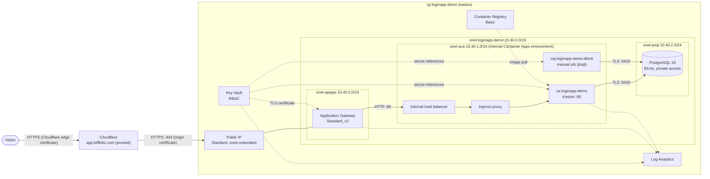
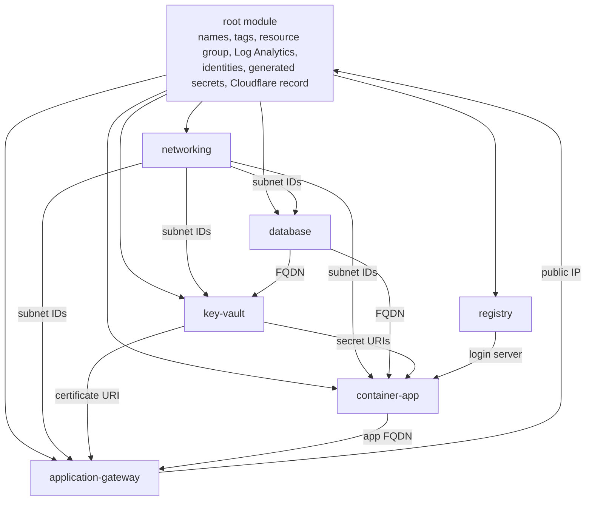

# Architecture

How the Login App runs in Azure: the request path, the network, identities, secrets and DNS, and why each part is
built the way it is. For the application's own design (authentication flow, security headers, forwarded headers),
see the app's [docs/ARCHITECTURE.md](../../docs/ARCHITECTURE.md).

- [Overview](#overview)
- [Request path](#request-path)
- [Network](#network)
- [Identities and access](#identities-and-access)
- [Secrets and certificates](#secrets-and-certificates)
- [DNS](#dns)
- [Terraform structure](#terraform-structure)
- [Design decisions](#design-decisions)
- [Well-Architected Framework alignment](#well-architected-framework-alignment)
- [Cost](#cost)
- [Limitations and possible next steps](#limitations-and-possible-next-steps)

## Overview

| Component | Resource | Purpose |
| --- | --- | --- |
| Edge | Cloudflare (proxied DNS record) | Visitor-facing TLS, DDoS protection and Cloudflare's security features; hides the origin IP |
| Entry point | Application Gateway Standard_v2 + static public IP | Terminates the origin TLS connection; routes to the Container App |
| Compute | Container Apps environment (workload profiles, internal) + Container App | Runs the Login App image: one replica, 0.5 vCPU, 1 GiB |
| One-off task | Container Apps job | Creates the app's least-privilege database role |
| Data | Azure Database for PostgreSQL flexible server (B1ms, PostgreSQL 18) + database `loginapp` | The app's data; private IP only |
| Secrets | Key Vault (RBAC) | Connection string, JWT signing key, database passwords, TLS certificate |
| Images | Azure Container Registry (Basic) | The app's images |
| Observability | Log Analytics workspace | Container logs, gateway access logs, Key Vault audit events |

## Request path

1. The browser resolves `app.biffkittz.com` to Cloudflare's anycast addresses (the record is proxied), and Cloudflare
   terminates the TLS connection with its edge certificate.
2. Cloudflare connects to the gateway's public IP on 443, sending SNI and Host `app.biffkittz.com`. With the zone's
   SSL/TLS mode on **Full (strict)**, it verifies the gateway's certificate: a Cloudflare Origin CA certificate for
   `*.biffkittz.com`. The gateway subnet's NSG accepts 443 only from Cloudflare's published IPv4 ranges.
3. Application Gateway terminates TLS with the certificate from Key Vault, using TLS 1.2 or 1.3 under the
   `AppGwSslPolicy20220101S` policy. Its multi-site listener matches `app.biffkittz.com`. It then forwards **plain
   HTTP on port 80** to `ca-loginapp-demo.<environment default domain>`, with that name as the Host header, because
   the Container Apps ingress routes by host name. It adds `X-Forwarded-For` (Cloudflare's edge address) and
   `X-Forwarded-Proto: https`.
4. The private DNS zone for the environment's default domain resolves that name to the internal load balancer. The
   Container Apps subnet's NSG admits only the gateway subnet (TCP 80 and 31080). The ingress checks its IP
   restrictions and forwards the request to the container on port 80.
5. Kestrel serves the API and the SPA. The app accepts the connection only from an internal peer (the ingress
   proxy). It then walks `X-Forwarded-For` back through the trusted hops (ingress, gateway, Cloudflare edge) to find
   the visitor's IP, which it uses for rate limiting and logs.
6. The app connects to PostgreSQL's private IP with `SSL Mode=VerifyFull`. The PostgreSQL subnet's NSG admits only
   the Container Apps subnet on 5432.

## Network

| Subnet | Prefix | Holds | Delegation | Service endpoints | Inbound allowed (everything else is denied) |
| --- | --- | --- | --- | --- | --- |
| `snet-appgw` | 10.40.0.0/24 | Application Gateway | none | `Microsoft.KeyVault` | TCP 443 from Cloudflare IPv4 ranges (+ `gateway_additional_allowed_cidrs`); GatewayManager TCP 65200-65535; Azure Load Balancer |
| `snet-aca` | 10.40.1.0/24 | Container Apps environment | `Microsoft.App/environments` | `Microsoft.KeyVault` | TCP 80 and 31080 from `snet-appgw`; Azure Load Balancer; within the subnet |
| `snet-psql` | 10.40.2.0/24 | PostgreSQL flexible server | `Microsoft.DBforPostgreSQL/flexibleServers` | `Microsoft.Storage` | TCP 5432 from `snet-aca`; Azure Load Balancer; within the subnet |

- Each NSG ends with an explicit deny rule: **Internet** for the gateway subnet, **VirtualNetwork** for the other
  two. That overrides Azure's default `AllowVnetInBound` rule, which would otherwise let any address in the VNet (or
  a peered VNet) reach every subnet.
- The `VirtualNetwork` service tag also covers the Azure host address 168.63.129.16, where load balancer probes come
  from. That is why each subnet re-allows `AzureLoadBalancer` ahead of its deny rule.
- The rules for the Container Apps subnet follow Microsoft's documented NSG requirements for workload profile
  environments. Port 31080 is where the environment's edge proxy answers HTTP behind the internal load balancer.
- Outbound traffic keeps the platform defaults. Every service needs to reach Microsoft Entra ID, container
  registries, Azure Storage and Azure Monitor. Locking egress down would take user-defined routes and Azure Firewall;
  see [Limitations](#limitations-and-possible-next-steps).
- The address space sits in 10.0.0.0/8, which the app trusts as internal by default (`Network:InternalNetworks`).
  It also avoids the ranges Container Apps reserves: `100.100.0.0/17`, `100.100.128.0/19`, `100.100.160.0/19`,
  `100.100.192.0/19`, `172.30.0.0/16`, `172.31.0.0/16`, `192.0.2.0/24` and `169.254.0.0/16`.

## Identities and access

Each workload has its own user-assigned managed identity, granted exactly what it uses. User-assigned identities
exist before the resources that use them, so their role assignments can be created and propagated before the
Container App, job or gateway first needs them. A system-assigned identity only exists once its resource does.

| Principal | Role | Scope | Why |
| --- | --- | --- | --- |
| `id-loginapp-demo-app` (the app) | AcrPull | the registry | Pull the app image |
| | Key Vault Secrets User | secrets `ConnectionStrings--DefaultConnection` and `Jwt--SigningKey` | Its two secrets, nothing else |
| `id-loginapp-demo-dbinit` (bootstrap job) | Key Vault Secrets User | secrets `postgresql-admin-password` and `postgresql-app-password` | The only identity that can read the administrator password |
| `id-loginapp-demo-agw` (gateway) | Key Vault Secrets User | the certificate's secret | Load the TLS certificate |
| Whoever runs Terraform | Key Vault Secrets Officer, Key Vault Certificates Officer | the vault | Create and update secrets and import the certificate; Terraform grants these itself |

Running Terraform requires **Owner**, or **Contributor** plus **Role Based Access Control Administrator**, on the
subscription. [AUTHENTICATION.md](AUTHENTICATION.md) explains why and covers CI identities.

New role assignments take a minute or two to take effect, so the configuration waits `rbac_propagation_wait` (90 s)
after creating them. The `time` provider does the waiting: the Key Vault and registry modules expose their outputs
only after the wait.

## Secrets and certificates

| Key Vault object | Generated by | Read by | Contents |
| --- | --- | --- | --- |
| `ConnectionStrings--DefaultConnection` | Terraform (composed) | app | `Host=<server>.postgres.database.azure.com;Port=5432;Database=loginapp;Username=loginapp_app;Password=…;SSL Mode=VerifyFull` |
| `Jwt--SigningKey` | `random_bytes` (64 bytes, Base64) | app | HMAC-SHA256 signing key for session tokens |
| `postgresql-admin-password` | `random_password` (32 characters) | bootstrap job | Server administrator password |
| `postgresql-app-password` | `random_password` (40 alphanumerics) | bootstrap job | Password the job sets on `loginapp_app` |
| certificate `app-biffkittz-com-origin` | imported from your PFX | gateway | Cloudflare origin certificate and private key |

- **How the app receives them.** The app gets its secrets as Container Apps Key Vault references, which the platform
  resolves with the app's identity and exposes as `ConnectionStrings__DefaultConnection` and `Jwt__SigningKey`
  environment variables.
- **Rotation.** The references carry no version. A new secret version therefore reaches the app within 30 minutes,
  and Container Apps restarts the revision so the app re-reads it. The gateway likewise follows new certificate
  versions (it checks every 4 hours, and immediately on any gateway change).
- **Remote state.** The generated values and the PFX are also stored, marked sensitive, in the remote state blob.
  Treat read access to the state container like read access to the vault (see
  [AUTHENTICATION.md](AUTHENTICATION.md#remote-state)). Write-only attributes plus ephemeral values would keep them out
  of state, but those values aren't stable across runs. A partial failure could then leave the server's password and
  the vault's copy out of sync, so stable `random_*` resources were chosen.
- **The app's configuration provider.** The app could also read Key Vault itself (`KeyVault__Uri`), but that provider
  loads every secret in the vault. Key Vault references, scoped to the app's two secrets, are the least-privilege
  option.

## DNS

| Zone | Type | Records | Purpose |
| --- | --- | --- | --- |
| `biffkittz.com` (Cloudflare) | public | `app` A → gateway public IP, **proxied** | Public name of the app |
| `<server>.private.postgres.database.azure.com` | private, linked to the VNet | managed by the PostgreSQL service | Makes `<server>.postgres.database.azure.com` resolve to the server's private IP |
| `<environment default domain>` | private, linked to the VNet | `*` and `@` A → environment static IP | Lets the gateway resolve `ca-loginapp-demo.<default domain>` |

Cloudflare's **zone-wide** settings aren't managed here, because they would affect every other record in
`biffkittz.com`. Set them once in the dashboard:

- SSL/TLS encryption mode **Full (strict)**;
- **Always Use HTTPS**;
- **Minimum TLS Version 1.2**.

With *Flexible*, Cloudflare would call the origin over plain HTTP. The gateway has no HTTP listener, so that would
fail.

## Terraform structure

| Module | Owns |
| --- | --- |
| `networking` | VNet, subnets (delegations and service endpoints), one NSG per subnet with its rules |
| `registry` | Container registry, AcrPull role assignments, propagation wait |
| `key-vault` | Vault, secrets, certificate import, per-secret role assignments, propagation waits, audit diagnostics |
| `database` | PostgreSQL flexible server (private access), private DNS zone and link, database, TLS enforcement |
| `container-app` | Environment, its private DNS zone and records, the Container App, the bootstrap job and its script |
| `application-gateway` | Public IP, Application Gateway, access-log diagnostics |

Module outputs that something must wait for are gated on that event with `depends_on`. Subnet IDs appear once their
NSG is attached, secret URIs once read access has propagated, and the app FQDN once its DNS records exist. Consumers
therefore don't start too early, and no ordering hints are needed at the call sites.

## Design decisions

### PostgreSQL: private access instead of service endpoints

**The question.** You asked whether service endpoints could keep the app-to-database traffic on Microsoft's network.

**Why not service endpoints.** Azure Database for PostgreSQL flexible server doesn't support them. Virtual network
service endpoint rules existed only for the retired Single Server. Flexible server offers two network models:

- **private access** (VNet integration);
- **public access**, optionally with a private endpoint.

**The choice.** This configuration uses private access. The server is injected into the delegated `snet-psql` subnet
and gets a private IP, and **it has no public endpoint at all**. Traffic from the app never leaves the VNet. That
goes further than a service endpoint, which keeps traffic on the backbone but leaves the server's public endpoint
reachable. Clients use the normal host name, which the linked private DNS zone resolves to the private IP, so
`SSL Mode=VerifyFull` still matches the certificate.

**Where service endpoints are still used.** They do help elsewhere: `Microsoft.KeyVault` endpoints on the gateway
and Container Apps subnets keep Key Vault calls on the backbone and make the optional vault firewall possible.

**Trade-off.** A server's network model can't be changed after creation; switching would mean a new server and a
data migration.

### TLS ends at the gateway; plain HTTP inside the VNet

As required, the gateway terminates TLS and forwards to the Container App on port 80. The ingress therefore sets
`allow_insecure_connections = true`; otherwise it would answer HTTP with a redirect to HTTPS.

- **What is unencrypted.** The hop from the gateway to the app, which runs entirely inside the VNet. It is fenced by
  the NSG and the internal environment.
- **What stays encrypted.** Every hop that leaves the VNet: visitor to Cloudflare, Cloudflare to the gateway, and the
  app to PostgreSQL.
- **If you want encryption on every hop.** Switch the backend settings to HTTPS on 443 and the probe to HTTPS. The
  environment serves its default domain with a publicly trusted certificate, so the gateway's well-known CA check
  works. Then drop `allow_insecure_connections`.

### "Only from the Application Gateway": three independent layers

1. **Internal environment.** Its only entry point is an internal load balancer with a private IP, so nothing outside
   the VNet can reach the app.
2. **NSG on `snet-aca`.** Only the gateway subnet may open TCP 80 or 31080, and all other VNet sources are denied.
   This is the authoritative control: it filters real source addresses at the network layer.
3. **Ingress IP restrictions on the app.** These allow the gateway subnet. Microsoft is changing which client address
   the ingress sees ([microsoft/azure-container-apps#1666](https://github.com/microsoft/azure-container-apps/issues/1666)):
   until that rollout finishes (Microsoft says by the end of February 2027), requests can appear to come from the
   platform's infrastructure ranges. Microsoft asks customers to keep those ranges in their allow-lists, so the
   configuration does (`container_apps_transitional_ingress_cidrs`). Until then this layer is weaker than the NSG.
   After March 2027, set that variable to `[]`.

The app adds its own check on top: it refuses any TCP peer outside `Network:InternalNetworks`.

### Only Cloudflare may reach the gateway

The gateway NSG allows 443 only from Cloudflare's IPv4 ranges, read at plan time from the Cloudflare provider's
`cloudflare_ip_ranges` data source. Nobody can bypass Cloudflare's protections by calling the public IP directly.
Such a caller would also get the origin certificate, which browsers don't trust.

- **When Cloudflare publishes new ranges,** the next `plan` shows the NSG rule changing; apply it.
- **To test the gateway directly,** add your own `/32` to `gateway_additional_allowed_cidrs` temporarily.

For stronger origin lock-down, Cloudflare's Authenticated Origin Pulls (mutual TLS) could be added: an Application
Gateway SSL profile that trusts Cloudflare's origin-pull CA.

### The visitor's real IP

The app trusts `X-Forwarded-For` hops only from `Network:InternalNetworks`, and its per-IP rate limiting and logs
depend on finding the real visitor address.

**The problem.** Requests pass through Cloudflare's edge before the gateway. The app would stop at the edge's
address, and every visitor sharing a Cloudflare data center would share one rate-limit bucket.

**The fix.** The Container App therefore receives Cloudflare's ranges as additional `Network__InternalNetworks__100+`
entries; index 100 and up leaves the defaults in `appsettings.json` in place.

**Why it is safe.**
- The same setting also guards the TCP peer, but in Container Apps that peer is always the platform's ingress, so
  adding Cloudflare's ranges opens nothing.
- Only Cloudflare can reach the gateway, so the hop the gateway records is always Cloudflare's edge. The entry
  before it is the one Cloudflare appended: the visitor.

**Possible improvement.** A future app change could split the setting into separate "internal" and "trusted proxy"
lists.

### Key Vault network access

**Defaults.**
- **Access control:** RBAC with per-secret assignments.
- **Deletion:** purge protection on, and 7-day soft-delete retention (the minimum), so a destroyed demo is recoverable
  for a week.
- **Network:** the public endpoint is enabled and unfiltered, so every request relies on Microsoft Entra ID
  authentication plus an RBAC role.

**Why the firewall is off by default.**
- Container Apps isn't a "trusted Microsoft service" for the vault firewall.
- Microsoft doesn't document whether the platform resolves Key Vault references through the environment's subnet.
- An open issue reports Container Apps **jobs** failing to resolve references
  ([microsoft/azure-container-apps#1804](https://github.com/microsoft/azure-container-apps/issues/1804)).
- Terraform itself needs data-plane access to the vault from wherever it runs.

**Turning it on.** `key_vault_firewall_enabled = true` gives a default-deny firewall that allows:
- the gateway and Container Apps subnets (via service endpoints);
- trusted services (Application Gateway is one, as of 2021);
- `key_vault_allowed_ip_ranges`, for your workstation or CI.

Test the app and the bootstrap job after enabling it. The most robust hardening would be a private endpoint for the
vault plus a self-hosted CI agent inside the VNet.

### A dedicated, least-privilege database role

**What it does.** The app never connects as the server administrator. A manually triggered Container Apps job,
`caj-loginapp-demo-dbinit`, runs
[`modules/container-app/scripts/db-bootstrap.sh`](../modules/container-app/scripts/db-bootstrap.sh) from inside the
VNet. That is the only place the private server can be reached from.

**The resulting role.** `loginapp_app` gets:
- `LOGIN`, with no `CREATEDB`, `CREATEROLE` or superuser-like membership;
- `CONNECT` and `TEMPORARY` on `loginapp`;
- `USAGE` and `CREATE` on schema `public`.

`PUBLIC` loses `CONNECT`. The app applies its EF Core migrations at startup as this role, so it owns its own tables.

**Script safeguards.**
- It's idempotent, so re-running it after rotating the password is the rotation procedure.
- It passes values as psql variables, so they can't inject SQL.
- It verifies the server certificate (`verify-full`).

**Tests run.** It was exercised against PostgreSQL 18 twice:
- once with the database owned by the administrator;
- once with it owned by a group role, like Azure's `azure_pg_admin`.

Runs were repeated to confirm idempotency, and a hostile role name and password confirmed the injection protection.

**The job itself.** It uses Microsoft's Azure Linux PostgreSQL image from MCR, pinned to a dated tag, so there are no
Docker Hub rate limits. It runs under its own identity.

### Two-phase app deployment

A Container App's first revision fails to provision if its image doesn't exist. The app would also crash-loop
before its database role exists. So the Container App is created only once `app_image_tag` is set:

1. The first apply builds the platform.
2. You push an image and run the bootstrap job.
3. Setting the tag and applying again creates the app.

From then on, deploying a new version means changing the tag. Removing the tag would delete the Container App, which
the plan shows clearly.

### Smaller choices

- **Workload profiles environment, Consumption profile.** This is the current environment type. It supports a /27
  subnet, NSGs and private endpoints, and is billed per use.
- **Single replica, no zone redundancy for the app or database.** This is a demonstration environment.
  - Application Gateway and its public IP are zone-redundant, which costs nothing extra.
  - The database runs on Burstable B1ms, the smallest size, which offers no high availability.
- **Application Gateway Standard_v2, no WAF, autoscaling 0-2 capacity units.** You chose Standard_v2. Cloudflare filters
  traffic at the edge. WAF_v2 would add an Azure WAF policy for about $117/month more in fixed cost.
- **Container Registry Basic.** No network rules or private endpoints exist on this SKU, so its endpoint is public.
  The admin user is disabled; pulls use Entra ID only.
- **Kestrel on port 80 as a non-root user.** The image grants the `dotnet` binary `CAP_NET_BIND_SERVICE`. If Container
  Apps refuses file capabilities (the container exits with `SocketException (13): Permission denied`), set
  `app_target_port = 8080`. Terraform then also sets `ASPNETCORE_HTTP_PORTS` and the probes.
- **Deterministic name suffix.** Globally unique names (Key Vault, registry, PostgreSQL) end with 6 hex characters
  derived from the subscription, project and environment. Names are therefore known at plan time and stable across
  runs; override them with `name_suffix`.
- **Explicit resource provider registration.** azurerm 5 registers nothing by default, so the provider registers the
  eight namespaces this configuration uses.

## Well-Architected Framework alignment

Measured against Microsoft's
[Azure Container Apps service guide](https://learn.microsoft.com/azure/well-architected/service-guides/azure-container-apps).

| Recommendation | Status | Notes |
| --- | --- | --- |
| Deploy into a custom VNet; internal environment | Applied | Workload profiles, internal load balancer |
| NSG rules on the environment's subnet | Applied | Only the gateway subnet may connect |
| Application Gateway with WAF in front | Partly | Application Gateway Standard_v2 (no WAF, by choice); Cloudflare filters at the edge |
| Managed identities for Azure resources | Applied | User-assigned, one per workload |
| Key Vault for secrets and certificates | Applied | Key Vault references; per-secret RBAC; certificate from Key Vault |
| Entra ID authentication to the registry, no admin user | Applied | AcrPull with the app's identity |
| Startup, liveness and readiness probes | Applied | Startup allows 3 minutes for migrations; liveness ignores the database |
| Logs to Log Analytics | Applied | Container logs, gateway access logs, Key Vault audit logs |
| Consistent tagging; infrastructure as code | Applied | `project`, `environment`, `managed_by` on every taggable resource |
| At least three replicas and availability zones | Not applied | One replica, as required for the demo |
| HTTPS enforced at the app (`allowInsecure: false`) | Not applied | Plain HTTP behind the gateway, as required (see above) |
| Private endpoint for the environment | Not applied | The internal environment + gateway in the VNet is Microsoft's documented pattern for this topology |
| Egress control with UDRs and a firewall | Not applied | Cost; see limitations |
| Defender for Containers image scanning | Not applied | Cost; consider for production |

## Cost

Approximate monthly cost of the demo in `eastus`, from the
[Azure Retail Prices API](https://learn.microsoft.com/rest/api/cost-management/retail-prices/azure-retail-prices) on
2026-11-05 (list prices, USD, 730 hours). Check
[Azure Cost Management](https://portal.azure.com/#view/Microsoft_Azure_CostManagement/Menu/~/overview) for actuals.

| Resource | Rate | Per month |
| --- | --- | --- |
| Application Gateway Standard_v2 | $0.20/hour fixed + $0.008/capacity-unit-hour | ≈ $146 + a few dollars of capacity units |
| Gateway public IP (Standard, static) | $0.005/hour | ≈ $3.65 |
| PostgreSQL B1ms | $0.017/hour + $0.115/GB-month storage (32 GB) | ≈ $12.41 + $3.68 |
| Container App (1 replica, 0.5 vCPU, 1 GiB, always on) | Idle: $0.000003/vCPU-s and /GiB-s; active: $0.000024/vCPU-s; monthly free grant | ≈ $10 (mostly idle) to $34 (always busy) |
| Environment's managed load balancer and egress IP | Standard Load Balancer and public IP, billed in the managed resource group | ≈ $18 + $3.65 (published rates; not returned by the Retail Prices API) |
| Container Registry Basic | $0.1666/day | ≈ $5.07 |
| Private DNS zones (2) | $0.50/zone | $1.00 |
| Key Vault, Log Analytics, Cloudflare | Per operation; first 5 GB of logs free; free plan | ≈ $0 |
| **Total** | | **≈ $205–230** |

Microsoft added an "Environment Management Hour" meter ($0.10/hour, about $73/month) for Container Apps environments
in September 2026. It isn't clear from the public documentation whether it applies to a Consumption-only workload
profiles environment, so check your first invoice.

Most of the cost is Application Gateway. When the demo isn't needed, `terraform destroy` removes everything; see
[DEPLOYMENT.md](DEPLOYMENT.md#teardown).

## Limitations and possible next steps

- **No egress filtering.** Outbound traffic uses the platform defaults. For production, route egress through Azure
  Firewall with user-defined routes. Workload profile environments support this.
- **The gateway-to-app hop is plain HTTP** (see above). Switching it to HTTPS is a small change.
- **Key Vault and the registry have public endpoints.** Private endpoints need Premium for the registry, and a CI
  agent inside the VNet.
- **One replica and Burstable PostgreSQL.** There is no high availability. Raise `app_min_replicas`, and move
  PostgreSQL to General Purpose with zone-redundant high availability for production.
- **The ingress IP restriction is weaker until about March 2027** (issue #1666, above).
- **The app setting `Network:InternalNetworks` serves two purposes,** guarding the TCP peer and trusting proxies.
  Splitting it would make the Cloudflare configuration more explicit.
